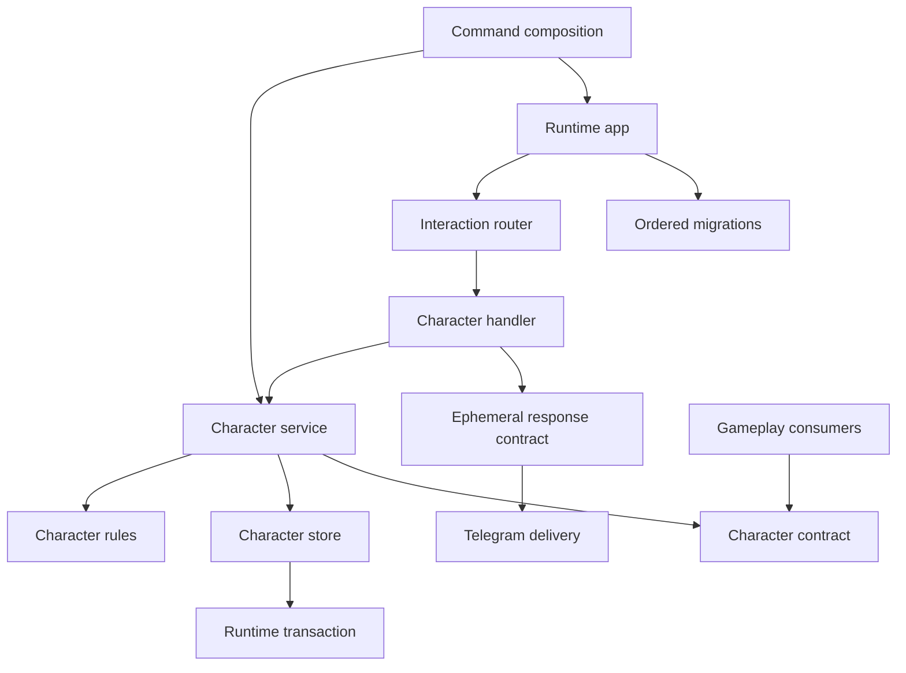
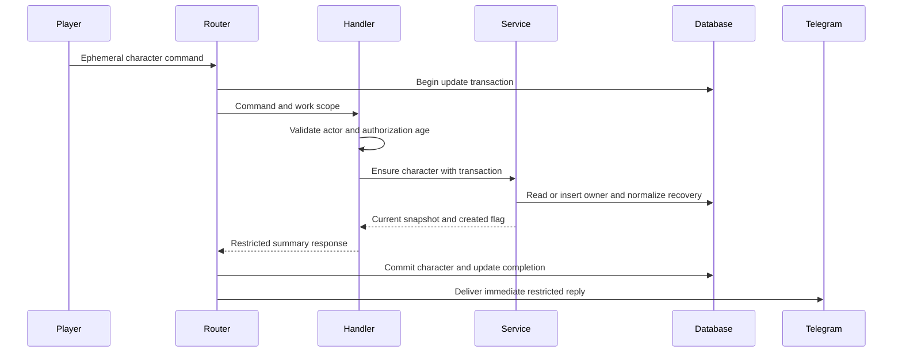
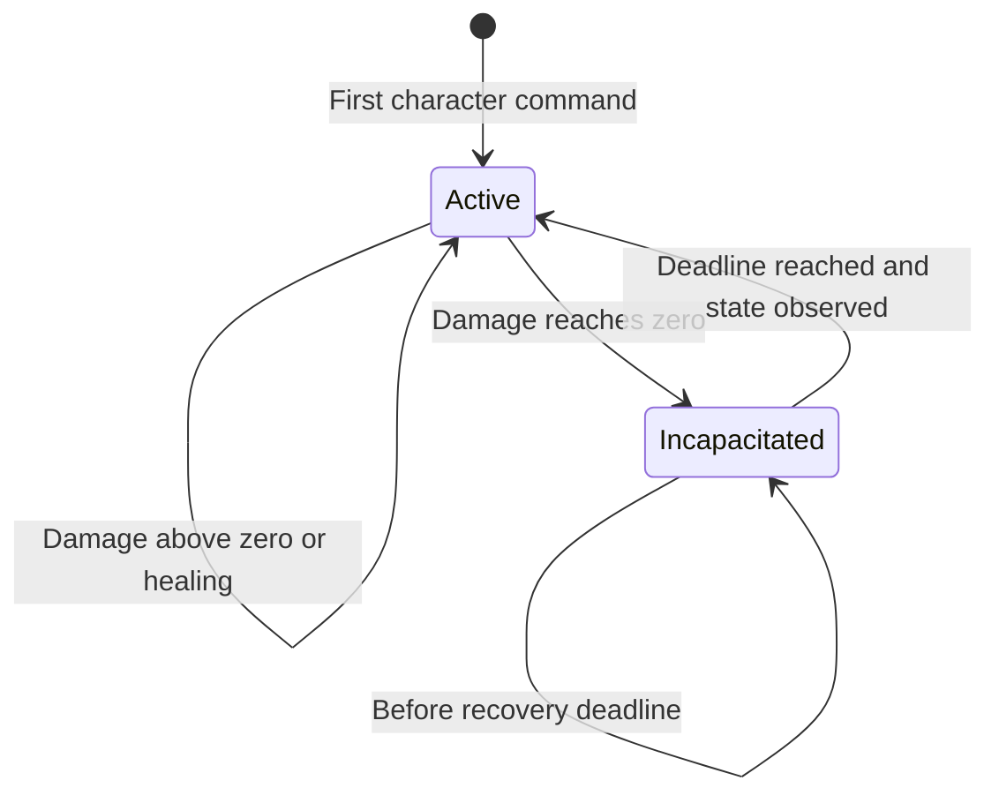
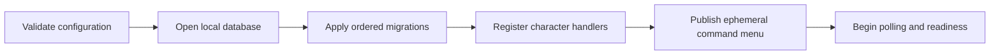

# Design Document

## Overview

The Character System adds a persistent generic character to the existing Telegram runtime. Selecting the ephemeral `/character` command creates the actor's character if needed and shows its current state. Characters have stored maximum health, attack, defense, current health, and a recoverable incapacitation deadline. A small transaction-bound service supplies the same rules to later inventory, encounter, and battle features.

This is an extension of the existing modular monolith. It reuses runtime transactions, ephemeral delivery, diagnostics, and lifecycle management. No library, worker, independent database, or external service is added. Discovery findings and alternatives are recorded in `research.md`.

### Goals

- Establish one character per Telegram user across groups, with stable internal identity and no profile collection.
- Make health changes, incapacitation, and deadline-based partial recovery atomic, idempotent, and durable.
- Provide an immediately runnable Telegram interaction and an explicit contract for downstream gameplay.
- Deliver incremental milestones with deterministic tests and reproducible live-group demonstrations.

### Non-Goals

Equipment modifiers, battle damage calculation, item permissions, spawning, battle participation/cooldowns, XP, levels, classes, skills, customization, permanent death, private-chat interaction, passive regeneration, and multi-instance operation remain outside this design.

## Boundary Commitments

### This Spec Owns

- **Character Contracts**: Stable IDs, snapshots, eligibility values, health-operation inputs/results, and typed errors for gameplay callers.
- **Character Rules**: Starting attributes, health bounds, zero-health incapacitation, partial recovery, and replay semantics.
- **Character Store and Service**: Character and mutation-ledger data; parameterized SQL executed only through a supplied transaction capability.
- **Character Interaction**: The ephemeral `/character` route, personal summary, and explicitly enabled self-only development probes.
- **Runtime Integration**: Additive schema migration, narrowly allowed gameplay-contract imports, generic ephemeral command-menu publication, and the transport metadata necessary to validate actor and authorization context.
- **Character Verification**: Domain, persistence, composed-runtime tests, and documented manual milestones.

### Out of Boundary

- Runtime retains transaction ownership, cursor advancement, response delivery, shutdown, storage lifecycle, and API failure classification.
- Downstream gameplay decides whether an action is allowed and computes damage/healing before requesting a character mutation. It never writes character tables directly.
- The character feature does not create missing characters from eligibility checks, grant items, calculate effective equipment stats, track current battles, or send recovery notifications.
- No public prompt or private-chat fallback is introduced when ephemeral authorization is unavailable.

### Allowed Dependencies

- `internal/character/contract` imports only the standard library and `internal/runtimecontract` for typed user IDs and `DBTX`. It contains no SQL, Telegram models, runtime services, or feature implementation imports.
- `internal/character` imports its own contract, the standard library, runtime contracts, and the interaction registry. It does not import concrete persistence, Telegram, configuration-loader, or diagnostics packages.
- Future gameplay may import exactly `internal/character/contract`, with consumer-owned interfaces using its values. It cannot import character implementation packages. Runtime packages remain unable to import gameplay, including the contract.
- `cmd/replipg` constructs character dependencies and injects registration. Persistence owns the deployment-wide ordered migration list and embeds the additive character schema.
- Architecture tests explicitly permit the character-contract edge and retain negative tests for all forbidden directions.

### Revalidation Triggers

Changes to snapshot/health-operation semantics, identity scope, recovery timing or rounding, operation identity, schema ownership, permitted import edges, command registration, or ephemeral authorization require rechecking adjacent inventory, encounter, battle briefs and the runtime design. Any additional runtime lifecycle worker or transport change needs runtime regression coverage. This spec documents the generic runtime extensions below; it does not rewrite the approved upstream spec.

## Architecture

### Existing Architecture Analysis

Handlers already receive `runtimecontract.WorkScope`; its `DBTX()` is the current immediate SQLite transaction. Successful dispatch commits feature changes, durable effects, update completion, and cursor together. Immediate responses are validated before commit and delivered afterward. A duplicate completed update does not rerun the handler.

Startup currently embeds only migration `0001_runtime.sql`; registrations do not publish Telegram command menus. The boundary checker also rejects imports between distinct gameplay packages. Those three integration gaps are explicitly covered here rather than left to implementers.

The expected `product.md`, `tech.md`, and `structure.md` steering files are absent. The roadmap, development-workflow steering, root agent rules, approved requirements, and inspected runtime code provide the available guidance.

### Architecture Pattern & Boundary Map



Dependency direction is `runtimecontract → character/contract → character rules/store/service → character interaction → command composition`. Arrows in this sentence express allowed building order; imports point toward earlier capabilities. Runtime integration continues to use its existing inward dependency direction. No generic repository interface is introduced: service and concrete SQL store are cohesive within one feature package; consumers own the interfaces they need.

### Technology Stack

| Layer | Choice / Version | Role | Change |
|---|---|---|---|
| Language | Go 1.26 through devenv | Domain, SQL store, handlers | Existing pin |
| Storage | modernc.org/sqlite v1.61.0; libc v1.79.0 | Existing WAL database and transaction owner | Add migration 0002 |
| Telegram | github.com/go-telegram/bot v1.27.0 | Existing ephemeral delivery; generic command-menu adapter | No dependency change |
| Rules and configuration | Go standard library | Integer health, exact decimal-percentage parsing, embedded configuration, clock injection | No new dependency |

## File Structure Plan

### Directory Structure

| New file | Boundary | Responsibility |
|---|---|---|
| `internal/character/contract/types.go` | Character Contracts | Character ID, state, snapshot, eligibility, mutation values |
| `internal/character/contract/errors.go` | Character Contracts | Safe typed domain and storage errors |
| `internal/character/config.go` | Character Rules | Parse and validate embedded version-controlled tuning |
| `internal/character/defaults.json` | Character Rules | Production starting stats and recovery settings |
| `internal/character/defaults_development.json` | Character Verification | Same starting stats with a short recovery duration |
| `internal/character/rules.go` | Character Rules | Pure bounded damage/healing and recovery transitions |
| `internal/character/store.go` | Character Store and Service | Character SQL reads, inserts, conditional updates |
| `internal/character/operations.go` | Character Store and Service | Mutation identity lookup, conflict detection, recording |
| `internal/character/service.go` | Character Store and Service | Transaction-scoped creation, lookup, eligibility, health changes |
| `internal/character/commands.go` | Character Interaction | Register `/character`, validate context, call service |
| `internal/character/render.go` | Character Interaction | Personal summary and fixed domain-error text |
| `internal/character/development.go` | Character Verification | Explicitly enabled self-only damage and defeat commands |
| `internal/persistence/migrations/0002_characters.sql` | Runtime Integration | Character and operation-ledger schema |
| `internal/runtimecontract/commands.go` | Runtime Integration | Transport-neutral command-menu declarations and validation |
| `internal/telegram/commands.go` | Runtime Integration | Map command declarations to scoped `setMyCommands` |
| `cmd/replipg/character.go` | Runtime Integration | Character construction, clock and registration composition |
| `cmd/replipg/character_integration_test.go` | Character Verification | Composed executable character flows against local fake Telegram |
| `.kiro/specs/character-system/manual-verification.md` | Character Verification | Reproduction steps and separate observed evidence |

Tests follow the corresponding `*_test.go` files in each affected package. In particular, `rules_test.go`, `service_test.go`, `store_test.go`, `operations_test.go`, `commands_test.go`, and `development_test.go` cover the named feature boundaries. `store_test.go` and service integration tests may import persistence from an external test package; production import restrictions remain in force.

### Modified Files

- `internal/persistence/migrate.go` and `migrate_test.go`: Embed/list immutable migration 0002; update schema-version fixtures without changing migration 0001.
- `internal/persistence/runtime_schema_test.go`: Verify both existing runtime schema and new character invariants remain valid.
- `internal/interaction/events.go`: Add command metadata `SentAt time.Time`, `ActorIsBot bool`, and `SenderIsChat bool` without changing the handler signature.
- `internal/telegram/mapper.go` and `mapper_test.go`: Populate command metadata from message date, `from.is_bot`, and `sender_chat`; do not retain full actor/profile objects.
- `internal/app/runtime.go` and startup tests: Add optional command declarations to `Options`, validate/copy them before I/O, and publish after Telegram identity verification before polling admission. Nil declarations preserve existing runtime behavior.
- `internal/architecture/boundaries_test.go`: Allow only the gameplay-to-character-contract edge and enforce that the contract imports only standard library/runtime contracts.
- `cmd/replipg/main.go` and command tests: Always compose character registration; retain optional devsmoke registration; safely propagate construction errors.
- `cmd/replipg/smoke_test.go`: Teach the fake API command-menu publication and retain the existing runtime smoke assertions.
- `README.md` and `.env.example`: Document ephemeral command use, configuration source, development flag, restart verification, and authorization limits.

## System Flows

### Character Command



The command uses the actor from trusted mapped update context, never an argument-supplied owner. Responses are immediate, not queued in the outbox: their authorization is short-lived and replaying them after restart would be inappropriate. Delivery failure leaves committed state intact; a new `/character` command reads it.

### Character State



Recovery is normalized at the beginning of state-reading and mutation operations, at `now >= recover_at`. A dormant row may retain an expired deadline until next observed; every supported read returns the recovered effective state. No timer, recovery job, polling scan, notification, or manual revive command is needed.

## Requirements Traceability

Each listed ID is an individual acceptance criterion from `requirements.md`.

| Requirement | Summary | Components | Interfaces | Flows |
|---|---|---|---|---|
| 1.1, 1.2, 1.3, 1.4, 1.5, 1.6 | Automatic creation, owner identity, replay and validation | Character Interaction; Character Store and Service | Ensure; command context | Character Command |
| 2.1, 2.2, 2.3, 2.4 | Personal summary, creation notice, recovery timing | Character Interaction; Runtime Integration | EphemeralResponse; command menu | Character Command |
| 2.5, 2.6 | No fallback or cross-player personal access | Character Interaction; Runtime Integration | IncomingEphemeralAuthorization; actor validation | Character Command |
| 3.1, 3.2, 3.3, 3.4, 3.5 | Validated starting configuration, stable stored base stats | Character Rules; Character Store and Service | LoadConfig; Ensure; Snapshot | Creation |
| 4.1, 4.2, 4.3, 4.4, 4.5, 4.6, 4.7 | Bounded health, immediate incapacitation, no regeneration | Character Rules; Character Store and Service | ApplyHealth | Character State |
| 5.1, 5.2, 5.3, 5.4, 5.5, 5.6 | Durable deadline, exact boundary, rounded partial recovery | Character Rules; Character Store and Service | Lookup; Eligibility; ApplyHealth | Character State |
| 6.1, 6.2, 6.3, 6.4, 6.5 | Shared snapshots, absence, coordinated atomic changes | Character Contracts; Character Store and Service | Transaction-bound methods | Gameplay transaction |
| 7.1, 7.2, 7.3, 7.4, 7.5, 7.6 | Restart, operation replay, serialization, failed commit/delivery | Character Store and Service; Runtime Integration | Mutation ledger; WorkScope | Both flows |
| 8.1, 8.2 | Data minimization and safe diagnostics | Character Contracts; Character Interaction | Safe errors and fixed rendering | Character Command |
| 8.3, 8.4, 8.5, 8.6 | Explicit development probes and repeatable demonstrations/tests | Character Verification | Development flag; injected clock | Verification milestones |

## Components and Interfaces

| Component | Domain | Intent | Requirement coverage | Key dependencies | Contracts |
|---|---|---|---|---|---|
| Character Contracts | Gameplay contract | Stable values consumed through caller-owned interfaces | 1.3, 4.5, 6.1–6.5 | Runtime contracts P0 | Service, State |
| Character Rules | Domain | Validate configuration and health transitions | 3.1–3.5, 4.1–4.7, 5.1–5.6 | Standard library P0 | State |
| Character Store and Service | Persistence and domain coordination | Apply rules and operation identities within caller transaction | 1.1–1.4, 5.1–5.6, 6.1–6.4, 7.1–7.6 | DBTX P0; rules P0 | Service, State |
| Character Interaction | Group interface | Personal creation/inspection and safe errors | 1.1, 1.5, 1.6, 2.1–2.6, 8.1, 8.2 | Interaction registry P0; service P0 | Service |
| Runtime Integration | Composition and adapters | Migrations, command metadata/menu and dependency checks | 1.6, 2.1, 2.5, 3.3, 6.4, 7.1, 7.4 | Runtime app P0; Telegram P0 | Service |
| Character Verification | Tests and opt-in probes | Runnable milestones with isolated time and state | 8.3–8.6 | Character service P0; fake Telegram P0 | Service |

### Character Contracts

**Responsibilities**: Define typed feature values without exposing implementation packages. Consumer-owned interfaces avoid requiring future battle or inventory packages to import the implementation.

**Dependencies**: Inbound: gameplay consumers and character service (P0). Outbound: runtime `UserID` and `DBTX` (P0). External: none.

**Contracts**: Service [x] / API [ ] / Event [ ] / Batch [ ] / State [x].

```go
// Values below are owned by internal/character/contract.
type ID string
type OperationID string
type HealthKind string // damage, heal
type State string      // active, incapacitated

type Snapshot struct {
    ID ID
    UserID runtimecontract.UserID
    MaxHealth, Health, Attack, Defense int64
    State State
    RecoverAt time.Time // zero while active
    Revision int64
}

type HealthChange struct {
    OperationID OperationID
    CharacterID ID
    Kind HealthKind
    Amount int64
}

type MutationResult struct {
    Applied bool // false for a matching recorded operation
    AppliedRevision int64
    Current Snapshot
}

type EligibilityKind string // missing, active, incapacitated
type Eligibility struct {
    Kind EligibilityKind
    Character Snapshot // zero value when missing
}

// ServiceSurface documents the implementation's methods, not an additional
// shared interface to implement. Consumers declare only their needed subset.
type ServiceSurface interface {
    Ensure(context.Context, runtimecontract.DBTX, runtimecontract.UserID) (Snapshot, bool, error)
    Lookup(context.Context, runtimecontract.DBTX, runtimecontract.UserID) (Snapshot, bool, error)
    Eligibility(context.Context, runtimecontract.DBTX, runtimecontract.UserID) (Eligibility, error)
    ApplyHealth(context.Context, runtimecontract.DBTX, HealthChange) (MutationResult, error)
}
```

`Ensure` alone creates a missing character. `Lookup` and `Eligibility` normalize an existing character's expired recovery but never create one. These are transaction-bound operations even when called as reads. Callers pass the same transaction as their battle/inventory writes; they must not start nested transactions. Results are tentative until the transaction owner successfully commits. Feature code cannot prove a supplied `DBTX` is transactional, so passing a bare database is prohibited by contract and tested in composed callers.

`HealthChange` is a trusted gameplay operation, not a player-facing raw health setter. Player commands derive the target from their actor. Downstream gameplay authenticates and authorizes actions before calling it, including monster attacks against other characters. IDs are opaque and contain no display names. `OperationID` is globally unique across character mutations, nonempty and at most 128 bytes; a caller namespaces it by action and target so multi-target attacks use distinct identities. Reuse with a different character, kind, or amount returns a typed conflict.

### Character Rules

**Dependencies**: Inbound: character service (P0). Outbound: character contract and standard library (P0). External: none.

**Contracts**: Service [ ] / API [ ] / Event [ ] / Batch [ ] / State [x].

Configuration is embedded JSON parsed strictly: unknown fields, invalid integer stats, invalid duration, or invalid decimal percentage fail before runtime construction and any storage/network access. Proposed initial tuning is maximum health 100, attack 10, defense 5, incapacitation 5 minutes, recovery 25%; these are editable starting values, not combat balance commitments. The development configuration changes only incapacitation duration to 5 seconds. Existing base attributes are copied at creation and never refreshed from defaults.

`recovery_percent` is a decimal string parsed exactly with standard-library rational arithmetic, constrained to `0 < p < 100`. Only decimal notation is accepted, not fractions or exponent notation; no binary floating-point rounding is used. On incapacitation, compute and store `recovery_health = min(max_health, max(1, ceil(max_health * p / 100)))` using exact arithmetic, and snapshot the recovery deadline. Configuration edits cannot change an already recorded incapacitation's deadline or recovery-health amount.

Health quantities use `int64`. Damage subtracts at most current health; healing adds at most the gap to maximum health, avoiding overflowing intermediate addition. Negative amounts are invalid; zero is an accepted no-op for active characters. Fractional values are rejected before entering typed operations. All successful states satisfy either active with `1 <= health <= max_health`, or incapacitated with health zero and a nonzero future-or-expired deadline plus stored recovery-health amount.

Use one injected clock reading per service operation. Store timestamps as UTC milliseconds and round newly established deadlines upward so recovery is never early. Validate representable timestamps and revision increments; numeric/time exhaustion returns a safe error and rolls back. No passive regeneration is calculated.

### Character Store and Service

**Dependencies**: Inbound: character handlers and trusted gameplay transactions (P0). Outbound: `runtimecontract.DBTX`, rules, and contract (P0). External: existing SQLite engine through the runtime transaction capability (P0).

**Contracts**: Service [x] / API [ ] / Event [ ] / Batch [ ] / State [x].

Construction takes validated immutable configuration and a nonnil `func() time.Time`; command composition supplies `time.Now`, tests supply a manual clock. The service owns no database handle, context, mutex, timer, or goroutine.

Creation uses an opaque 128-bit random hex character ID generated by the standard library, `INSERT ... ON CONFLICT(user_id) DO NOTHING`, then reads the owner row. Unique owner constraints and existing immediate transactions serialize concurrent creation. Do not deliberately trigger and swallow constraint errors: the router tracks SQL failures and will roll back the transaction.

State lookup normalizes expired recovery conditionally against character revision/deadline, then returns the stored current snapshot. Recovery clears its deadline and stored recovery-health amount and increments revision. Two observations cannot heal twice because the first removes the recovery state in the same transaction. A later defeat establishes a new deadline; an earlier observation carries no independently executable recovery action.

Health mutation validates identity, kind, and amount, then checks the mutation ledger. For a new operation, load and normalize the character; reject it as incapacitated if its deadline is still pending. Apply bounded damage/healing; if damage reaches zero, record deadline and recovery-health amount in the same character update. Insert the successful operation identity with its resulting revision before returning. Matching replay does not reapply health changes; it returns `Applied=false`, the original applied revision, and a newly read/normalized current snapshot. Conflicting replay returns an error before applying any transition. Rejected operations do not consume their identities.

Zero-amount and full-health healing no-ops still record accepted operation identity but need not increment character revision. Stored revision advances only on a state change. No mutation-ledger cleanup is introduced: deleting identities could allow old damage to apply twice. Retention is a later design decision requiring a bounded replay policy.

Expected absence is a domain result (`Lookup` found=false; mutation returns not-found). Unexpected SQL/scan/iteration/close errors return a sanitized storage wrapper with `Unwrap`, preserving the driver or runtime cause for existing runtime classification. The feature does not import persistence to classify it. Particularly, `QueryRowContext().Scan` errors must be returned: the current router cannot track those through the `DBTX` signature. No error contains SQL, supplied arguments, or raw driver text in its `Error()` string.

### Character Interaction

**Dependencies**: Inbound: interaction registry (P0). Outbound: character service and ephemeral response contracts (P0). External: Telegram ephemeral action authorization via runtime (P0).

**Contracts**: Service [x] / API [ ] / Event [ ] / Batch [ ] / State [ ].

Register one production command, `character`, with no arguments and no callbacks. The published command is ephemeral. A supported personal command requires a negative group/supergroup chat ID, a positive individual non-bot actor, no `sender_chat`, a positive incoming ephemeral message ID, and an unexpired source message timestamp. Typed ordinary `/character` messages lack incoming-ephemeral authorization: they cause no character operation or response; instructions direct users to the ephemeral command menu. The feature does not claim administrator authorization or request new admin privileges.

The handler builds `IncomingEphemeralAuthorization` with `ValidUntil = SentAt + 15 seconds`, not handler-start time plus 15 seconds. Expired/missing timestamps and invalid actor context cause no mutation or response. After `Ensure`, return a fixed-format summary: creation notice when applicable; current/maximum HP; base attack and defense; active/incapacitated status; UTC recovery deadline when incapacitated. Validate the response before returning; runtime validation before commit and delivery rechecks remain authoritative. Authorization can expire after commit; such delivery failure preserves state.

Nonempty production arguments are rejected with a fixed personal usage response when authorized, without inspecting another user. Anticipated domain rejections are rendered from an allowlist; storage errors are returned so the runtime rolls back/retries. There is no raw error interpolation, full update logging, or extra feature telemetry pipeline.

### Runtime Integration

**Dependencies**: Inbound: command composition and runtime startup (P0). Outbound: existing persistence engine, generic interaction metadata, Telegram client (P0). External: pinned Telegram library and Bot API (P0).

**Contracts**: Service [x] / API [ ] / Event [ ] / Batch [ ] / State [ ].

Add `runtimecontract.CommandDeclaration {Name string; Description string; Ephemeral bool}` and an optional `app.Options.Commands []runtimecontract.CommandDeclaration`. Nil means no menu management, preserving existing embedders/tests. A nonnil slice is the complete application-owned default-language menu for `all_group_chats`; command composition supplies `/character` and any enabled development commands. Validate unique canonical names, Telegram field bounds, and maximum 100 declarations; defensively copy the slice before startup. Command composition verifies menu entries have matching registered handlers.

After `getMe` succeeds and before poller initialization/readiness, call a generic `Client.SetGroupCommands(ctx, declarations) error`. It maps declarations to the pinned library's `SetMyCommandsParams`, `BotCommandScopeAllGroupChats`, and `BotCommand.IsEphemeral`. Use the existing bounded client call and safe API classification; false API result or failure aborts startup and unwinds resources. Reissuing the complete same menu is idempotent. Replacing the menu when development mode is disabled removes declarations from this managed scope, while route removal independently makes stale client entries harmless. Do not delete unrelated Telegram command scopes or language-specific settings automatically; document that deployment must not install overriding per-chat or localized menus for these commands.

Populate additive command metadata from raw update fields. Preserve existing handling of other routes. Character handlers reject bot/chat actors; mapper tests establish `sender_chat` detection even when Telegram supplies a synthetic positive `from.id`. A missing message date remains zero metadata rather than silently becoming receipt time. No transport models enter feature packages.

Migration 0002 is added to the existing persistence-owned ordered embed/list. This keeps the migration engine and runtime startup interfaces intact; character packages do not import persistence. Runtime-schema tests that expect version 1 explicitly use the original set or update their expected complete version. Runtime boot always applies the complete set before feature registration and readiness.

Command composition loads/validates character configuration and constructs its service before `app.New`. Change its helper to `productionOptions(cfg config.Config, lookup config.LookupEnv) (app.Options, error)` so both construction errors and flag lookup remain testable; production supplies `os.LookupEnv`. Update command tests accordingly. A command-owned development flag `REPLIPG_DEV_CHARACTER` defaults to false, accepts strict booleans, and is read/validated in the command layer without moving gameplay settings into runtime `config.Config`. Registration includes character behavior in normal mode and preserves separately opted-in devsmoke behavior.

### Character Verification

**Dependencies**: Inbound: operator/test harness (P0). Outbound: character service and private command handling (P0); real Telegram only for explicitly performed manual verification (P1).

**Contracts**: Service [x] / API [ ] / Event [ ] / Batch [ ] / State [ ].

When the development flag is true, load development tuning and register ephemeral `/dev_character_damage <whole HP>` and `/dev_character_defeat` commands. They operate solely on the requesting actor; defeat requests damage equal to the current health, never a raw state overwrite. Use update-derived namespaced operation identities, so retry/replay cannot repeat the health mutation. These commands share authorization checks and automatic creation for valid first-use commands. They cannot target another player, bypass the health service, change the system clock, heal before a recovery deadline, or erase the mutation ledger.

When disabled, omit development routes and menu declarations and use production tuning. Tests inject character time without changing transport authorization time. Live demonstrations use the short development recovery duration. The manual record distinguishes proposed commands from observed outcomes and never claims a live demonstration occurred during automated execution.

## Data Models

### Domain Model

The aggregate is one character, owned by one external Telegram user and identified by a distinct opaque internal ID. External identity and domain identity are separate columns; no independent profile table is needed for the current one-to-one relationship. Base attributes are immutable after creation in this scope. Current health, incapacitation, recovery snapshot, and revision change together.

### Logical and Physical Data Model

Migration 0002 defines two tables with foreign keys enabled through existing runtime storage.

| Table / field | Type and constraints | Purpose |
|---|---|---|
| `characters.id` | TEXT primary key; 32 lowercase hex characters | Stable internal identity |
| `characters.user_id` | INTEGER not null, unique, > 0 | One owner across all groups |
| `characters.max_health` | INTEGER not null, > 0 | Persisted base maximum |
| `characters.health` | INTEGER not null, 0 through max_health | Persisted current health |
| `characters.attack`, `characters.defense` | INTEGER not null, >= 0 | Persisted base combat attributes |
| `characters.recover_at_ms` | Nullable INTEGER | Original incapacitation deadline |
| `characters.recovery_health` | Nullable INTEGER | Snapshotted rounded recovery amount |
| `characters.revision` | INTEGER not null, >= 1 | Conditional transition and result revision |
| `character_operations.operation_id` | TEXT primary key, length 1 through 128 | Globally unique mutation identity |
| `character_operations.character_id` | TEXT not null, FK characters.id, restrict delete | Mutation target |
| `character_operations.kind` | TEXT not null, damage or heal | Replay equality |
| `character_operations.amount` | INTEGER not null, >= 0 | Replay equality |
| `character_operations.applied_revision` | INTEGER not null, >= 1 | Successful original operation result |

A row-level constraint enforces active `health > 0` with both recovery fields null, or incapacitated `health = 0` with both fields populated and `1 <= recovery_health <= max_health`. There is no separate stored status flag that could disagree with those fields. Use SQLite STRICT tables or equivalent integer-type constraints so numeric affinity cannot accept fractional state. Identity uniqueness and primary keys provide the access indexes; no recovery scan/index is needed. Operations never cascade-delete characters or receipts. There is no character delete/reset interface.

### Data Contracts & Integration

Only contract snapshots and operation values cross gameplay boundaries. Equipment-derived values are not persisted here. Future battle writes use the caller's same `DBTX`, and operation success is acknowledged only after the outer transaction commits. Character ID is the foreign-key target for later inventory/battle schemas; those migrations are owned by their later specs.

## Error Handling

### Error Strategy

Define safe typed errors for invalid input/configuration, missing character, incapacitated character, operation conflict, and exhausted numeric/time range. `errors.Is` or `errors.As` drive handling. A sanitized `StorageError` preserves its underlying cause through `Unwrap`; it never exposes driver text in its message. SQL failures, context cancellation, and commit failure propagate to the owning runtime boundary.

### Error Categories and Responses

| Condition | Behavior |
|---|---|
| Missing or invalid actor, unsupported chat, missing/expired ephemeral authorization | No state change and no response fallback |
| Invalid command arguments | Fixed ephemeral usage response when authorized |
| Character missing during lookup/eligibility | Explicit absence, no creation |
| Damage/healing before recovery | Typed incapacitated result; state and deadline retained |
| Same operation, same target/kind/amount | No repeated mutation; return current normalized state and original applied revision |
| Same operation, changed target/kind/amount | Typed conflict and no state change |
| SQL, scan, close, cancellation, commit failure | Roll back coordinated effects; never claim success |
| Telegram failure after commit | Retain character changes; retry with a new user command |
| Invalid tuning or command-menu publication failure | Fail startup before admission; remain not ready |

### Monitoring

Reuse runtime dispatch, storage, startup, and delivery diagnostics with existing safe categories/correlations. No raw SQL, profile fields, operation payloads, command arguments, or personal summaries enter diagnostics. Do not add health totals, character snapshots, or player-facing state to health endpoints.

## Testing Strategy

### Unit Tests

- Configuration: invalid/fractional attributes, invalid duration, zero/100/out-of-range percentage, decimal percentage, unknown JSON fields, and validated production/development defaults (3.1–3.4).
- Rules: zero and excessive damage/healing, int64 boundary arithmetic, active-to-incapacitated atomic state, pre-deadline rejection, no passive healing, exact deadline recovery, small maximum health, and decimal-percent ceiling (4.1–4.7, 5.1–5.4).
- Handler: first-use notice and full summary, existing state preservation, actor-only targeting, invalid arguments, bot/chat identities, missing/expired timestamps, ordinary versus ephemeral commands, private-only responses, and no raw errors (1.1, 1.2, 1.5, 1.6, 2.1–2.6, 8.1, 8.2).

### Integration Tests

- Apply migrations to fresh and version-1 databases; preserve runtime cursor/jobs/outbox; reopen characters; enforce ownership/type/state/FK constraints; failed migration rollback and future-schema rejection (1.3, 1.4, 3.4, 4.1, 7.1).
- Competing owner creation and distinct health operations through actual immediate transactions; duplicate identities before/after restart; conflicting replay; identity reuse after rollback; repeated recovery observations; old operation replay after later damage or later defeat (1.4, 5.5, 6.3, 7.2, 7.3, 7.6).
- One transaction combines character mutation and test-owned battle/inventory fixture changes; inject failure before receipt, after receipt, and at commit; assert no partial state, ledger, cursor, or claimed success (6.4, 7.4).
- Reopen before/after deadline; current configuration differs from creation/incapacitation configuration; recover from recorded deadline/amount and never reset base attributes (3.4, 5.6, 7.1).
- Verify QueryRow scan/iteration/close failures preserve storage classification, and cancellation remains retryable rather than terminal handler failure (7.4).
- Architecture fixtures allow gameplay contract imports, reject runtime-to-gameplay and gameplay-to-implementation imports, and retain domain-neutral runtime contracts (3.5, 6.5).

### Executable and Telegram Flows

- Boot the production command with temporary SQLite and local fake Telegram. Assert `setMyCommands` declares ephemeral character routes before readiness and failure prevents readiness; verify invalid tuning fails before storage/network (2.1, 3.3).
- Send the first incoming ephemeral `/character`, repeat with a new update, and issue it from a second group: one owner/character persists, response is restricted, and another user gets a separate character (1.1–1.4, 2.1–2.4).
- Drive development damage/defeat, advance only injected character time in service tests, inspect before/at/after deadline, and restart around recovery. Assert configured partial HP and no passive regeneration or duplicate restoration (4.1–4.7, 5.1–5.6, 8.3, 8.6).
- Inject rejected/expired ephemeral delivery after commit, inspect again, verify committed identity/health and absence of public/private sends; assert diagnostics contain none of the sensitive fixtures (2.5, 7.5, 8.1, 8.2).
- Start with the development flag false after a development run: no health-control routes, no development menu declarations in the managed scope, and production recovery tuning restored for new incapacitations (8.4).

### Runnable Milestones and Manual Verification

1. **Creation and inspection**: Schema, production configuration, contract lookup/ensure, command metadata/menu, and executable composition. Demonstrate first-use creation, repeated inspection, two-user isolation, cross-group identity, and restart persistence in a dedicated Telegram group.
2. **Health and recovery**: Add health rules/ledger, eligibility, self-only development probes, and coordinated mutation tests. Demonstrate HP loss, defeat, a blocked pre-deadline action, partial recovery after the shortened delay, and restart during incapacitation.
3. **Replay and release verification**: Complete concurrency/fault/privacy coverage, disable development mode and verify probe removal, run canonical quality gates, and record the final live-group observations.

Each milestone ends with automated tests, a live test-group demonstration, and reproducible commands in `manual-verification.md`, as required by development steering. Record missing live evidence as manual verification required; deterministic fake Telegram does not replace client visibility checks.

Implementation gates are `./scripts/check` and `./scripts/smoke` through devenv, plus the character executable integration tests. Check formatting, full tests, vet, lint, race, runtime smoke, migration compatibility, and production import boundaries. This document describes required future validation; it does not claim implementation tests or live messages have run.

## Security Considerations

No profile data is collected. Numeric Telegram identity is trusted only from mapped group update context; `sender_chat` and bot senders are not eligible personal actors. Authorization expiry is based on the originating message timestamp. User-supplied operation identifiers cannot become target selectors in the personal command flow. Development flags are explicit, default off, and apply only to the actor in the isolated test deployment. Existing one-replica/local-volume deployment and ephemeral-delivery limits remain in force.

## Performance & Scalability

Lookups use primary/unique indexes and normalize at most one character. Mutations use one ledger lookup, one character read/update as needed, and one receipt insert in the existing bounded immediate transaction. No network call occurs inside a character transaction. There is no background scan or cached health state. Ledger growth is accepted for the single-community MVP; any retention policy must preserve replay safety. No new latency or throughput promise is introduced.

## Migration Strategy



Migration 0002 is additive and immutable. It runs before readiness using the existing migration ledger and rollback behavior. It does not modify old migration SQL or create characters on upgrade. A version-1 runtime refuses the upgraded version-2 database, so binary-only rollback is unsupported: stop the process and restore a compatible whole-volume snapshot or roll forward. Back up the entire local SQLite directory with the runtime stopped. Command-menu state is external and should be restored deliberately if rolling back to a binary that does not manage it. This design creates specification artifacts only; it does not run migrations, publish a Telegram menu, or send live messages.
