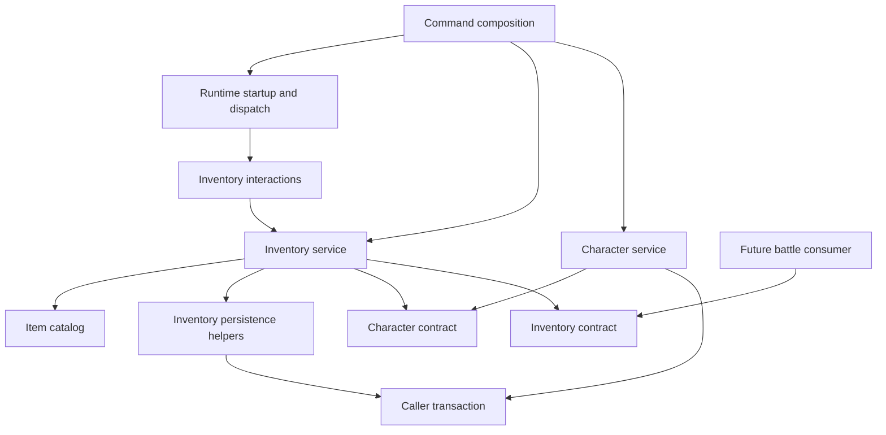
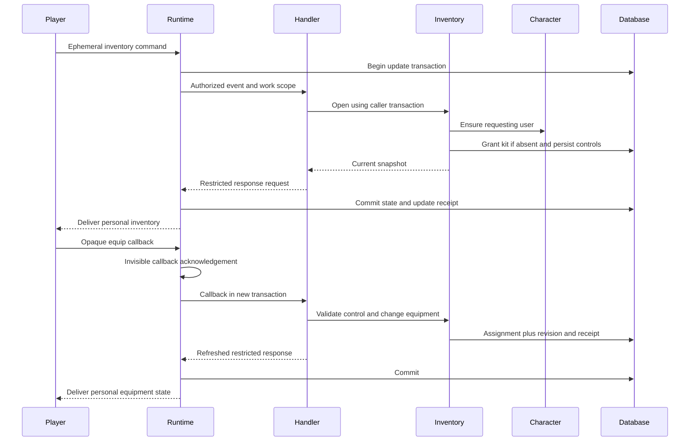
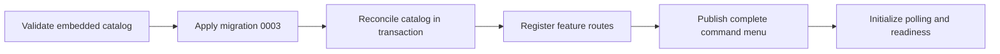

> Historical note (2026-11-04): The custom checker in `internal/architecture` has been retired. References below to its source, allowlists, fixtures, commands, or results describe historical work and are no longer implementation or validation requirements. Package dependency guidance still applies.

> Historical pre-split combined design. Item catalog ownership and former development authorization described here are superseded by design.md. Retained for original task/evidence traceability.

# Design Document

## Overview

Inventory provides a persistent collection and two equipped slots for each globally owned character. The ephemeral `/inventory` command creates a missing character, grants the starter kit once, and opens personal inventory navigation. Owned quantities and equipped assignments survive restart; equipment contributes additive attack or defense without changing character base attributes.

Gameplay consumers use an inventory contract and caller-owned transactions for grants, equipment reads, and healing consumption. Battle permission and reward selection remain downstream. This extension uses the existing modular monolith, character service, interaction registry, SQLite persistence, and ephemeral delivery without new dependencies.

### Goals

- Deliver a runnable inventory and starter-kit interaction before implementing combat integration.
- Preserve quantity, ownership, equipment, replay, and character-health consistency across concurrent callbacks and failures.
- Stabilize small typed contracts for the later battle implementation.

### Non-Goals

Trading, gifting, economy, crafting, durability, affixes, additional equipment slots, damage consumables, buffs, revival, out-of-battle consumption, battle rules, loot selection, background inventory workers, and public inventory views are excluded. This feature does not change `/character` to include equipment or add new HTTP endpoints.

## Boundary Commitments

### This Spec Owns

- `internal/inventory`: catalog loading and saved-catalog compatibility, ownership quantities, starter entitlement, equipment assignments, derived bonuses, operation receipts, and opaque personal controls.
- `internal/inventory/contract`: immutable value snapshots, mutation requests/results, and typed sanitized errors available to gameplay consumers.
- `/inventory`, its callback prefix, development inventory probes, composition wiring, additive inventory migration, and the tests/documentation for these behaviors.
- Coordination of one healing-item consumption with the existing character health service through the same transaction.

### Out of Boundary

- Character creation rules, base attributes, health invariants, incapacitation, and recovery stay in Character System. Inventory invokes its service instead of writing character tables.
- Battle authorizes consumption and owns cooldowns, damage, participation, monster responses, loot selection, and whether to freeze a loadout for a battle step. Inventory neither imports battle nor stores battle state.
- Runtime retains update intake, acknowledgement, commit ownership, delivery, retries, health, and shutdown. Inventory never calls Telegram directly.
- No implementation or live Telegram actions occur during this specification phase.

### Allowed Dependencies

- Inventory production code imports standard library, its own packages, `internal/runtimecontract`, `internal/interaction`, and the exact `internal/character/contract` package.
- Inventory contract imports only standard library, `internal/runtimecontract`, and exact `internal/character/contract` for stable character IDs and snapshots. Neither contract imports services.
- Future gameplay may import exact `internal/inventory/contract`, never inventory implementation. The architecture checker gains explicit contract rules and fixtures; existing runtime and character restrictions remain enforced.
- `cmd/replipg` composes concrete services. Persistence owns migration execution and imports no inventory. Runtime accepts a generic startup callback without importing gameplay.

### Revalidation Triggers

Revalidate battle integration when mutation request equality, operation-ID namespacing, item effects, bonus calculation, quantity semantics, or transactional error handling changes. Revalidate character coordination when health/recovery contracts change. Revalidate startup and rollback procedures when catalog reconciliation or schema changes. Revalidate Telegram UI when ephemeral capabilities or response bounds change.

## Architecture

### Existing Architecture Analysis

Handlers already execute in one short immediate transaction supplied through `WorkScope.DBTX()`. The runtime commits update completion with feature state before sending immediate personal responses. Character methods use that same capability, including reads that normalize recovery. Production import checks isolate gameplay from persistence and transport implementations.

Two focused extensions are necessary: an optional generic startup preparation callback for saved-catalog validation before update admission, and explicit architecture allowances for the inventory contract. No changes to character service signatures, `DBTX`, transaction ownership, or ephemeral response models are needed.

### Architecture Pattern & Boundary Map



Dependencies flow from composition to feature handlers/services to contracts and the caller transaction. Within inventory, catalog and pure rules depend on values; store helpers depend on values and DBTX; service coordinates these helpers; interaction and development handlers depend on the service. Consumer-owned interfaces are used only at character and gameplay substitution seams; no generic repository framework or effect plugin system is added.

### Technology Stack

| Layer | Existing choice | Inventory role |
|---|---|---|
| Domain and UI | Go 1.26; standard library | Typed operations, embedded JSON catalog, opaque controls, rendering |
| Persistence | Pinned `modernc.org/sqlite` v1.61.0 and matching libc v1.79.0 | STRICT tables, immediate caller transactions, restrictive foreign keys |
| Telegram | Existing adapter using `github.com/go-telegram/bot` v1.27.0 | Group ephemeral command and callback delivery through runtime contracts |
| Build and checks | Existing devenv; `scripts/check`, `scripts/smoke` | Pinned tools and deterministic executable verification |

These are the repository's recorded versions, not a claim of independently verified latest releases. No dependency changes or new external API integrations are proposed; discovery uses local source contracts.

## File Structure Plan

### New Files

| Path | Component and responsibility |
|---|---|
| `internal/inventory/contract/types.go` | Inventory Contract: IDs, categories, snapshots, requests, results |
| `internal/inventory/contract/errors.go` | Inventory Contract: domain errors and sanitized storage wrappers |
| `internal/inventory/catalog.go` | Catalog: strict JSON decoding, immutable item lookup and validation |
| `internal/inventory/items.json` | Catalog: production definitions and starter-kit quantities |
| `internal/inventory/rules.go` | Inventory Service: pure quantity, slot, fingerprint and checked-bonus rules |
| `internal/inventory/store.go` | Inventory Store: ownership, revision, starter, equipment and catalog queries |
| `internal/inventory/operations.go` | Inventory Store: replay receipts and operation savepoint handling |
| `internal/inventory/service.go` | Inventory Service: initialization, reads, grants, equipment and healing coordination |
| `internal/inventory/controls.go` | Inventory Interaction: persisted opaque controls, actor/group/expiry/revision validation |
| `internal/inventory/commands.go` | Inventory Interaction: `/inventory` and `inv:` callback handlers |
| `internal/inventory/render.go` | Inventory Presentation: compact numbered summary, owner header, item details and navigation |
| `internal/inventory/development.go` | Inventory Verification: opt-in self-only grant and consumption probes |
| `internal/persistence/migrations/0003_inventory.sql` | Inventory schema and consistency constraints |
| `internal/persistence/inventory_schema_test.go` | Fresh/upgrade schema and constraints |
| `cmd/replipg/inventory.go` | Inventory Composition: service wiring, catalog preparation and probe flag |
| `cmd/replipg/inventory_integration_test.go` | Executable fake-Telegram inventory flows and restart |
| `internal/app/prepare_test.go` | Runtime preparation ordering, rollback, cancellation and failure |
| `.kiro/specs/inventory-system/manual-verification.md` | Milestone commands, expected results, and actual manual evidence |

Tests follow responsibilities in `internal/inventory`: `catalog_test.go`, `rules_test.go`, `store_test.go`, `operations_test.go`, `service_test.go`, `controls_test.go`, `commands_test.go`, `render_test.go`, `development_test.go`, `coordination_test.go`, `concurrency_test.go`, and `failure_integration_test.go`. Contract validation has `contract/types_test.go` and `contract/errors_test.go`.

### Modified Files

- `internal/app/runtime.go`: optional generic `Options.Prepare` and bounded transactional invocation after migrations.
- `internal/persistence/migrate.go`: append migration 0003 to both embed and ordered filename list; leave migrations 0001/0002 unchanged.
- `cmd/replipg/character.go`: make the existing character instance available for inventory composition; preserve production and development character routes.
- `cmd/replipg/character_test.go`, `cmd/replipg/character_integration_test.go`, `cmd/replipg/integration_test.go`, `cmd/replipg/smoke_test.go`: update applicable composition/menu/schema assertions without weakening existing character or runtime checks.
- `internal/architecture/boundaries_test.go`: exact inventory-contract import rules and allow/reject fixtures.
- `internal/interaction/events.go`: optional transient actor display label on mapped identity; no effect on ownership or authorization.
- `internal/telegram/mapper.go`, `internal/telegram/mapper_test.go`: carry the requesting actor's optional username into that label for command and callback views, without adding persisted inventory profile fields.
- `internal/persistence/migrate_test.go`, `internal/persistence/runtime_schema_test.go`, `internal/persistence/character_schema_test.go`: distinguish deliberately historical sets from the complete migration set where needed.
- `README.md`, `.env.example`: document ephemeral inventory access, development flag, catalog policy and reproducible demonstrations.

## System Flows

### Inventory Opening and Equipment



An equipment mutation checks the control's expected inventory revision. Reusing an accepted control resolves its original operation receipt before applying stale-state checks, so later state cannot cause the action to run again. Unused controls from an older revision are rejected. Post-commit delivery failure retains the result, recoverable by opening inventory again.

### Healing Coordination

Battle first authorizes its action in the caller transaction. Inventory checks its own replay receipt, validates the consumable and quantity, obtains normalized character state, rejects full HP or pending incapacitation, invokes `ApplyHealth`, decrements one copy, advances inventory revision, and inserts its receipt. Battle then persists its action result. All results remain tentative until the outer commit. Inventory performs no battle advance or Telegram delivery.

## Components and Interfaces

| Component | Intent | Requirement coverage | Dependencies | Contracts |
|---|---|---|---|---|
| Catalog | Validated immutable content and saved compatibility | 1.1, 1.2, 1.3, 1.4, 1.5, 1.6, 1.7 | Standard library P0 | Service, State |
| Inventory Contract | Stable typed gameplay values | 4.7, 4.8, 5.6, 6.6, 8.2, 8.3 | Character contract P0 | Service values |
| Inventory Store | Durable aggregate, controls and replay | 2.2, 2.5, 5.5, 7.3, 8.1, 8.4 | DBTX P0 | State |
| Inventory Service | Grants, starter, equipment, healing | 2.1, 2.7, 4.2, 5.3, 6.1, 8.5 | Catalog, store, character port P0 | Service |
| Inventory Interaction | Authorized commands and controls | 3.1, 3.6, 7.1, 7.2, 7.3, 7.4, 7.5, 7.6 | Registry, service P0 | Service |
| Inventory Presentation | Bounded personal views | 3.2, 3.3, 3.4, 3.5 | Snapshots and catalog P0 | Values |
| Inventory Composition | Startup and command integration | 1.4, 1.5, 9.4 | Runtime, concrete services P0 | Service |
| Inventory Verification | Development probes and delivery evidence | 9.3, 9.4, 9.5, 9.6, 9.7 | Inventory and character ports P0 | Service |

### Catalog

**Dependencies**: Inbound inventory service and composition (P0); external standard-library JSON and embedding (P0). **Contracts**: Service and immutable State.

`LoadCatalog() (Catalog, error)` strictly decodes embedded `items.json`, rejects unknown fields, duplicate IDs, invalid numeric fields and incompatible category fields, and returns defensive copies from lookup/list methods. Item IDs are 1–64 ASCII letters, digits, underscores or hyphens. Display names and descriptions are resolved from localization resources and bounded to 80 and 400 Unicode code points respectively; empty text is rejected by localization validation. These bounds allow predictable personal rendering.

`ItemDefinition` contains `ID ItemID`, `Category`, `AttackBonus int64`, `DefenseBonus int64`, and `HealingHP int64`. Consumables have positive healing and zero bonuses; weapons have nonnegative attack and zero defense/healing; armor has nonnegative defense and zero attack/healing; inert items have zero bonuses and healing, no equipment slot, and no effect. Coin is an inert catalog item with ordinary stack quantity, never a separate currency balance. Effect identity is the closed value `heal_self_fixed_hp`. Items of the same definition are fungible quantities; no instance IDs are introduced.

The checked-in starter configuration contains at least one weapon, one armor, and one healing consumable in positive quantities, with all equipment initially unequipped. Concrete values are version-controlled tuning, validated before startup; the implementation milestone records them in reproduction instructions. Duplicate starter item entries are rejected rather than ambiguously combined.

Saved definitions freeze category and numeric mechanics once registered. Display names/descriptions live exclusively in localization resources and may change independently. Removing a registered identity or altering its mechanics fails preparation; a balance change requiring new mechanics uses a new item ID while retaining the old definition. This conservative policy also preserves historical operation semantics. Starter-kit composition can change for characters not yet initialized; existing entitlement never resets.

### Inventory Contract and Service

**Dependencies**: Inbound handlers and future gameplay consumers (P0); outbound Catalog, Inventory Store, and consumer-owned character interface (P0). **Contracts**: Service and State values.

All methods below belong to the concrete inventory service; consumers declare the subset interface they need. Types are defined in `internal/inventory/contract`, using `charactercontract` as the alias for the existing character contract.

```go
type OperationID string
type ItemID string
type Slot string // weapon or armor
type Category string // consumable, weapon, armor, inert

type GrantLine struct { ItemID ItemID; Quantity int64 }
type GrantRequest struct {
    OperationID OperationID
    CharacterID charactercontract.ID
    Items []GrantLine
}
type EquipmentChange struct {
    OperationID OperationID
    CharacterID charactercontract.ID
    Slot Slot
    ItemID ItemID // empty means unequip
    ExpectedRevision int64
}
type ConsumeRequest struct {
    OperationID OperationID
    CharacterID charactercontract.ID
    ItemID ItemID
}
type Modifiers struct { Attack, Defense int64 }
type OwnedItem struct { ItemID ItemID; Quantity int64 }
type Snapshot struct {
    CharacterID charactercontract.ID
    Revision int64
    Items []OwnedItem
    Weapon, Armor ItemID
    Modifiers Modifiers
}
type MutationResult struct {
    Applied bool
    AppliedRevision int64
    Current Snapshot
}
type OpenResult struct {
    CharacterCreated, StarterGranted bool
    Current Snapshot
}
type ConsumeResult struct {
    Mutation MutationResult
    Character charactercontract.Snapshot
    HealingHP int64 // configured effect amount, not actual HP delta
}

// Signatures use context.Context and runtimecontract.DBTX first.
Prepare(ctx context.Context, tx runtimecontract.DBTX) error
Open(ctx context.Context, tx runtimecontract.DBTX, user runtimecontract.UserID) (OpenResult, error)
Inspect(ctx context.Context, tx runtimecontract.DBTX, id charactercontract.ID) (Snapshot, error)
Grant(ctx context.Context, tx runtimecontract.DBTX, req GrantRequest) (MutationResult, error)
ChangeEquipment(ctx context.Context, tx runtimecontract.DBTX, req EquipmentChange) (MutationResult, error)
ConsumeHealing(ctx context.Context, tx runtimecontract.DBTX, req ConsumeRequest) (ConsumeResult, error)
Modifiers(ctx context.Context, tx runtimecontract.DBTX, id charactercontract.ID) (Modifiers, error)
Effect(id ItemID) (EffectDefinition, error)
EffectiveStats(baseAttack, baseDefense int64, modifiers Modifiers) (CombatStats, error)
```

`Effect` rejects inert items and equipment as not usable. `EffectDefinition` holds `ItemID`, closed effect kind, and positive `HealingHP`. `CombatStats` holds `Attack` and `Defense`. Checked addition rejects int64 overflow; inventory never persists effective attributes. `Inspect` returns a canonical empty revision-0 view for an existing character with no inventory root, without granting starter supplies; missing characters return not-found. `Modifiers` similarly returns zeros before initialization. `Grant` may initialize an existing character's inventory root with starter entitlement still pending. Only `Open` creates characters and grants a starter kit. Equipment changes and consumption require existing ownership.

The character port consists of the existing `Ensure`, `Lookup`, and `ApplyHealth` signatures. `Lookup` is called using the stored owner of the requested character, obtained from the character's stable identity; the only permitted direct character-table query reads `id,user_id` to resolve that association and confirm existence. Character state and eligibility are always obtained through the service, never mutated or interpreted from ad hoc health queries. Inventory grants and equipment reads need only confirm character existence. The service verifies returned character identity matches the request before using the snapshot.

Preconditions are a nonnil transaction supplied by the caller, validated typed inputs, an existing target except for `Open`, and trusted gameplay authorization for grants/consumption. Operation IDs are 1–128 bytes and namespaced by caller. No public personal command accepts a target character or caller-chosen mutation identity. `Grant` canonicalizes lines by item identity and sums duplicates with overflow checks; equality uses the resulting sorted quantities.

Mutation replay is checked before current ownership, quantity, full-health, or revision checks. Matching receipts return `Applied=false`, original applied revision and current state, without reverting later changes. Conflicting target, kind, canonical quantities, slot, expected revision, item, or effect identity returns operation-conflict. Accepted no-op equipment changes receive a receipt but do not increase revision. Other accepted changes increase inventory revision once; overflow rejects. Grant/consume replays cannot create a missing character or reissue a starter kit.

`Open` creates a root if necessary, invokes the private grant implementation once with deterministic `inventory:starter:<character-id>` identity, and marks starter entitlement in the same operation. Concurrent calls serialize through existing immediate transactions and uniqueness constraints. Starter replay matches the recorded kit, not the current kit configuration. The starter marker and stored receipt remain authoritative after later configuration changes.

Consumption derives a character operation identity as `inventory:heal:` plus SHA-256 hex of the inventory operation ID, fitting the character's 128-byte limit. Its receipt includes frozen item effect and original inventory revision. Matching inventory replay reads current character state but never calls `ApplyHealth` again. New requests check ownership and category, call character `Lookup` to normalize due recovery, reject incapacitated/full-health outcomes, and pass configured healing to `ApplyHealth`. Any unexpected character replay without a matching inventory receipt is an invariant failure and rolls back rather than decrementing inventory alone.

**Operation isolation**: Public mutation methods wrap tentative changes in an inventory-owned SQL savepoint on the supplied transaction. Expected domain rejection rolls back to that savepoint before returning, allowing the handler to commit a safe personal rejection response without partial starter or recovery changes. Success releases the savepoint but never commits the transaction. Public operations do not call one another; initialization uses private helpers, preventing savepoint-name nesting. SQL/scan/iteration/close or savepoint-cleanup failures propagate as storage failures and require outer rollback. This is local operation isolation, not a new transaction owner. Cross-feature changes performed by battle before or after the call still require battle to propagate any failed action and roll back its whole transition.

### Inventory Store

**Dependencies**: Inbound inventory service and controls (P0); outbound DBTX and immutable values (P0). **Contracts**: State.

Store helpers use parameterized SQL, close rows, propagate scan/iteration/close errors, and do not import concrete persistence. They persist the aggregate and receipts described under Data Models. Inventory revision covers grants, starter changes, consumption and actual equipment changes, not read/navigation control creation. Immediate transactions serialize concurrent writers; conditional revision updates detect incorrect caller expectations without introducing a process mutex.

Read queries order items by stable item ID, exclude zero quantities, and fetch one bounded page plus aggregate equipment metadata. `Inspect` may assemble a complete domain snapshot for gameplay callers; handlers use an indexed page query to avoid loading an unbounded collection for every click. Both paths use the same aggregate revision and catalog. Receipt rows are permanent in this scope; controls have separate expiration and can be pruned without weakening replay guarantees.

### Inventory Interaction and Presentation

**Dependencies**: Inbound registry and authenticated events (P0); outbound inventory service, control store and runtime response contracts (P0). **Contracts**: Service. Presentation consumes values only.

Production registration adds ephemeral `inventory` with no arguments and callback prefix `inv:`. Initial commands use the same human/group, incoming-ephemeral-ID and original `SentAt + 15 seconds` authorization checks as `/character`. Invalid actors, missing authorization and ordinary typed commands trigger no inventory initialization. Unsupported arguments produce fixed restricted usage text when authorized. Incapacitation does not restrict viewing or equipment management.

Controls use `inv:` plus a cryptographically random 128-bit base64url token, totaling 26 ASCII bytes. Server-side records bind each token to user, character, chat, fixed action, optional item/slot/page, expected inventory revision and absolute expiry. They contain neither a client-selected quantity nor encoded effect values. Mutating operation identity is `inventory:control:<token>`, independent of Telegram update/query IDs. All actions validate actor and group binding before reading receipts. Navigation tokens are also bound; there is no cross-user inspection endpoint.

Control lifetime is five minutes from generation. Valid matching mutation replay returns current state while the control remains unexpired; expiry, unknown token or ownership mismatch rejects without mutation. Receipts outlive expired controls. Unused stale-revision controls reject and offer a fresh `/inventory` entry; successful mutation issues new controls using the resulting revision. Navigation reads current state and clamps pages after quantities change rather than mutating inventory. Store expiry uses UTC milliseconds and an injected clock. Prune expired control rows opportunistically in bounded batches; no background goroutine.

Callback replies use the current query ID, `OriginatedFromEphemeral` from event metadata, `ReplaceCallbackMessage=false`, `EditMessageID` from the originating ephemeral callback message, and a short deadline no later than the control expiry or handler-start plus 15 seconds. A known expired/stale control for the correct actor/group may receive a fixed reopen-inventory response under the callback's fresh response authorization; it never authorizes a mutation. Unknown or foreign tokens produce no inventory details. Invisible acknowledgement remains the runtime processor's responsibility.

Render each page with at most eight owned entries and fixed navigation, plus equipped slots and aggregate bonuses. Use the approved plain-text `Inventory • <owner>` header, numbered `Item name (quantity)` rows, and ` • Equipped` markers; show matching numbered selection buttons. Page-local numbers map to stored item references in opaque controls, never item identities or client-authoritative list indexes. Owner labels use only optional actor username metadata from the current mapped event, bounded to 64 code points with control characters removed, and fall back to `you`. Labels are presentation only: never persist them in inventory tables, controls, receipts or diagnostics and never use them to authorize access. Names/descriptions from localization resources are validated and displayed as plain text; do not interpret translated strings as markup. Truncate only optional prose at Unicode boundaries and verify the complete response and button payloads against `runtimecontract.ValidateResponse`; paginate further if equipment headers plus entries would exceed the existing 4096 UTF-16 limit. Item details include quantity and applicable equip/unequip controls, never standalone Use buttons. Each callback edits the originating restricted message using `editEphemeralMessageText`, replacing its text and keyboard. Reject callbacks without a positive representable ephemeral message ID before inspection or mutation. Empty keyboards explicitly remove buttons for stale or expired controls. A new command sends a new view; failed edits have no fallback and never undo committed equipment state. `EphemeralResponse.EditMessageID` defaults to zero for existing send callers and requires fresh ephemeral callback authorization when positive. The runtime sender interface and processor routing remain unchanged.

The following is the approved layout; names, quantities and bonuses are illustrative rather than fixed seed requirements.

```text
Inventory • player

1. Coin (500)
2. Stick (10) • Equipped
3. Cloth armor (1)
4. Healing potion (3)

Equipment
Weapon: Stick (+2 attack)
Armor: Empty

[1] [2] [3] [4]
```

Details use `<item name> • <owner>`, description, `Owned: <quantity>`, applicable attack/defense or healing information, and equipped status for equipment. Weapon/armor details offer Equip or Unequip and Back. Inert-item details offer Back only; healing-item details state `Usable during battle` and offer Back only. Long lists add Previous/Next navigation. No decorative item icons or currency-specific summary is required.

### Inventory Composition and Startup

**Dependencies**: Inbound production command construction (P0); outbound generic app preparation, inventory and character services (P0). **Contracts**: Service.

Add optional `app.Options.Prepare func(context.Context, runtimecontract.DBTX) error`. Runtime invokes it once after the complete migration set and before handler registration, Telegram setup, polling and readiness, inside `db.WithinTransaction` with a context bounded by configured handler timeout and startup cancellation. Nil preserves current startup behavior. Failure aborts startup with safe stage `feature_preparation`, rolls back and closes acquired resources; runtime imports no gameplay. The preparation hook must perform only bounded database work, never network calls or goroutine creation.

Command composition loads and validates embedded inventory content before `app.New`, creates inventory with the already constructed character service, and sets `Prepare` to catalog compatibility reconciliation. Preparation validates all persisted definitions, registers new ones and commits them together; compatibility errors leave previous catalog records intact and prevent admission. `Register` adds inventory routes while preserving character, opt-in character-development, and devsmoke registrations. The application-owned complete menu includes `/character` and `/inventory`, plus only explicitly enabled development commands.

`REPLIPG_DEV_INVENTORY` is a strict command-layer boolean defaulting false. Invalid values fail construction without opening storage or contacting Telegram. Composition remains in `cmd/replipg`; do not move feature flags or service imports into runtime configuration. Existing character test helpers may retain their narrower menu while production composition gains inventory; tests must explicitly identify which options they exercise.

### Inventory Verification

**Dependencies**: Inbound isolated test deployment and harness (P0); outbound inventory and character services (P0). **Contracts**: Service.

When enabled, register ephemeral self-only `/dev_inventory_grant <item-id> <quantity>` and `/dev_inventory_heal <item-id>`. A grant identity derives from the incoming update and actor; an intentional new command is a new grant. Automated tests explicitly reuse operation IDs to demonstrate replay. The heal probe invokes the same coordinated consumption path, substituting a development-authorized action for battle authorization. It neither simulates a battle nor bypasses full-health/incapacitation rules. Use the existing separately enabled character damage/defeat probes to prepare health and short recovery examples.

Disabled mode omits probe routes and menu entries. Production starter and inspection/equipment flows remain available. Manual evidence records actual observations separately from instructions; no real Telegram message is sent by automated tests. See Testing Strategy for milestone order.

## Data Models

### Domain Model

One character owns one optional inventory root, positive quantities keyed by catalog item, and up to two equipment assignments. Equipped copies remain part of total ownership. Starter entitlement is per character, independent of chat and creation date. No stack capacity or gameplay inventory limit is added; checked int64 arithmetic defines representable bounds.

### Logical and Physical Data Model

Migration 0003 creates STRICT tables with restrictive foreign keys. All identities and quantities have explicit byte/type/range constraints.

| Table | Fields and constraints | Purpose |
|---|---|---|
| `inventory_catalog` | `item_id` TEXT PK; `category`; `attack_bonus`, `defense_bonus`, `healing_hp` INTEGER with category-specific checks | Registered immutable mechanics; display text stays exclusively in localization resources |
| `inventories` | `character_id` TEXT PK FK characters; `revision` INTEGER >=1; `starter_granted` INTEGER in 0,1 | Aggregate revision and one-time entitlement |
| `inventory_items` | PK `character_id,item_id`; FKs inventories and catalog; `quantity` INTEGER >0 | Fungible owned copies; last consumption deletes row |
| `inventory_equipment` | PK `character_id,slot`; slot in weapon,armor; `item_id`; composite FK to inventory_items | Assignments always backed by a positive owned row |
| `inventory_operations` | `operation_id` TEXT PK 1–128 bytes; character FK; kind; canonical request TEXT; original `applied_revision` INTEGER >=1; frozen effect fields for consumption | Permanent equality/replay receipt |
| `inventory_controls` | `token` TEXT PK; user/chat IDs; character FK; action; optional item/slot/page; expected revision; `expires_at_ms` INTEGER | Opaque group-bound expiring UI actions |

Use an equipment insert/update trigger to enforce slot compatibility against registered catalog category; foreign keys prevent deleting assigned ownership. Catalog mechanical changes are rejected during preparation and are never updated in place. Starter markers only transition from false to true through the service; mutation and entitlement tests enforce this invariant.

Indexes: ownership's composite PK supports ordered per-character pages; controls index expiry for bounded cleanup; operations and controls have primary-key lookup. No health index, scheduler job or encounter foreign key is introduced. Canonical request JSON uses a versioned fixed-field structure, stable ordering and whole integers; compare canonical bytes for equality rather than relying on a hash alone. Receipts retain no Telegram content or display text.

### Data Contracts & Integration

Only inventory contract values cross gameplay boundaries. `ExpectedRevision` is required for equipment changes and included in replay equality; a consumer wanting current loadout reads modifiers in its own transaction. Battle can choose a step snapshot or read policy but cannot modify inventory tables. Grants are supplied as already-resolved reward lines. Caller operation IDs must namespace their feature/action and target.

## Requirements Traceability

| Requirement | Summary | Components | Interfaces | Flows |
|---|---|---|---|---|
| 1.1, 1.2, 1.3, 1.4, 1.5, 1.6, 1.7 | Seeded typed catalog, validity, stable mechanics | Catalog, Composition, Store | LoadCatalog, Prepare, Effect | Startup reconciliation |
| 2.1, 2.2, 2.3, 2.4, 2.5, 2.6, 2.7 | Global owner, character creation, one-time kit | Service, Store, Interaction | Open | Inventory opening |
| 3.1, 3.2, 3.3, 3.4, 3.5, 3.6, 3.7, 3.8, 3.9 | Personal summaries/details and navigation | Interaction, Presentation, Service | Inspect, page reads | Ephemeral inspection |
| 4.1, 4.2, 4.3, 4.4, 4.5, 4.6, 4.7, 4.8, 4.9 | Two slots, replacement, ownership and bonuses | Service, Store, Contract | ChangeEquipment, Modifiers, EffectiveStats | Equipment callback |
| 5.1, 5.2, 5.3, 5.4, 5.5, 5.6 | Atomic validated reward quantities | Service, Store | Grant | Caller transaction |
| 6.1, 6.2, 6.3, 6.4, 6.5, 6.6, 6.7 | Battle-authorized healing without wasted items | Service, Contract, Verification | ConsumeHealing, Effect, character port | Healing coordination |
| 7.1, 7.2, 7.3, 7.4, 7.5, 7.6 | Actor/group validation and opaque current controls | Interaction, Store, Presentation | Control resolution, ChangeEquipment | Equipment callback |
| 8.1, 8.2, 8.3, 8.4, 8.5, 8.6, 8.7 | Persistence, exact replay, atomic failure handling | Service, Store, Composition | All mutations, savepoints, Prepare | Transaction and post-commit delivery |
| 9.1, 9.2, 9.3, 9.4, 9.5, 9.6, 9.7 | Privacy, development controls, reproducible delivery | Verification, Interaction, Composition | Probe registration and canonical gates | Runnable milestones |

## Error Handling

Inventory contract defines inspectable errors for invalid input/catalog, missing character/item, not owned, incompatible slot, stale/expired control, operation conflict, full health, incapacitation, and exhausted numeric range. Expected errors contain fixed safe messages; handlers map an allowlist to personal responses. Character errors are inspected with `errors.Is`/`errors.As`, never string matching.

Unexpected SQL, scan, row cleanup, context and savepoint failures return a sanitized wrapper preserving the cause and implementing `runtimecontract.StorageFailure`. These always reach the transaction owner for rollback/retry. A failed savepoint rollback/release is a storage failure even if the triggering problem was a domain rejection. No response reports a tentative mutation as committed.

| Condition | Result |
|---|---|
| Invalid command context or missing ephemeral authorization | No initialization or personal-data response |
| Invalid grant, unsupported item, insufficient copies, full HP or incapacitation | Safe typed rejection; operation-local state unchanged |
| Unused stale control | No mutation; fixed reopen guidance when authorized |
| Matching replay | Original application revision plus current state; no repeated effect |
| Conflicting replay | No state change and fixed conflict result |
| Catalog mismatch or preparation failure | Startup remains not ready; rollback preparation |
| Commit/storage failure | Outer rollback, no successful mutation response |
| Delivery failure after commit | Retain result; reopen inventory to inspect |

Reuse runtime diagnostics and safe startup stages. Do not add inventory contents or character health to health endpoints or log operation payloads, token values, raw errors, commands, or personal responses.

## Testing Strategy

### Unit Tests

- Catalog: strict fields, duplicate IDs/kit entries, invalid category mechanics and quantity ranges, stable copies, localized text bounds and valid embedded mechanics (1.1–1.7).
- Rules/contracts: canonical reward ordering and duplicate aggregation, overflow, one-copy ownership, same-slot replacement, empty-slot no-op and checked effective bonuses (4.1–4.8, 5.1–5.6).
- Controls/rendering: 26-byte tokens, actor/group binding, expiry equality boundary, expected revisions, unknown/foreign control rejection, eight-entry pages, empty and multi-page collections, Unicode and 4096-UTF-16 limits, numbered item-to-button mapping across pages, owner-label fallback and nonpersistence, inert Coin grant/stack/detail behavior without equipment or effects, and absence of use buttons (1.7, 3.1–3.9, 7.1–7.6).
- Commands: original timestamp authorization, human and group checks, ordinary-command rejection, argument handling, no public/private fallback, callback authorization and refreshed response behavior (3.1, 3.6, 7.1–7.6).

### Integration Tests

- Migrate fresh and version-2 databases, reopen persisted ownership/equipment, enforce STRICT/FK/slot constraints, and preserve existing character/runtime data. Preparation accepts display-only changes/new IDs, rejects changed/removed registered mechanics, and rolls back additions on failure (1.4, 1.5, 8.1).
- Race first opens from the same and different groups, including an existing damaged character, failed initialization and changed starter configuration. Assert one grant, no reset, and no permanently lost entitlement. Grant before first Open does not consume starter entitlement (2.1–2.7).
- Apply multiple reward lines and concurrent independent grants; inject invalid trailing lines, arithmetic overflow, store errors, and commit failure. Assert neither partial quantities nor partial receipts (5.1–5.6, 8.2–8.6).
- Consume healing below/full HP, pending incapacitation, exact recovery deadline, over-heal and last-copy boundaries. Retry after exhaustion, later damage, and restart; matching replay does not spend or heal twice, and changed inputs conflict (6.1–6.7, 8.1–8.5).
- Coordinate inventory, actual character service and a test-owned battle fixture in one transaction. Inject failure before/after each receipt, at savepoint cleanup and outer commit; verify all state and receipts roll back. Handle expected domain rejection and intentionally commit the outer transaction to prove operation-local rollback (2.7, 6.3, 8.5, 8.6).
- Concurrent equip controls from the same revision: at most one different change wins; repeating its accepted control is harmless. Mutations in one group invalidate unused older controls in another. Expired token pruning retains operation receipts (7.3, 8.2–8.4).
- Startup Prepare nil/ordering, cancellation, timeout, catalog mismatch and storage failure; no readiness or Telegram calls before successful preparation. Architecture fixtures forbid runtime-to-inventory and gameplay-to-implementation imports, and allow exact inventory contracts (1.4, 1.5, 9.4).

### Executable and Telegram Flows

Boot the actual production command with isolated temporary SQLite and the existing local fake Telegram boundary. Verify ephemeral command menu publication and execute first Open, kit display, details, equip, replace, unequip, cross-group inspection and restart persistence. Reject delivery after commit and prove a later view retains state with no fallback. Exercise foreign/stale controls, logs with sensitive sentinels, and disabled development routes (2.1–2.7, 3.1–3.9, 4.1–4.9, 7.1–7.6, 8.7, 9.1–9.4).

Enable both development flags in a dedicated test deployment to damage the requesting character and consume a seeded healing item through the probe; demonstrate rejected full-health and incapacitated uses without quantity loss. Automated tests control domain time independently from transport authorization time and never contact real Telegram (6.1–6.7, 9.3–9.6).

### Runnable Milestones and Manual Verification

1. **Starter kit and inspection**: Catalog, preparation hook, migration, shared permanent receipt and savepoint infrastructure, initialization/read service, bound read/navigation controls and callbacks, ephemeral command, details/paging, production composition and docs. Demonstrate first opening for new/existing characters, repeat opening, cross-group continuity and restart persistence.
2. **Equipment management**: Equipment rules, mutating equipment controls/callbacks, equipment receipt equality and stale-revision checks built on milestone 1 infrastructure. Demonstrate equip, replacement, unequip, unchanged base stats and stale controls in a test group.
3. **Healing and final consistency**: Composable grant/consume contracts, development probes, cross-feature rollback, concurrency/replay/privacy coverage and final executable verification. Demonstrate healing, rejected use, disabled probes and persistence; record actual outcomes.

Every milestone ends with automated checks, a Telegram test-group demonstration, and documented commands/observations in `manual-verification.md`. Record unavailable live evidence as manual verification required rather than claiming it occurred. Canonical implementation gates are `./scripts/check` and `./scripts/smoke` through devenv, including formatting, tests, vet, lint, race and production smoke. This design does not claim these future implementation checks have run.

## Security Considerations

An opaque token alone is not authority: require matching actor, chat, character, expiry and current revision before mutation. Commands seed controls only for authorized human actors; foreign users cannot gain the bound human's identity even though callbacks do not expose a separate bot flag. Callback-origin metadata is trusted only through runtime mapping. Never accept target ownership, effect amounts or quantities from personal control data. Grant and consumption methods are trusted internal capabilities, not external endpoints.

## Performance & Scalability

Retain the single active replica, local-volume WAL and bounded busy handling. UI page reads use indexed character/item ordering; control cleanup is bounded and opportunistic. Mutations use short caller transactions and no network I/O. Catalog preparation scans registered definitions at startup; permanent catalog and replay growth is accepted for this community MVP. Any receipt retention or additional scaling policy requires explicit replay-contract revalidation. No new throughput or latency promise is introduced.

## Migration Strategy



Migration 0003 is additive and never grants starter items to existing characters during upgrade. Startup preparation registers catalog mechanics but creates no inventory roots. A version-2 binary rejects the upgraded schema: stop the runtime and restore a compatible whole-volume database snapshot for rollback, or roll forward. Catalog content and binary must match the frozen-mechanics policy. An incompatible catalog that fails after schema upgrade can be fixed by restoring compatible content in a forward build; schema migration remains applied. External Telegram menu state must be restored deliberately when reverting binaries. No files under the live `data/` directory are inspected or modified for this specification.
