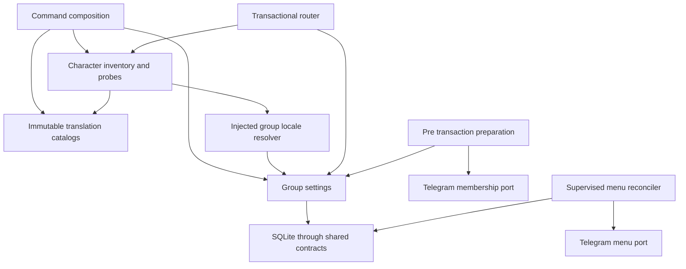
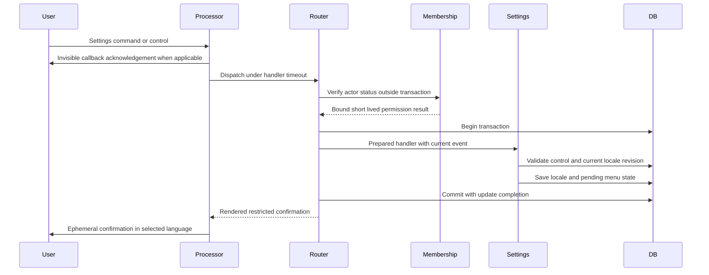
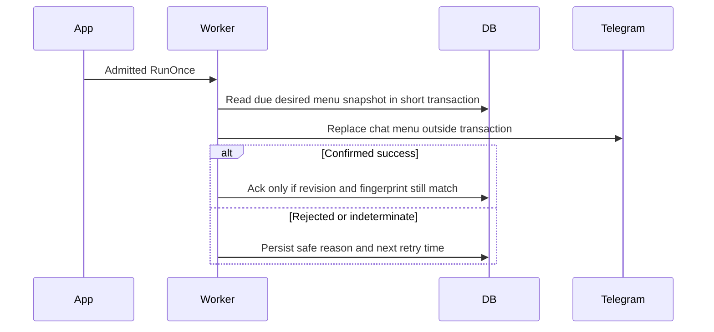
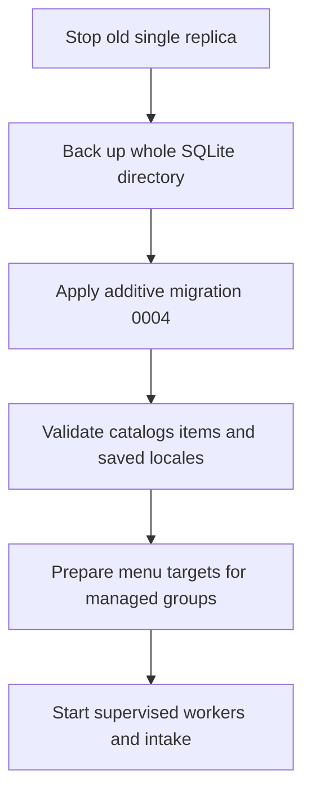

# Design Document

## Overview

Localization supplies English and Russian presentation for every current player-facing feature and a persistent group language selected through ephemeral `/settings`. Group administrators change the setting; all members can inspect it. English is the default.

The design extends the existing modular monolith with an immutable standard-library translation package and a settings feature. Existing character and inventory services retain their mechanics and replay contracts. Settings owns group preferences, controls, and durable command-menu synchronization. Network permission checks precede transactions; command-menu publication follows committed settings through a supervised worker.

### Goals

- Translate messages, buttons, command descriptions, item text, status labels, and enabled development interactions completely in both languages.
- Preserve group privacy, independent group preferences, current gameplay, restart recovery, and current item identities.
- Provide runnable vertical milestones and concrete integration contracts without new dependencies.

### Non-Goals

Additional languages, individual language preferences, automatic detection, runtime translation services, translation of player-authored text or operational output, historical-message rewriting, and encounter/battle implementation.

## Boundary Commitments

### This Spec Owns

- `internal/localization`: immutable catalogs, supported locale values, message/parameter schemas, plural selection, and translated item presentation.
- `internal/settings`: authoritative group locale, settings controls and authorization decisions, locale resolution, menu desired/applied state, and menu reconciliation.
- Adaptation of existing feature renderers, command descriptions, and development probes to explicit locale input.
- Minimal generic runtime extensions for pre-transaction preparation, injected membership/menu capabilities, and supervised background work.

### Out of Boundary

- Character health/identity and inventory mechanics, ownership, quantities, grants, consumption, equipment, and gameplay operation receipts.
- Transport routing semantics, outbox message delivery rules, scheduler transactions, and the existing restricted-delivery authorization model.
- Downstream encounter/battle rules; those features will consume the same locale and presentation capability.

### Allowed Dependencies

- `localization` imports only the standard library. It accepts item IDs as strings and never imports inventory or settings.
- `settings` imports only standard library, `localization`, `interaction`, and `runtimecontract`; it receives abstract transaction and network capabilities and never imports concrete persistence, Telegram, app, character, or inventory packages.
- Character, inventory, and devsmoke may import `localization` and receive locale-resolution functions from composition. They do not import settings or each other's implementations.
- Runtime remains free of localization/settings/gameplay imports. New ports in `runtimecontract` use only standard-library and existing runtime types. `cmd/replipg` composes features, adapters, and worker factories.
- Preserve existing transport, driver, and cross-feature dependency direction when integrating localization.

### Revalidation Triggers

Changes to locale/message schemas, item ID retention, command registration, settings-control binding, administrator verification freshness, runtime preparation or worker lifecycle, menu-scope ownership, or migration version require revalidation of their consumers. New encounter/battle text requires catalog entries and bilingual coverage before release.

## Architecture

### Existing Architecture Analysis

`interaction.Router.Dispatch` invokes handlers inside a transaction that also commits update completion and cursor advancement. Immediate responses are validated and copied before commit, then sent by `telegram.Processor`. Callback acknowledgement happens before dispatch. Character and inventory already validate restricted authorization, ownership, and stale controls.

Scheduler handlers also execute inside transactions. Outbox decoders yield only the closed message response types. Neither is suitable for menu-management HTTP calls without expanding unrelated contracts. A single settings-owned reconciler uses durable pending state and short transactions around external calls.

### Architecture Pattern & Boundary Map



The arrows indicate capability use, not unrestricted imports. Catalogs are shared presentation data; settings alone owns language persistence. Locale is resolved once per interaction transaction and passed explicitly to rendering, never stored in character or inventory operations.

### Technology Stack

| Layer | Choice / Version | Role | Change |
|---|---|---|---|
| Services | Go 1.26, pinned devenv | Typed locale, catalogs, settings | Standard library only |
| Resources | `embed`, `encoding/json`, restricted `text/template` | Validated bundled translations | New embedded files |
| Telegram | Existing `github.com/go-telegram/bot v1.27.0` | Membership and scoped command menus | New adapter methods, no version change |
| Storage | Existing `modernc.org/sqlite v1.61.0` | Settings and pending menu state | Additive migration 0004 |
| Lifecycle | Existing app supervision/drain | One menu worker per single replica | Generic worker factory support |

## File Structure Plan

### New Files

| Path | Responsibility |
|---|---|
| `internal/localization/locale.go` | Closed `Locale` values and strict parsing |
| `internal/localization/messages.go` | Typed message keys and parameter schemas |
| `internal/localization/catalog.go` | Embedded-resource loading, immutable lookups, strict validation |
| `internal/localization/format.go` | Restricted interpolation and integer plural selection |
| `internal/localization/locales/en.json`, `ru.json` | Flat dotted-key string maps for messages, plural variants and item text |
| `internal/localization/catalog_test.go`, `format_test.go` | Coverage, invalid resources, parameter/plural limits |
| `internal/settings/store.go` | Group locale, controls, and menu snapshot/ack persistence |
| `internal/settings/commands.go` | Settings preparation, transactional authorization and changes |
| `internal/settings/controls.go` | Opaque actor/chat/revision-bound expiring controls |
| `internal/settings/render.go` | Localized ephemeral settings and guidance |
| `internal/settings/menu.go` | Command fingerprint and desired menu construction |
| `internal/settings/worker.go` | Durable menu retries outside transactions |
| `internal/settings/*_test.go` | Store, authorization, controls, worker and failure regressions |
| `internal/runtimecontract/group.go` | Membership and group-menu capability types |
| `internal/telegram/membership.go`, `membership_test.go` | Bounded membership adapter and fake tests |
| `internal/interaction/preparation.go`, `preparation_test.go` | Optional pre-transaction handler preparation |
| `internal/app/background.go`, `background_test.go` | Generic worker supervision and admission |
| `internal/persistence/migrations/0004_localization.sql` | Additive settings/control schema |
| `internal/persistence/localization_schema_test.go` | Schema invariants and upgrade compatibility |
| `cmd/replipg/localization.go` | Catalog validation, settings wiring, localized declarations |
| `cmd/replipg/localization_integration_test.go` | Fake-Telegram end-to-end group settings |
| `.kiro/specs/localization/manual-verification.md` | Milestone steps and actual live evidence |

### Modified Files

- `internal/runtimecontract/database.go`: own the single shared `Transactor` interface for `WithinTransaction`; persistence implements it without declaring a duplicate.
- `internal/interaction/events.go`, `dispatch.go`: optional preparation contract and invocation; carry `ActorIsBot` on callbacks without changing closed event kinds.
- `internal/telegram/mapper.go`, `mapper_test.go`: map callback bot identity consistently with commands.
- `internal/telegram/commands.go`, `commands_test.go`: scoped menu replacement and owned locale-override cleanup.
- `internal/app/runtime.go`, `composition.go`: inject transport ports into registrations, create client before registration, initialize factories, wait for worker-start handshake, size supervision results for all workers.
- `internal/character/render.go`, `commands.go`, `development.go` and corresponding tests: explicit locale and injected presentation dependencies, including domain errors and raw states.
- `internal/inventory/render.go`, `commands.go`, `development.go` and corresponding tests: bilingual item lookup, labels, owner fallback, stale guidance and controls.
- `internal/inventory` presentation validation and command composition: validate retained item translations independently from the pure item catalog; inventory retains persisted mechanics reconciliation.
- `internal/persistence/migrate.go`: explicitly embed and register migration 0004 in ordered runtime migrations.
- `internal/devsmoke/register.go` and its tests: translate all visible probe messages without changing routes or privacy.
- `cmd/replipg/main.go`, `character.go`, `inventory.go`: compose shared presentation options and command description keys; preserve enabled command flags and names.
- `cmd/replipg/smoke_test.go`, existing character/inventory integration tests: preserve executable transport regressions and add bilingual expectations.
- `README.md`: settings behavior, bot permissions, new managed menu scopes, restart/rollback instructions and reproduction commands.

`internal/item/items.json` contains stable identities, categories and mechanics only; separate inventory seed configuration owns starter quantities. All rendering reads bilingual names and descriptions exclusively from localization resources. Do not reset preexisting user edits; the current `cloth_armor` display intent is leather armor despite its historical ID. Reconcile the English wording with that intent and correct Russian spelling without renaming the ID or changing defense.

## System Flows

### Settings Selection



Permission lookup failures become an explicit unverifiable result, allowing a safe translated rejection through normal transactional dispatch. They are not interpreted as administrator status. Missing/expired incoming ephemeral authorization is rejected before any lookup or state creation.

### Menu Synchronization



There is one reconciler per replica, with serialized `RunOnce`. A newer selection committed during HTTP makes the old acknowledgement ineffective. The next pass publishes the latest target. Repeating menu replacement is safe after an indeterminate result or a crash after publication.

## Requirements Traceability

| Requirement | Summary | Components | Interfaces | Flows |
|---|---|---|---|---|
| 1.1, 1.2, 1.3, 1.4, 1.5 | Supported locales and independent groups | Catalog, GroupStore, feature renderers | Locale, Resolve | Interaction |
| 1.6, 1.7 | Language change and existing messages | Feature renderers, settings handlers | Presentation options | Interaction |
| 2.1, 2.2, 2.3, 2.4 | Ephemeral settings inspection | SettingsHandler, MembershipPort | Prepare, Handle | Settings selection |
| 2.5, 2.6, 2.7 | No gameplay side effects or disclosure | SettingsHandler | WorkScope, EphemeralResponse | Settings selection |
| 3.1, 3.2, 3.3 | Current administrator verification | PreparingHandler, MembershipPort | Prepare, VerifyGroupMember | Settings selection |
| 3.4, 3.8 | Invalid or stale controls | SettingsControls, GroupStore | ResolveControl | Settings selection |
| 3.5, 3.6, 3.7 | Commit and confirmation | SettingsHandler, GroupStore | Change, Handle | Settings selection |
| 4.1, 4.2, 4.3 | Complete interface labels | Catalog, feature renderers | Text, Item | Interaction |
| 4.4, 4.5, 4.6 | Values, grammar, user content | Catalog, feature renderers | Args, Count | Interaction |
| 4.7, 4.8 | Development text and stable commands | Composition, devsmoke, feature adapters | CommandSpec | Startup and interaction |
| 5.1, 5.2, 5.4 | Bilingual item presentation | Catalog, inventory renderer | Item, ValidateItems | Startup and interaction |
| 5.3, 5.5, 5.6 | Gameplay and control compatibility | Feature adapters, existing services | Presentation options | Interaction |
| 6.1, 6.2, 6.3 | Group-specific complete command menus | MenuBuilder, MenuWorker, MenuPort | ReplaceGroupMenu | Menu synchronization |
| 6.4, 6.5, 6.7 | Durable publication and status | GroupStore, MenuWorker, settings renderer | MenuSnapshot, Ack | Menu synchronization |
| 6.6, 6.8 | Restart refresh and scope ownership | Composition, MenuWorker, documentation | Startup preparation | Startup |
| 7.1, 7.2, 7.3 | Durable ordered replay-safe changes | GroupStore, existing router completion | Change | Settings selection |
| 7.4, 7.5 | Invalid or unreadable saved state | GroupStore, preparation | Resolve, ValidateSaved | Startup and interaction |
| 7.6, 7.7 | Stable response retries and privacy | Existing response/outbox contract, settings | Rendered MessageContent | Delivery |
| 8.1, 8.2, 8.3 | Complete validated catalogs | Catalog, composition | Load, ValidateItems | Startup |
| 8.4, 8.5 | Unicode and presentation limits | Catalog, feature renderers, inventory validator | Text, ValidateItemText | Startup and interaction |
| 9.1, 9.2, 9.3 | Deterministic verification | Catalog/settings/feature tests | Fakes and controlled time | Automated gates |
| 9.4, 9.5 | Runnable increments and permissions | Composition, manual verification, README | Development test deployment | Milestone demonstration |

## Components and Interfaces

| Component | Domain | Intent | Coverage | Key dependencies | Contracts |
|---|---|---|---|---|---|
| Catalog | Shared presentation | Immutable validated translation | 4.1, 5.1, 8.1 | Standard library P0 | Service |
| GroupStore | Settings persistence | Locale, controls, desired/applied menu state | 1.2, 3.4, 7.1 | DBTX P0 | State, Service |
| SettingsHandler | Settings UI | View/change language with current permission | 2.1, 3.1 | Membership P0, Catalog P0 | Service |
| PreparingHandler | Runtime | Resolve external evidence before transaction | 3.1, 3.2 | Handler route P0 | Service |
| MembershipPort | Telegram adapter | Typed current membership | 3.1, 9.5 | Existing client P0 | API |
| MenuBuilder and MenuWorker | Settings integration | Converge Telegram menu to saved preference | 6.1, 6.4 | MenuPort P0, Transactor P0 | Batch, State |
| Feature renderers | Existing UI | Explicit locale without gameplay changes | 4.1, 5.6 | Catalog P0, injected resolver P0 | Service |
| Composition | Executable | Validate resources and register adapters/workers | 6.6, 9.4 | Existing app P0 | Startup |

### Catalog

**Contract: Service.** Inbound: features and composition (P0). Outbound: standard library only (P0).

```go
type Locale string // English="en", Russian="ru"; strict ParseLocale
type Key string    // Named constants, backed by required schema manifest
type ParamKind uint8 // TextParam, IntegerParam
type Value struct { /* private tagged string or int64 storage */ }
type Args map[string]Value
type ItemText struct { Name string; Description string }

func Load() (*Catalog, error)
func (c *Catalog) Text(locale Locale, key Key, args Args) (string, error)
func (c *Catalog) Count(locale Locale, key Key, count int64, args Args) (string, error)
func (c *Catalog) Item(locale Locale, itemID string) (ItemText, error)
func (c *Catalog) ValidateItems(ids []string, validate func(ItemText) error) error
```

`Value` has explicit string/integer constructors; no untyped parameter escape hatch. Each resource is a flat JSON object whose keys and values are strings. Ordinary messages use dotted keys directly, such as `settings.title`; they have no `.other` suffix. Count-sensitive messages use a logical base key with explicit form suffixes: `recovery.seconds.one`, `recovery.seconds.other`, and the additional Russian `.few` and `.many` forms. Item entries use `items.<stable-id>.name` and `items.<stable-id>.description`. There are no nested objects or in-band metadata/version fields.

```json
{
  "settings.title": "Group settings",
  "settings.language": "Language: {{.Language}}",
  "button.back": "Back",
  "recovery.seconds.one": "Recovery in {{.Count}} second.",
  "recovery.seconds.other": "Recovery in {{.Count}} seconds.",
  "items.coin.name": "Coin",
  "items.coin.description": "An ordinary coin."
}
```

The Go manifest declares each logical message key, parameter names/types, count sensitivity, and static presentation limit. Expand count-sensitive keys into the required suffixes for each locale before validating exact key coverage; English and Russian raw key sets therefore differ only by their required plural forms. Reserve `items.` for item presentation and reject collisions between literal keys and expanded plural keys. Require exactly two item keys per retained configured ID. `Text` resolves an ordinary key directly; `Count` selects and appends a form suffix to its logical base key; `Item` reads the two item keys into `ItemText`. Callers continue using the typed contracts above rather than assembling resource keys themselves.

Decode with token-level duplicate-key rejection plus unknown-key, non-string-value, null and trailing-data rejection; arrays and nested objects are invalid. Parse templates once with `missingkey=error`; allow only plain text and simple named field substitutions. Reject template functions, pipelines, nested selectors, branches, loops and definitions. Validate placeholder sets against the manifest in every form, validate argument types before execution, and check final output limits. No implicit language fallback, raw-key return, unresolved placeholders, or panic-based rendering.

For nonnegative integer counts, English uses `one` for 1 and `other` otherwise; Russian uses `one` for final digit 1 excluding 11, `few` for 2–4 excluding 12–14, and `many` otherwise. Require `other` as a valid resource form too, but reject fractional or negative count inputs rather than invent semantics. Dates remain RFC3339 UTC; translating labels does not change time values. Current count-neutral inventory layout remains valid; do not introduce grammatical nouns unnecessarily. The rules follow [Unicode CLDR](https://www.unicode.org/cldr/charts/49/supplemental/language_plural_rules.html).

Item names remain limited to 80 runes and descriptions to 400; export and reuse inventory's current text validator, including control/format/separator rejection. Preserve safe username handling and compute formatting entity offsets on the final translated text using existing UTF-16 rules. Reject final output outside runtime limits; pagination must budget both languages before committing associated controls.

### GroupStore and Feature Presentation

The approved item/inventory split adds `Store.ResolveReadOnly(ctx, tx, chat)` for application-owned catalog inspection. It reads the saved locale or returns English without initializing group settings or menu work. `/dev_item` uses this capability after owner authorization; existing `Resolve` and normal player interactions retain their initialization behavior. `TestResolveReadOnlyDoesNotCreateSettings` covers both missing settings and saved Russian selection.

**Contracts: State, Service.** Inbound: settings and injected feature resolution (P0). Outbound: DBTX (P0). Store errors wrap safe storage markers consistent with existing feature stores.

```go
type Selection struct {
    Locale localization.Locale
    Revision int64
    MenuPending bool
}
func (s *Store) Resolve(ctx context.Context, tx runtimecontract.DBTX,
    chat runtimecontract.ChatID) (localization.Locale, error)
func (s *Store) Inspect(ctx context.Context, tx runtimecontract.DBTX,
    chat runtimecontract.ChatID) (Selection, error)
func (s *Store) Change(ctx context.Context, tx runtimecontract.DBTX,
    chat runtimecontract.ChatID, expectedRevision int64,
    locale localization.Locale) (Selection, error)
```

`Resolve` validates a supported negative chat ID, reads/validates the stored locale, and inserts an English managed-group record only when absent. Call it only after a feature's existing human/group/restricted-authorization checks; ordinary accepted devsmoke messages may register their group after validating group context. It never creates gameplay state. Unknown or corrupt rows are errors, not default English. Every first managed record starts with pending menu synchronization. Startup validates all existing rows before accepting updates.

Each feature's `Register` and applicable `RegisterDevelopment` entry points require presentation options containing the catalog and a narrow resolver function with the above signature. All callers, including tests, use this single presentation path; no legacy registration wrappers or English-only fallback renderers remain. Resolve once with the handler's `WorkScope.DBTX`, before translating usage, errors or content; pass locale explicitly through character summaries and inventory page/detail renderers. No DB access in render functions. Missing presentation dependencies fail registration, rather than silently disabling localization.

`ItemDefinition` contains gameplay mechanics only; renderers exclusively use `Catalog.Item` for names and descriptions. Custom display text in tests belongs to translation fixtures. Inventory retains startup mechanics reconciliation and constructor validation of injected item content and separate starter lines. Composition validates bilingual item text using the current catalog IDs and exported validator before preparation/admission.

### PreparingHandler and MembershipPort

**Contracts: Service, API.** Inbound: router/settings (P0). Outbound: membership adapter (P0). Preparation is optional for existing handlers.

```go
// In interaction; normal Handler stays unchanged.
type PreparingHandler interface {
    Prepare(context.Context, Event) (Handler, error)
}

// In runtimecontract/group.go.
type MembershipStatus uint8 // Member, Administrator, Owner, Unknown
type MembershipResult struct {
    Status MembershipStatus
    CheckedAt time.Time
}
type GroupMembershipReader interface {
    VerifyGroupMember(context.Context, ChatID, UserID) (MembershipResult, error)
}
```

Router resolves the handler, invokes optional preparation before `WithinTransaction`, then invokes the returned handler in its existing transaction. Apply the current bounded-router timeout to preparation plus dispatch. Isolate preparation panics without logging panic values; cancellation or unexpected preparation errors leave the update incomplete for existing intake recovery. An ordinary denied/unverifiable membership result is not a preparation error.

Settings validates event shape, human actor, group, and incoming restricted authorization before network lookup. Add/map `Callback.ActorIsBot` so callbacks enforce the same human rule. Preparation returns an immutable prepared handler holding private evidence bound to update/chat/user, checked time, status, and the original command/control identity. Never accept evidence from callback bytes or command arguments. Evidence expires five seconds after lookup; revalidate binding and expiry immediately before mutation. Expired evidence rejects the change with reopen guidance; it is never reused on another update. Remote membership can change after lookup, so the guarantee is a fresh per-request check, not a distributed atomic membership transaction.

The Telegram adapter performs bounded `getChatMember` for the bot itself and requesting actor; verify returned chat/member identities and human actor status, and accept administrator/owner evidence only when the bot's own status permits guaranteed verification. Nil, unknown, or mismatched provider results are unverifiable. A member result hides change controls; errors or insufficient bot privileges produce read-only settings with verification-unavailable guidance. Require bot administrator status in the deployment guide for reliable changes. A failure affects language changes, not ordinary translated gameplay. See [Telegram getChatMember](https://core.telegram.org/bots/api#getchatmember).

### SettingsHandler and Controls

**Contracts: Service, State.** Inbound: `/settings` and `set:` callbacks (P0). Outbound: GroupStore, catalog, preparation evidence (P0).

Opening settings returns an `EphemeralResponse` under incoming authorization, with current language and menu status. Non-admins see read-only guidance. Admin choices use the self-identifying labels `English` and `Русский` to remain recognizable in either UI language. These are language proper names in the catalog, not fallback translations.

Controls use random opaque `set:` tokens under 64 bytes. Store chat, actor, expected locale revision, selected locale, expiry and consumed state; do not embed authoritative identity/permission in payloads. Use five-minute expiry matching existing inventory navigation. Validate token binding, current revision, unconsumed state, current permission evidence, and supported selection in the transaction. A successful choice consumes the token, changes locale if different, increments revision only for a real change, and invalidates previous-revision controls. Selecting the current language consumes that choice and confirms the existing state without a revision bump. Opening settings creates fresh controls. Retain consumed tokens until expiry; purge expired tokens during startup and bounded settings operations.

Button responses edit the original ephemeral settings message using existing callback replacement behavior; command invocation opens a new personal message. Re-render current selection and newly bound controls on success. Confirmation uses the selected locale and says menu synchronization is pending when appropriate. Non-admin, stale, expired or unverifiable changes never mutate locale; safe guidance uses the current locale only when a restricted reply remains authorized. Typed ordinary `/settings` lacks incoming authorization and produces no response, consistent with existing commands.

### MenuBuilder and MenuWorker

**Contracts: Batch, State, API.** Inbound: app worker supervision (P0). Outbound: Transactor and GroupMenuWriter (P0).

```go
// The shared transaction capability lives in runtimecontract/database.go.
type Transactor interface {
    WithinTransaction(context.Context,
        func(context.Context, DBTX) error) error
}
type GroupMenuWriter interface {
    ReplaceGroupMenu(context.Context, ChatID, []CommandDeclaration) error
}
type MenuFailureKind uint8 // Transient, RateLimited, Forbidden, Invalid, Indeterminate
type MenuError struct {
    Kind MenuFailureKind
    RetryAfter time.Duration
}
// MenuError implements error with sanitized category text only.
// Feature-owned descriptions remain typed localization keys.
type CommandSpec struct {
    Name string
    Description localization.Key
    Ephemeral bool
}
func (w *MenuWorker) RunOnce(context.Context) (bool, error)
```

Composition constructs one ordered enabled command specification set, including enabled development commands. MenuBuilder renders each locale and computes SHA-256 over deterministic ordered name/description/ephemeral fields. Existing command validation applies. A saved change updates desired fingerprint in the same transaction as locale/revision and marks it due immediately.

Worker reads the earliest due group snapshot in a short transaction, publishes outside it, then conditionally records success only if locale revision and desired fingerprint still match. No SQL lock is held during HTTP. On mismatch leave the current target pending. Success records applied revision/fingerprint and a refresh deadline 15 minutes later; a periodic idempotent refresh repairs external drift and late indeterminate requests. On any API failure preserve pending state and persist safe reason, saturated attempt count, and bounded exponential retry delay using configured initial/maximum delays, honoring Telegram retry-after. Failure writes use the same snapshot revision/fingerprint predicate as success: an obsolete attempt cannot clear a newer acknowledgement or postpone a newer desired target. Retry indefinitely at the capped delay; `RetryAttempts` does not discard desired state. Storage failures are fatal to the supervised loop. Inject time into worker/backoff tests.

The adapter maps its concrete API errors into `runtimecontract.MenuError`; settings inspects them with `errors.As`, never imports transport error types or compares error strings. Cancellation propagates directly and leaves durable pending state. Treat unexpected unclassified errors as transient with a safe generic reason. Even forbidden/invalid requests retain pending state at capped delay so an operator permission/configuration repair can recover automatically.

At startup, composition validates saved rows and marks every managed group's current menu target pending, recalculating fingerprints from the enabled command set. Publication does not block gameplay readiness; pending state is visible in settings until confirmed. Global default-English `all_group_chats` publication retains its existing startup gate so untouched groups can discover `/settings`.

The adapter replaces default-language `BotCommandScopeChat` for the group and removes `en`/`ru` variants in that same scope; the complete sequence must succeed before acknowledgement. The application owns those scopes plus default-language `all_group_chats`. It does not enumerate/delete unknown language variants, per-member or administrator scopes. Document operator removal of competing unmanaged scopes; startup must not silently delete unrelated configuration. Group selection is independent of client-language selection, following [Telegram command precedence](https://core.telegram.org/bots/api#determining-list-of-commands) and [setMyCommands](https://core.telegram.org/bots/api#setmycommands).

### Composition and Worker Lifecycle

`app.Registrations` gains runtimecontract membership/menu ports. Create the existing Telegram client after storage/domain preparation and before feature registration, so injected ports are live without deferred mutable globals. Adapt internal positional `Registrations` literals to named fields. Keep command publication, poller initialization and update admission ordered after feature registration.

Add optional named background-worker factories to `app.Options`. Factory dependencies are `runtimecontract.Transactor` and menu writer; command-specific construction stays in `cmd/replipg` closures. Workers implement only `RunOnce(context.Context) (bool,error)` and are owned by the app. Names must be unique; factories fail startup before admission. The app uses its existing admission/work contexts and a cancellable one-second idle timer. It starts one supervised loop per factory, includes their started handshakes in readiness, sizes the results channel for all loops, and joins them in the existing owned wait group. No feature starts goroutines. Stop admission before another iteration; allow in-flight publication and acknowledgement to drain under the shutdown deadline, then cancel and join. An interrupted attempt leaves durable desired state for recovery.

## Data Models

### Domain Model

One group selection is authoritative for all presentation in that group. Locale revision changes only when the language changes. Menu publication has separate desired/applied fingerprint and retry state; a saved selection is valid even while its menu is pending. Settings controls bind a human actor and group revision, without any foreign key to characters or inventories.

### Physical Data Model

Migration `0004_localization.sql` adds two STRICT tables; milliseconds are UTC integer instants.

| Table | Fields and constraints |
|---|---|
| `group_settings` | `chat_id INTEGER PRIMARY KEY CHECK(chat_id<0)`, `locale TEXT CHECK(locale IN ('en','ru'))`, `revision INTEGER CHECK(revision>=1)`, `desired_menu_hash TEXT`, nullable `applied_menu_hash TEXT`, nullable `applied_revision INTEGER`, `menu_next_attempt_at INTEGER`, `menu_attempts INTEGER CHECK(menu_attempts>=0)`, nullable safe `menu_failure_code TEXT`, `updated_at INTEGER`; hashes are 64 lowercase hex characters; applied hash/revision are either both null or both present |
| `settings_controls` | `token TEXT PRIMARY KEY`, `chat_id INTEGER REFERENCES group_settings(chat_id)`, `actor_id INTEGER CHECK(actor_id>0)`, `expected_revision INTEGER CHECK(expected_revision>=1)`, `selection TEXT CHECK(selection IN ('en','ru'))`, `expires_at INTEGER`, `consumed INTEGER CHECK(consumed IN (0,1))`; index expiry for bounded cleanup |

All fields except explicitly nullable ones are `NOT NULL`. Pending means missing applied state or a revision/fingerprint mismatch; retry failures clear applied acknowledgement for the attempted target. After successful acknowledgement the same next-attempt field schedules periodic refresh. Failed periodic refresh marks pending, distinguishing uncertainty from confirmed publication. Due-group index covers `menu_next_attempt_at,chat_id`. No personal content or permission evidence is persisted.

`Change` uses expected revision compare-and-update; updates tokens and desired state atomically in router dispatch. Update completion suppresses replayed Telegram updates. Consumed tokens and expected revision prevent a repeated control in a new update from rolling back a later selection. Validate existing row before any upsert. Future retained item definitions require bilingual text, but existing item/persistence schema is untouched.

### Data Contracts & Integration

Catalog schema is defined by the binary's required-key manifest and bundled resources, which ship together. No schema version is stored as a translation key; incompatible key/value shapes fail validation. Menu network errors use sanitized typed categories and optional retry-after, never raw API response bodies. Immediate feature responses already snapshot rendered text/buttons; durable message producers must persist fully rendered content with the accepted outcome, not consult the latest locale on retry. This spec does not widen outbox response types or introduce a new generic message schema.

## Error Handling

| Condition | Observable behavior | Recovery |
|---|---|---|
| Invalid/missing catalog translation or item text | Startup fails before gameplay admission with safe key/locale diagnostic | Correct version-controlled resources |
| Saved locale unreadable/corrupt | Distinguishable storage/selection failure; no default overwrite | Fail preparation or roll back interaction; operator repair |
| Member/unknown permission | Read-only settings; rejected change with localized guidance | Administrator retries after permissions are available |
| Expired/misbound/stale control | No change; restricted reopen guidance where authorized | Open `/settings` again |
| Save/commit failure | No success claim, prior selection retained | Existing intake/storage recovery |
| Personal delivery failure after commit | Selection persists; no visibility fallback | Inspect settings again |
| Menu API rejection/timeout | Saved selection retained and pending status visible | Durable capped backoff plus startup/periodic reconciliation |
| New selection during menu request | Old acknowledgement cannot clear new target | Next worker pass converges |

Private text and raw provider errors never enter diagnostics. Worker metrics use safe operation/reason categories; no token, username, response content, or permission response payload is logged. Context cancellation propagates across preparation, HTTP and transaction boundaries.

## Testing Strategy

### Unit Tests

- Catalog and formatter: exact English/Russian expanded message/item key coverage; duplicate/unknown keys; null/non-string values and rejected nested resources; literal/plural key collisions; missing placeholders and wrong types; unsupported locale; rune limits; prohibited Unicode; safe final formatting. Verify direct ordinary-key lookup, plural-base lookup, stable item lookup, and 0, 1, 2, 4, 5, 11–14, 21–25, 101, 111 counts and UTC values (4.1–4.6, 5.1, 5.2, 5.4, 8.1–8.5, 9.1).
- Settings preparation/handlers: ordinary versus ephemeral commands, bots/anonymous actors, read-only member view, verified admin/owner choices, unavailable permissions, evidence expiry and identity binding, current-language confirmations and replacement messages (2.1–2.7, 3.1–3.8).
- Controls/store: expired/malformed/cross-chat/cross-actor tokens, same-language selection, revision conflicts, consumed tokens, duplicate/new update replay, corrupted locale and failed reads without English overwrite (3.4, 7.2–7.5, 9.2).
- Menu worker: no network inside transaction; fingerprint ordering and enabled commands; typed error classification, retry-after, capped backoff, periodic refresh, in-flight revision change on both success and failure, failed acknowledgement and restart after successful HTTP (6.1–6.8, 7.3, 9.3).

### Integration Tests

- Upgrade a schema-3 fixture and reopen with language choices/controls intact; assert character/inventory rows, item mechanics and starter-kit receipt unchanged (2.5, 5.3, 5.6, 7.1).
- Use two groups with one actor to verify English default, independent Russian selection, public/personal/dev responses, and old inventory controls rendering the current locale while preserving ownership/revision validation (1.1–1.7, 4.7, 4.8, 5.5).
- Router preparation checks occur outside transactions; callback acknowledgement precedes remote lookup; duplicate dispatch does not repeat mutations; preparation panic/cancellation stays private and recoverable (3.1, 7.2, 7.7).
- Runtime worker factory startup failure, started handshake, storage failure supervision, admission shutdown, in-flight drain, forced cancellation and persisted menu recovery (6.4, 6.6, 7.1, 9.2, 9.3).
- Review package dependencies and validate existing character/inventory regressions under both presentation configurations (5.6).

### Executable and Live Paths

1. Fake Telegram executable: ephemeral `/settings` defaults to English; member cannot change; admin selects Russian; confirmation and next `/character` and `/inventory` are Russian, including items and buttons (1.2, 2.1–2.4, 3.5, 4.1, 5.1).
2. Simulate menu failure after save, inspect pending status, restart, then verify complete Russian menu publication with stable ephemeral command declarations and cleared status (6.1–6.7).
3. Select English again; verify second-group isolation, stale controls, no public/private fallback and retained gameplay state (1.4, 2.6, 3.4, 5.3).

Each vertical milestone includes documented real test-group steps and a distinct evidence record; do not mark live demonstrations complete without execution. Run `./scripts/check` and `./scripts/smoke` with fake Telegram plus focused localization/settings tests. Documentation-only design generation does not run application gates (9.1–9.5).

## Security Considerations

Permission evidence is server-created, per-request and short-lived; callbacks carry only opaque tokens. An administrator who loses status must fail subsequent fresh verification. Bound bot and actor membership requests to caller deadlines. Without sufficient bot privileges, read-only settings remains available while changes fail closed. Restricted response authorization remains independent of membership authorization; admin status does not bypass expiry or permit public fallback.

## Migration Strategy



Initialization does not backfill player state or replace item definitions. Groups become managed on first accepted localized interaction; untouched groups use the English global menu. Catalog/preparation failure blocks admission even if the migration has committed. A schema-3 binary rejects a schema-4 database; roll forward or restore a stopped matching whole-directory snapshot and binary. When rolling back, deliberately remove/restore owned chat menus because external Telegram state is not restored by a database backup.

## Approved Item Boundary Update (2026-11-04)

Dependencies: telegram-runtime, character-system, item-system for stable content IDs and inventory-system for UI. Item contracts/catalog import no localization. Names/descriptions stay exclusively in localization resources; inventory/composition performs item-text validation through the existing adapter. Earlier combined-catalog file references in historical research/tasks are superseded by this boundary.
