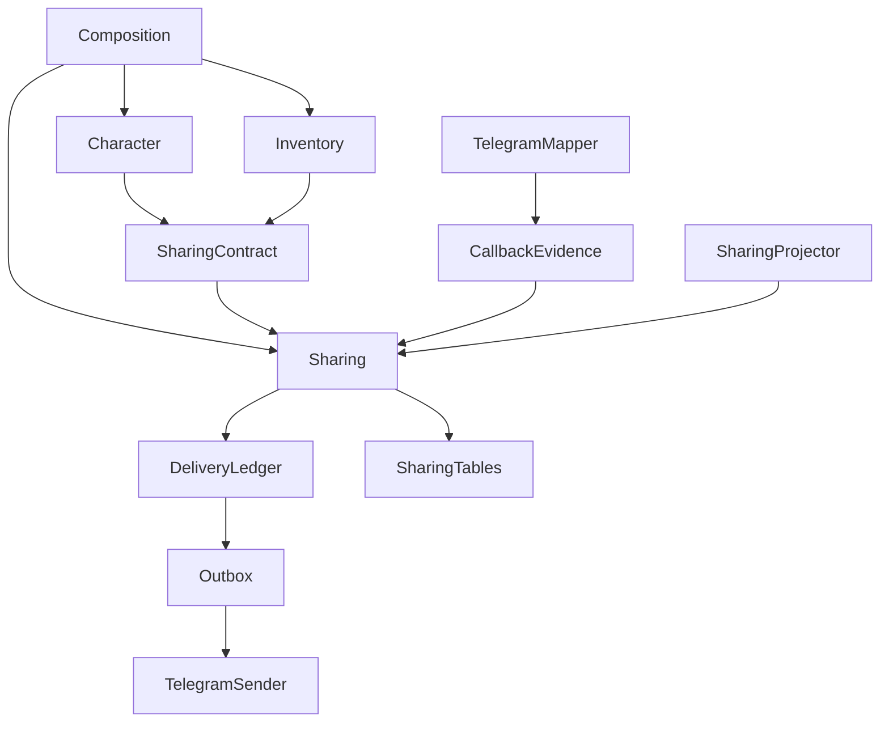
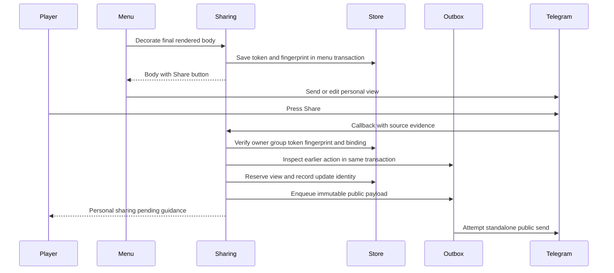
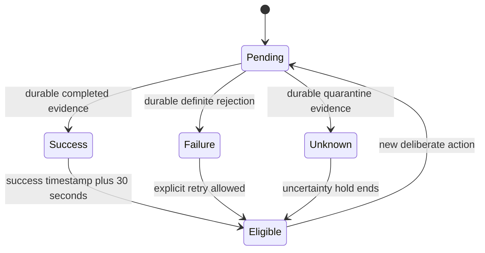
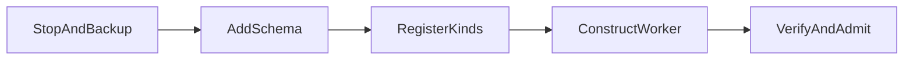

# Design Document

## Overview

Menu Sharing adds explicit public snapshots to the existing personal character and inventory interfaces. A player presses Share to publish the verified source view in the same group. The copy identifies its owner, contains no controls, and remains unchanged afterward. The same displayed view can be shared again after 30 seconds; previous shares remain in the conversation.

The design extends the existing modular monolith with one sharing feature, a narrow presentation contract, callback-source evidence, and two additive outbox operations. Existing gameplay services, ephemeral command declarations, settings authority, and runtime supervision remain in place. No third-party dependency is introduced.

### Goals

- Share exactly the selected character summary, inventory page, or item-details body without reading or changing gameplay state.
- Suppress action replays and concurrent presses, persist successful cooldowns, and distinguish confirmed delivery from uncertainty.
- Preserve personal browsing and finite retention of copied private text without inventing a new Share expiry.

### Non-Goals

- Deleting, replacing, editing, or automatically refreshing public shares.
- Public interactive menus, visibility settings, cross-group sharing, images, settings sharing, or development-menu sharing.
- A generic menu framework, new gameplay behavior, or exactly-once network-delivery guarantees.

## Boundary Commitments

### This Spec Owns

- Shared view decoration, view fingerprinting, opaque Share controls, owner/group/source validation, publication policy, cooldowns, and delivery-outcome projection.
- Sharing metadata, accepted-action replay records, temporary authorized delivery content, localized Share guidance, and feature-scoped retention.
- Additive callback-source evidence and transaction-bound outbox inspection/cleanup contracts needed by this feature.

### Out of Boundary

- Character/inventory initialization, health recovery, equipment operations, ownership, item quantities, and gameplay replay semantics.
- Runtime transport, acknowledgement, delivery attempt execution, and goroutine lifecycle. Sharing queues work; it never sends inside a transaction.
- Group locale selection, administrator verification, command visibility, and settings controls.
- Altering existing inventory control expiry or adding a character-view expiry.

### Allowed Dependencies

- Production composition in `cmd/replipg` imports and wires concrete sharing, gameplay, localization, and outbox packages.
- Character and inventory import only the exact `internal/sharing/contract` package through injected presentation capabilities. They never import sharing implementation, outbox, transport, or persistence.
- `sharing/contract` imports standard library types, `runtimecontract`, and `localization`; no gameplay, runtime implementation, or concrete storage.
- `internal/sharing` imports its own contract, `runtimecontract`, `interaction`, and `localization`. Injected narrow capabilities supply transaction-bound outbox access and locale resolution. It never queries outbox tables directly.
- `interaction` and `telegram` expose feature-neutral source evidence. Runtime packages never import sharing. Persistence owns SQL migrations; sharing owns queries against its own tables.

### Revalidation Triggers

- Callback-source representation, entity normalization, token format, fingerprint version, or message-binding semantics change.
- Existing menu usability, command rendering, or locale-resolution contracts change.
- Outbox status semantics, terminal timestamps, purge eligibility, or recovery states change.
- Additional shareable surfaces, automatic reposting, public editing/deletion, or cooldown scope are proposed. Such changes require explicit requirements review.

## Architecture

### Existing Architecture Analysis

Character and inventory render localized ephemeral responses. Inventory controls have a five-minute deadline per render; character has no callback deadline. Transactional dispatch supplies `WorkScope`, commits feature writes and outbound intent with processed update identity, and delivers immediate responses afterward. Public immediate responses do not expose persistent outcome evidence to gameplay.

The durable outbox already records completed, failed, and quarantined delivery states. Its accepted terminal timestamp supplies a conservative observed-success time for cooldowns. A supervised feature worker can project those statuses using the existing one-second idle polling loop. Startup recovery remains before feature registration; a recovered quarantined record is simply observed by the sharing projector after registration.

### Architecture Pattern & Boundary Map



The `SharingContract --> Sharing` edge denotes the injected implementation, not a Go import. Source evidence is transient. Open-view storage contains a fingerprint and authorization metadata; copied text enters persistent storage only for an accepted delivery request. This avoids a new lifetime limit solely to control snapshot retention.

### Technology Stack

| Layer | Choice / Version | Role | Deviation |
|-------|------------------|------|-----------|
| Application | Go 1.26.10, standard library | Typed contracts, SHA-256, random tokens, JSON payloads | None |
| Telegram | Existing `github.com/go-telegram/bot v1.27.0` adapter | Ordinary public send and callback-source mapping | No upgrade or new permission flow |
| Storage | Existing `modernc.org/sqlite v1.61.0`, libc v1.79.0 | Additive sharing tables and transactions | Migration 0005 |
| Delivery | Existing versioned outbox and supervised workers | Single-attempt public sends, projection, feedback, cleanup | Two additive outbox methods |
| Presentation | Existing embedded English/Russian catalogs | Share labels, attribution, status guidance | New catalog entries |

## File Structure Plan

### New Files

| Paths | Component | Responsibility |
|-------|-----------|----------------|
| `internal/sharing/contract/views.go` | SharingContract | Typed view kinds, decoration input, injected decorator interface |
| `internal/sharing/service.go` | SharingService | View creation, validation, cooldown decisions, acceptance |
| `internal/sharing/source.go` | SharingService | Canonical fingerprint and source evidence verification |
| `internal/sharing/store.go` | SharingStore | Sharing metadata and action queries only |
| `internal/sharing/delivery.go` | DeliveryLedger | Feature evidence types, public/feedback payload schemas and decoders |
| `internal/sharing/commands.go` | SharingService | Register `share:v1:` callbacks, validate actor and build personal guidance |
| `internal/sharing/worker.go` | SharingProjector | Bounded outcome projection and retention work through injected capabilities |
| `internal/sharing/service_test.go`, `source_test.go`, `worker_test.go`, `integration_test.go` | Sharing verification | Policy, source integrity, failure, concurrency, and restart coverage |
| `internal/persistence/migrations/0005_menu_sharing.sql` | SharingStore | Additive sharing schema |
| `internal/persistence/sharing_schema_test.go` | Sharing verification | Schema constraints and upgrade coverage |
| `internal/outbox/retention.go`, `retention_test.go` | DeliveryLedger | Guarded transactional removal of resolved feature deliveries and attempts |
| `cmd/replipg/sharing.go` | Composition | Construct sharing and implement the narrow outbox adapter |
| `cmd/replipg/sharing_integration_test.go` | Sharing verification | Real composition with fake Telegram and isolated database |
| `.kiro/specs/menu-sharing/manual-verification.md` | Sharing verification | Runnable test-group steps and separate live evidence record |

### Modified Files

- `internal/interaction/events.go` — optional transport-neutral callback-source evidence; clarify its transient privacy contract.
- `internal/telegram/mapper.go`, `mapper_test.go` — project source body, supported formatting, keyboard callback tokens, receiver and ephemeral message identity; reject malformed source evidence safely.
- `internal/outbox/store.go`, `store_test.go` — `StatusInTransaction` and shared status-query implementation; preserve content-free status.
- `internal/character/presentation.go`, `commands.go` — optional decorator and production summary integration only.
- `internal/inventory/presentation.go`, `commands.go` — decorate final page/detail bodies and supply their existing deadline and edit target.
- `internal/localization/manifest.go`, `keys.go`, `locales/en.json`, `locales/ru.json` — required sharing keys and parameter declarations.
- `cmd/replipg/localization.go` — production dependency injection, decoder registrations, and additional supervised worker factory.
- `internal/architecture/boundaries_test.go` — enforce only the explicit allowed sharing-contract edges and reject feature/runtime implementation imports.
- `internal/app/privacy_integration_test.go`, `cmd/replipg/smoke_test.go` — narrow voluntary-sharing exception and production transport regression evidence.
- `README.md` — explicit sharing UX, existing menu usability, cooldown/retry outcomes, retention, and migration operations.

No changes to `go.mod`, `go.sum`, command ephemeral declarations, runtime worker implementation, settings schema, or generated files are planned.

## System Flows

### Capture and Accept



The callback transaction never reads character/inventory state. An old visible view after a failed edit still validates its own token and fingerprint; a replacement view validates its own token. No database “latest attempted render” pointer can substitute different text. Delayed callbacks are evaluated against their authenticated source evidence, not an assumed linearizable client display.

### Outcome Projection



These are per-action outcomes and per-view eligibility, not outbox state replacements. Unknown actions are never automatically resent. The projector and every Share callback refresh from the same durable evidence before modifying eligibility.

## Requirements Traceability

| Requirement | Summary | Components | Interfaces | Flows |
|-------------|---------|------------|------------|-------|
| 1.1, 1.2 | Decorate supported views and queue explicit same-group shares | SharingContract, SharingService, Composition | Decorate, Handle | Capture and Accept |
| 1.3, 1.4, 1.5 | Personal browsing, unchanged gameplay, excluded views | Composition, SharingService | Production-only decoration | Capture and Accept |
| 2.1, 2.2 | Exact displayed body and frozen language | SharingService | SourceEvidence, Fingerprint | Capture and Accept |
| 2.3 | Owner attribution without username requirement | SharingService | PublicPayload | Capture and Accept |
| 2.4, 2.5 | Read-only immutable public posts | SharingService, DeliveryLedger | Public decoder | Delivery |
| 2.6, 2.7 | Whole-message size and entity validation | SharingService | ValidateResponse | Acceptance rejection |
| 3.1, 3.2, 3.3 | Repeat sharing and 30-second boundary | SharingService, SharingProjector | Refresh | Outcome Projection |
| 3.4 | Retain prior public posts | DeliveryLedger | Send-only public payload | Delivery |
| 3.5, 3.6 | Replay and concurrent-action fencing | SharingStore, SharingService | Accept, unique pending action | Capture and Accept |
| 3.7 | Immediate eligibility after definite failure | SharingProjector | Refresh | Outcome Projection |
| 4.1, 4.2, 4.3 | Owner/group/source authorization | SharingService | SourceEvidence, opaque token | Capture and Accept |
| 4.4, 4.5 | Inherit menu usability; no new expiry | SharingContract, SharingService | UsableUntil | Capture and Accept |
| 4.6 | Failed or ambiguous edit integrity | SharingService | Fingerprint and source token membership | Capture and Accept |
| 5.1, 5.2, 5.3 | Truthful short-lived personal outcomes | SharingProjector | FeedbackPayload | Outcome Projection |
| 5.4, 5.5 | No public fallback or feedback-driven repost | SharingService, SharingProjector | Separate delivery kinds | Delivery |
| 5.6, 5.7 | Restart, replay and immutable recovered work | SharingStore, DeliveryLedger | StatusInTransaction, payload v1 | Outcome Projection |
| 6.1, 6.2 | Current guidance locale, frozen source locale | SharingService, SharingProjector | Injected locale resolver | Both flows |
| 6.3, 6.4 | Private data protection and finite text retention | SharingStore, SharingProjector, DeliveryLedger | PurgeResolved | Cleanup |
| 6.5 | Preserve settings and command visibility | Composition | Unchanged command specifications | Composition |
| 7.1, 7.2, 7.3, 7.4 | Deterministic, live and regression evidence | Sharing verification | Existing check and smoke workflows | Testing Strategy |

## Components and Interfaces

| Component | Domain | Intent | Req Coverage | Key Dependencies | Contracts |
|-----------|--------|--------|--------------|------------------|-----------|
| SharingContract | Presentation boundary | Decorate final bodies without gameplay coupling | 1.1, 4.4 | Runtime types P0 | Service |
| SharingService | Feature | Validate and accept explicit publication | 1.2, 2.1, 4.1 | SharingStore P0, source evidence P0 | Service, State |
| SharingStore | Feature data | Enforce replay and per-view concurrency | 3.5, 3.6, 5.6 | DBTX P0 | State |
| DeliveryLedger | Runtime integration | Enqueue, inspect, and purge sharing work | 5.7, 6.4 | Outbox P0 | Service |
| SharingProjector | Feature work | Project outcomes, feedback, and cleanup | 3.1, 5.1, 6.4 | DeliveryLedger P0, locale resolver P1 | Batch |
| Composition | Executable | Integrate only supported production views | 1.3, 1.5, 6.5 | Gameplay and localization P0 | Composition |
| Sharing verification | Verification | Prove accepted behavior and document live checks | 7.1, 7.2, 7.3, 7.4 | Existing fake adapters P0 | Verification |

### SharingContract

**Dependencies**: Inbound character/inventory presentation (P0); outbound runtime value types and localization locale (P0). **Contracts**: Service.

```go
type ViewKind string // CharacterSummary, InventoryPage, ItemDetails

type View struct {
    Owner runtimecontract.UserID
    Destination runtimecontract.GroupDestination
    Kind ViewKind
    Locale localization.Locale
    Body runtimecontract.MessageContent
    EditMessageID int64
    UsableUntil time.Time // zero means no existing menu deadline
}

type Decorator interface {
    Decorate(context.Context, runtimecontract.DBTX, View) (runtimecontract.MessageContent, error)
}
```

Preconditions: final localized body, authenticated menu owner/group, caller's transaction, and valid existing controls. Decoration clones content and appends one Share row without changing the body or prior controls. It records a fresh token for every newly rendered view; render-equivalent views remain distinct. Inventory uses one captured render instant for control creation and decoration, passes the exact deadline used for that render's controls, and supplies its known edit target. Character passes no new deadline. Existing registration APIs retain optional undecorated behavior for their non-production callers; production explicitly injects the decorator. Development handlers do not invoke it.

### SharingService and Source Evidence

**Dependencies**: Inbound presentation decoration and `share:v1:` callbacks (P0); outbound SharingStore, DeliveryLedger, injected group-locale resolver and catalogs (P0); external Telegram callback semantics via mapper (P0). **Contracts**: Service, State.

Add optional `Source *CallbackSource` to `interaction.Callback`. `CallbackSource` contains text, explicit supported entities, extracted callback-data values from the keyboard, optional receiver user ID, and the source ephemeral message ID. It is immutable-by-convention copied input and must never enter diagnostic formatting. Unsupported or malformed source evidence is marked unavailable for sharing without changing unrelated callback routing. Inaccessible-source callbacks remain ignored according to existing mapping rules.

Fingerprint v1 is SHA-256 over an unambiguous versioned serialization of the exact UTF-8 body and normalized explicit entities. Sort entities by offset, length, kind, URL; include all fields and lengths. Normalize identically during decoration and callback validation. Validate every source entity's ranges and UTF-16 boundaries before normalization. Known automatically detected lexical entities such as mentions, links without display text, hashtags, and commands do not add explicit formatting and are excluded from this projection. Unsupported formatting entities, invalid offsets, or ambiguous projections make source evidence unusable; never silently strip formatting to force a match.

Share callback data is `share:v1:<32 lowercase hex characters>` from 128 random bits. Before accepting:

1. Validate non-bot human actor, supported group, callback identity, positive ephemeral source ID, and parse the exact token grammar.
2. Read the token record; match actor/group, check any inherited deadline, and require the token to appear in the source keyboard. If a receiver is supplied, require it to equal the actor. A missing receiver does not override token ownership or other checks.
3. Verify fingerprint and source message binding. For edits, the expected message ID was recorded during rendering; for a new send, bind its first valid authenticated source message ID atomically. Subsequent uses must match.
4. Refresh the view's pending action from durable delivery evidence, then check reservation, success cooldown and uncertainty hold. Reject without publication if blocked.
5. Copy verified source text/entities, omit all controls, append frozen-locale attribution, validate the complete public response, and atomically record the action plus outbound intent.

Public attribution is a localized “Shared by Player <numeric user ID>” footer. The player label can use existing text-link support with `tg://user?id=<ID>`; the visible numeric identity remains meaningful if the client cannot resolve the link. Do not add profile lookup or persistent username fields. Appending the footer preserves original entity offsets; only footer entities need new UTF-16 offsets. Source text is never truncated. Oversize content produces private unavailable guidance.

Typed decisions are `Accepted`, `Pending`, `Cooldown`, `UnknownHold`, `Unavailable`, `Invalid`. Results contain only safe reason enums, optional retry time, and generated request identity. Storage errors abort dispatch; expected invalid controls do not expose token or source content. Valid owner-bound expired controls receive reopen guidance when authorized; foreign or unknown tokens receive no snapshot or identifying guidance.

### SharingStore

**Dependencies**: Inbound SharingService and SharingProjector (P0); outbound caller-supplied `runtimecontract.DBTX` (P0). **Contracts**: State.

Sharing state changes occur inside the caller's existing transaction. No method commits independently or performs network I/O. A unique partial index permits only one pending action per view. The incoming update ID is the action's unique identity, in addition to existing runtime update deduplication. Repeated accepted updates do not enqueue again, even after old payloads are purged. All time comparisons use injected UTC time; deadlines are exclusive and equality permits resharing.

### DeliveryLedger

**Dependencies**: Inbound SharingService and SharingProjector (P0); outbound injected composition adapter over outbox (P0); external existing Telegram sender only through outbox (P0). **Contracts**: Service.

```go
type DeliveryState string // Pending, Completed, Rejected, Unknown

type Evidence struct {
    State DeliveryState
    UpdatedAt time.Time
    TerminalAt time.Time
}

type DeliveryLedger interface {
    Enqueue(context.Context, runtimecontract.DBTX, runtimecontract.DeliveryRequest) (runtimecontract.DeliveryID, error)
    Inspect(context.Context, runtimecontract.DBTX, runtimecontract.DeliveryID) (Evidence, error)
    Purge(context.Context, runtimecontract.DBTX, runtimecontract.DeliveryKind, runtimecontract.DeliveryID, time.Time) (bool, error)
}
```

The composition adapter maps outbox pending/attempting/retrying to Pending, completed to Completed, permanent_failure to Rejected, and reconciliation_required to Unknown. Missing records for unprojected actions are integrity failures, never presumed successful or rejected. Existing `Status` stays backward-compatible; new `StatusInTransaction(ctx, tx, id)` uses the same query with the supplied transaction and returns no body or authorization fields.

Register two exact kind/version pairs before sealing:

- `menu_share_public` v1: `{action_update_id, destination, content}`. Content is the already validated complete public snapshot with attribution and no buttons. Decode is pure; it never reads gameplay or resolves translations.
- `menu_share_feedback` v1: `{action_update_id, destination, target_user_id, callback_query_id, valid_until_ms, content}`. The decoder reconstructs a `CallbackAuthorization` and validates the resulting `EphemeralResponse`; it never unmarshals an authorization interface directly. Original callback evidence and fixed expiry are included only for personal feedback; public payloads have no ephemeral authorization or reply target.

Use `MaxAttempts: 1` for both kinds with valid positive delay fields. Public pending work may execute after restart because no attempt started; an interrupted send is quarantined and is never automatically retransmitted or confirmed. Register no sharing reconciler that converts unknown work to success or safe retry. `Inspect` only reads durable evidence; it does not change runtime states.

`Purge` delegates to the additive outbox method `PurgeResolved(ctx context.Context, tx runtimecontract.DBTX, kind runtimecontract.DeliveryKind, id runtimecontract.DeliveryID, cutoff time.Time) (bool, error)`. The cutoff is an inclusive upper bound for the outbox terminal timestamp, or `UpdatedAt` for abandoned quarantined work. Sharing first verifies its own projected/abandoned state and 24-hour retention deadline inside the same transaction; the outbox independently verifies the requested registered kind, matching row kind, age and eligible state. A missing row returns true for idempotent cleanup; a present but ineligible row returns false; kind mismatch and storage errors return typed errors. Eligible deletion removes attempts before the parent in the same transaction. The composition adapter rejects kinds other than the two sharing kinds.

Pending/attempting/retrying rows are never purgeable. Quarantined public or feedback work is eligible only after the feature has durably classified its outcome Unknown and permanently abandoned that old delivery. Do not interpret abandonment as proof that Telegram rejected the send. Completed and permanently failed records are eligible after projection and retention. The feature records public and feedback purge completion separately.

### SharingProjector

**Dependencies**: Inbound existing supervised worker lifecycle and callback refresh (P0); outbound SharingStore, DeliveryLedger, catalog and injected locale resolution (P0). **Contracts**: Batch.

`Refresh(ctx, tx, viewToken)` inspects outstanding work and updates its projection in the same transaction. `RunOnce(ctx) (bool, error)` uses an injected transactor and processes at most 100 due actions or cleanup entries. Reschedule still-pending inspection for one second later; do not repeatedly select a permanently pending oldest row. Existing runtime owns goroutines and idle waits. No startup reorder is required.

| Durable evidence | Projection and eligibility | Personal outcome |
|------------------|----------------------------|------------------|
| Pending | Keep active reservation | Initial or repeated-press “Sharing…” |
| Completed | Mark success; clear reservation; set last success from `TerminalAt` | “Shared” |
| Rejected | Mark failure; clear reservation; no success cooldown | “Could not share; try again” |
| Unknown | Mark unknown; clear pending reservation; hold until evidence `UpdatedAt + 30s` | “Delivery could not be confirmed” |

Persist the unknown timestamp once; polling, restart, or repeated presses never extend it. After the hold, a new deliberate press may create a new action with private guidance that the prior outcome was uncertain and another copy is being requested. It never requeues the old delivery. This is duplicate suppression for intentional actions, not a claim that Telegram cannot accept an unconfirmed send.

Success cooldown ends at `last_success_at + 30s`. Every callback refreshes before testing eligibility, so worker lag cannot permit an early repeat or delay a definite retry. If storage projection fails after a successful send, only projection is retried; the public delivery remains completed.

Outcome feedback is enqueued once while the accepted action's original callback authorization is still valid. Capture its deadline at handler entry, at most 15 seconds and capped by an inherited menu deadline. Never extend it during projection or restart. Resolve current group locale when rendering new guidance, then freeze that text in the feedback payload. If the deadline has passed, mark feedback skipped. Rejection guidance for an already expired owned view instead uses the fresh callback's short authorization window, as existing inventory guidance does; it never authorizes publication or renews the view. Feedback delivery failure has no effect on public outcome, reservation, or cooldown.

The worker also inspects queued feedback deliveries. It records completed, rejected, or unknown feedback outcomes; unknown feedback is permanently abandoned without retransmission or further feedback about feedback. Public and feedback retention clocks start separately at their respective projections. Cleanup removes each copied payload after 24 hours and revisits the action until both purges finish. Pending feedback or public work remains intact. Private callback authorization fields in sharing actions are cleared once feedback is queued or skipped; feedback then carries only its own bounded authorization copy.

Preserve content-free action tombstones, ownership and unelapsed cooldowns. An expired inventory view can be marked retired and have its body hash cleared after outstanding work is projected, retaining its token identity for replay and owned reopen guidance. Character view hashes remain without a new expiry and contain no copied body, username, or rendered attribution.

## Data Models

### Domain Model

A view is one rendered body plus a private control capability. A share action is one accepted incoming update referencing that view and exactly one public delivery intent. Success and unknown timing belong to the displayed view, not the whole character or group. Navigating or reopening renders a distinct view; the requirements do not impose a group-wide anti-spam policy.

### Logical and Physical Data Model

Migration `0005_menu_sharing.sql` adds strict tables using integer UTC milliseconds and checked enum values:

| Table | Key fields | Invariants and indexes |
|-------|------------|------------------------|
| `sharing_views` | `token` TEXT PK, owner/chat IDs, chat kind, view kind, locale, fingerprint version, `retired` flag, nullable `body_hash` BLOB, nullable bound ephemeral message ID, nullable `usable_until`, created time, nullable last success and unknown-until times | Owner positive; group ID negative; 32-byte hash required for active views and NULL for retired views; supported enum values; token grammar validated; expiry index for inventory |
| `sharing_actions` | `update_id` INTEGER PK, view token, unique public delivery ID, projected state, accepted/outcome times, next-check time, nullable callback query ID/deadline, feedback delivery ID/disposition/outcome time, separate public and feedback cleanup deadlines and purge flags | One pending action per token by unique partial index; due-work index; delivery ID retained after outbox purge; state transitions fenced |

Do not add a foreign key from an action's delivery ID to outbox storage: outbox content is intentionally purgeable while action tombstones remain. Action/view ownership stays internally consistent. Retired views preserve their token record while referenced by replay metadata, but cannot pass active-source verification. `processed_updates` remains the runtime replay boundary and is not rewritten.

Public and feedback payloads are versioned JSON through existing `VersionedPayload`. Copy byte slices and entities at capture/acceptance boundaries. No snapshot body is stored in `sharing_views` or `sharing_actions`; only authorized outbox content can contain copied personal text. Update the transient metadata comment in `interaction.Identity` narrowly to document this explicit delivery-copy exception, without allowing persisted user profile fields.

### Consistency and Integrity

- View decoration and menu response validation commit together with menu handling.
- Source verification, pending-action refresh, eligibility checks, action reservation, and outbound enqueue commit together with update completion.
- Outbox send and durable evidence remain under existing ownership. Evidence projection and feedback enqueue commit together; no cross-network transaction is claimed.
- Cleanup requires a projected state and retention deadline, then purges outbox records and records the purge atomically. Replays cannot recreate a removed delivery from an old action identity.

## Error Handling

| Condition | Behavior |
|-----------|----------|
| Foreign actor/group, malformed or unknown token | No publication; no snapshot disclosure; preserve invisible acknowledgement behavior |
| Expired owned inventory view or accessible message with unusable source evidence | Personal reopen guidance when authorized; never regenerate live state |
| Inaccessible source message | Preserve existing mapper behavior: no feature dispatch; invisible acknowledgement may still be attempted |
| Body mismatch, removed Share token, foreign message binding | Reject Share without altering the menu or gameplay |
| Cooldown | Private remaining-time guidance using ceiling seconds; allow equality at deadline |
| Pending delivery | No new publication; private pending indication |
| Oversize attributed content | Private unavailable guidance; no truncation or split snapshot |
| Definite send rejection | Project failure and permit explicit retry |
| Timeout, interruption, or uncertain acceptance | Quarantine old work, report uncertainty, no automatic resend |
| Feedback expiry/failure | Skip or record failure for feedback only; no public fallback |
| Storage failure | Roll back current transaction and use existing safe storage diagnostics |

Monitoring reuses content-free state/count diagnostics. Do not log source evidence, raw callback data, view hashes, message bodies, usernames, or raw Telegram errors. Unknown outcomes remain visible as safe aggregate states until retention cleanup; no new user-facing operational panel is introduced.

## Testing Strategy

### Unit Tests

- `source_test.go`: exact text/entities, canonical ordering, surrogate pairs, automatically detected lexical entities, unknown formatting, removed keyboard token, missing source, mismatched receiver/message identity; cover 2.1, 4.1, 4.6.
- `service_test.go`: supported-view decoration, unchanged body/prior controls, frozen language after health/catalog/locale changes, attribution without usernames, whole-message size limits; cover 1.1, 1.4, 2.2, 2.3, 2.6, 2.7.
- Inject time around 29.999s and exactly 30s, definite failure retry, unknown hold stability, pending presses, and inherited expiry without a new character timer; cover 3.1, 3.3, 3.7, 4.4.
- `worker_test.go`: projection from durable terminal time, expired feedback, pending fairness, no automatic uncertain retry, cleanup after 24 hours, preservation of active work; cover 5.1–5.7, 6.4.

### Integration Tests

- Mapper-to-sharing callback tests with real update shapes, replayed update IDs, cross-owner/group controls, and modified source content; verify no extra delivery row or gameplay change (3.5, 3.6, 4.1–4.3).
- Concurrent Share callbacks and projector/outbox completion against isolated SQLite: exactly one pending action and correct cooldown even before background projection (3.1, 3.6, 5.6).
- Failed/ambiguous menu edits: old visible token shares old content; replacement token shares replacement content; neither publishes the other body (4.6).
- Restart at pending, attempting, completed-before-projection, and feedback-enqueued states: no automatic repost of uncertain work, preserved frozen payload and cooldown, no replay-driven post (5.4, 5.6, 5.7).
- Retention guards: active/unprojected/unrelated-kind entries cannot be purged; projected accepted/failed/abandoned-unknown payloads are removed after retention while tombstones prevent replay (6.3, 6.4).

### E2E and Live Demonstration

- Fake-Telegram production composition: open character, inventory page and item detail; Share; inspect ordinary public text and absent buttons while original controls remain personal. Repeat in both languages (1.1–1.5, 2.4, 6.1).
- Fake-Telegram cooldown path: initial share, blocked double tap, deliberate repost after 30 seconds, both public messages retained (3.1–3.4).
- Live test-group instructions verify actual ephemeral source callback shape, no-username attribution, navigation/edit exactness, current guidance versus frozen snapshot language, and resharing. Record actual observations separately; do not treat fake tests as live evidence (7.2, 7.3).
- Run existing `./scripts/check` and `./scripts/smoke` as implementation gates, plus focused sharing, mapper, outbox, architecture and production integration tests. Preserve existing inventory and privacy regressions (7.1, 7.4).

## Security Considerations

Share is a narrow explicit exception to personal-delivery privacy. A random token alone is insufficient: actor, group, accessible ephemeral source, keyboard membership, fingerprint and message binding must all agree. Only original captured body content may enter the public payload. Source evidence stays transient and must not be copied into generic diagnostics or an update archive. The feature does not request administrator privileges or allow public controls to mutate another player's state.

## Performance & Scalability

Keep existing single-replica and short-transaction assumptions. One fingerprint and a small metadata insert occur per rendered view. Delivery projection uses bounded indexed batches of at most 100 and existing one-second idle waits. Network sends occur only through the outbox. Character capability metadata can grow with opened views; this is an explicit cost of preserving usable controls without an added expiry, not a reason to retain their text. Revisit metadata policy with product approval if measurements justify it.

## Migration Strategy



Add migration 0005 through the existing migration loader; do not hand-edit generated migration state. Existing gameplay and locale tables remain unchanged. Old menus without Share continue their existing behavior. New production views gain the injected decorator, and both delivery schemas are registered before admission and worker construction. Keep current startup recovery order.

For deployment, stop the single replica and back up the entire local SQLite directory. An older schema-4 binary refuses schema 5; rollback requires a compatible stopped database snapshot and binary, or a forward fix. No Telegram command-menu scope changes are needed. Deliver character sharing end to end first, then inventory integration, then comprehensive restart/retention and bilingual validation; every milestone includes automated evidence, a runnable test-group flow, and documented reproduction instructions.
