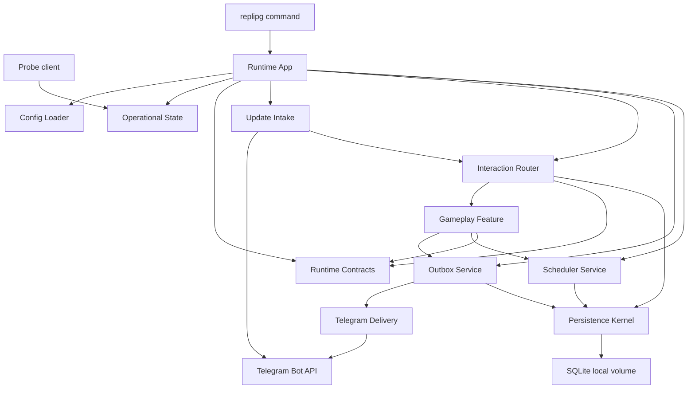
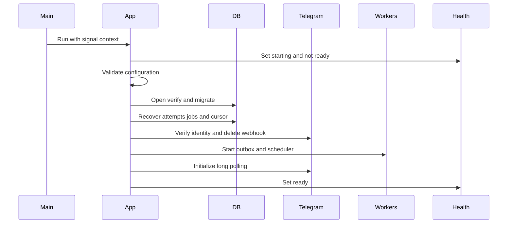
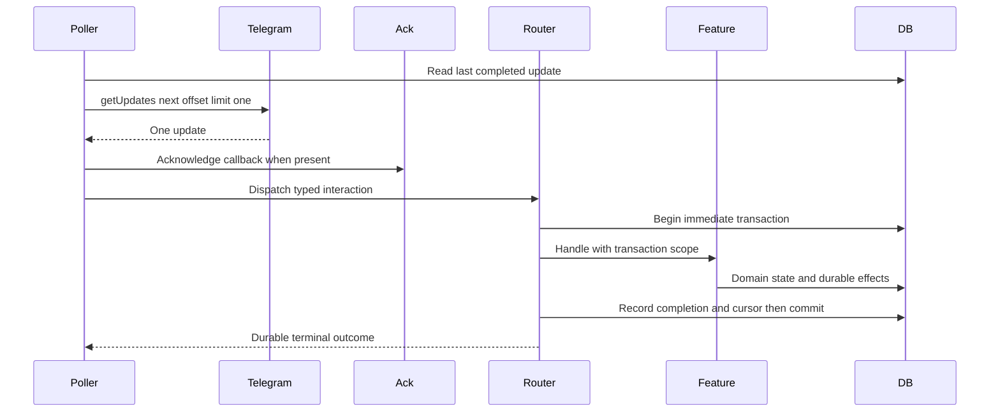
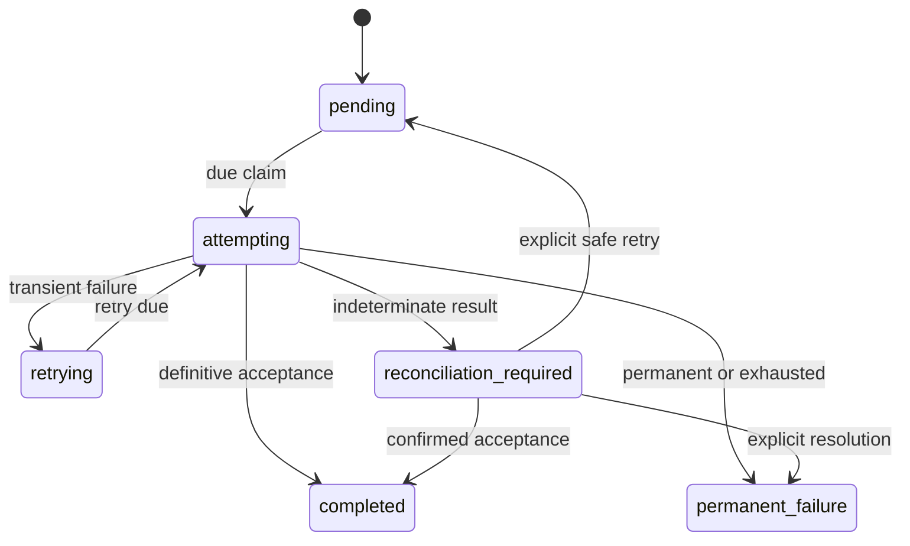
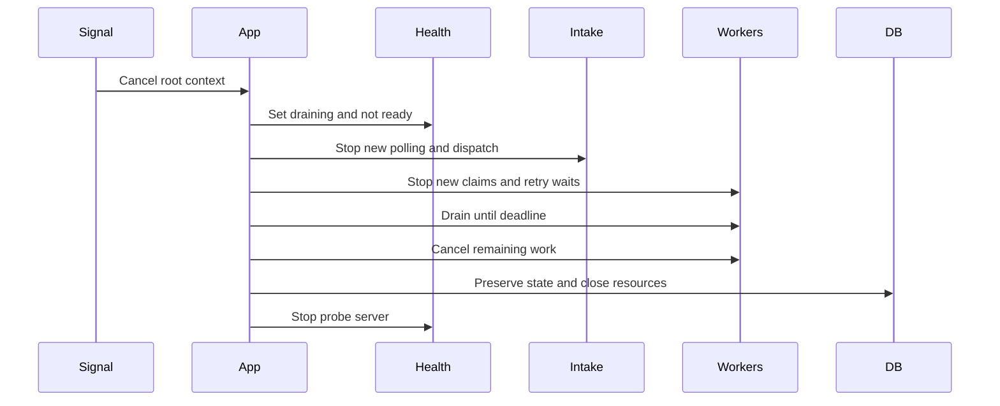
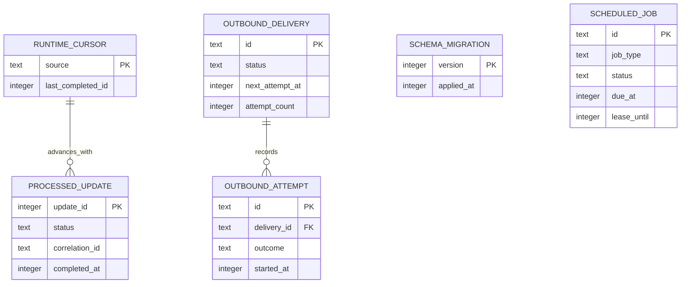
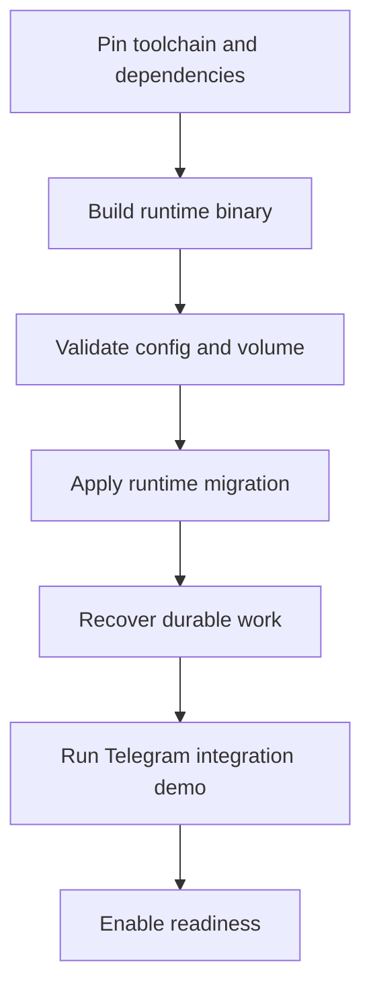

# Telegram Runtime Technical Design

## Overview

This feature establishes the executable and durable runtime foundation for Replipg. It gives gameplay packages transport-neutral interaction routing, atomic SQLite operations, durable scheduling, and recoverable Telegram delivery while keeping Telegram models, SQL lifecycle, and operational concerns outside game domains.

Operators run one long-polling container with a local persistent volume. Startup validates configuration, migrates and recovers state, removes any webhook, starts workers and completion-aware polling, and only then becomes ready. The design replaces the current `Hello World` command and creates the package boundaries consumed by later character, inventory, encounter, and battle specs.

### Goals

- Receive Telegram group commands, callbacks, and ordinary messages without a public inbound endpoint and dispatch transport-neutral events exactly once with respect to durable runtime state.
- Provide public, restricted ephemeral, and callback acknowledgement operations with strict visibility validation.
- Make runtime state, scheduled work, recoverable delivery intent, retry state, and reconciliation state survive restart.
- Expose truthful lifecycle and aggregate work status while keeping secrets and message content out of diagnostics.
- Preserve a thin command entry point and stable package seams for downstream gameplay features.

### Non-Goals

- Character, inventory, encounter, battle, content-administration, activity-scoring, or player-facing command behavior.
- Private-chat fallback, webhook intake, multiple bot replicas, distributed locks, or horizontal coordination.
- PostgreSQL, network-filesystem WAL, an ORM, a general event bus, or an administrative UI.
- Automatic replay of Telegram sends with indeterminate outcomes.
- Guaranteed presentation of an ephemeral message after Telegram accepts it; Telegram defines delivery as best-effort.

## Boundary Commitments

### This Spec Owns

- Environment configuration, redaction, application startup/shutdown, liveness, readiness, aggregate status, and privacy-safe diagnostics.
- Telegram webhook cleanup, completion-aware long polling, transport-to-domain event mapping, callback acknowledgement, and public/ephemeral response delivery.
- Registration and isolated dispatch of transport-neutral command, callback, ordinary-message, scheduled-job, and reconciliation handlers.
- SQLite connection policy, embedded migration execution, transaction creation, runtime-owned tables, contention classification, and persistent-volume placement.
- Durable inbound completion, outbound intent/attempt state, scheduled-job state, retry timing, claim/recovery rules, and reconciliation contracts.
- Stable typed identifiers and service contracts that downstream features consume without importing Telegram or SQLite driver types.
- Acyclic shared runtime contracts for transaction access, response requests, delivery requests, scheduled jobs, and feature work scopes.

### Out of Boundary

- Gameplay packages own the meaning, validation, tables, state transitions, idempotency rules, content, and player-visible wording of their domains.
- This spec does not score ordinary messages, choose encounters, resolve combat, mutate characters, grant inventory, or seed game content.
- Operators own the bot token, supported bot permissions, disabled Privacy Mode or equivalent access where ordinary messages are required, a local persistent directory, and enforcement of one active replica.
- Telegram owns update retention, restricted-message client presentation, Bot API acceptance, and rate limits. The runtime cannot recover updates after Telegram's retention window.
- Indeterminate send resolution requires a registered feature reconciler or explicit operator decision; the runtime does not infer acceptance or blindly retry.

### Allowed Dependencies

- Go 1.26 or newer, pinned through the repository devenv configuration and lock file.
- `github.com/go-telegram/bot` v1.27.0 for Bot API 10.3 models and methods other than the completion-controlled `getUpdates` loop.
- `modernc.org/sqlite` v1.61.0 with its matching `modernc.org/libc` v1.79.0, used through `database/sql` without CGO.
- Standard-library packages including `context`, `database/sql`, `embed`, `errors`, `log/slog`, `net/http`, `os/signal`, and `time`.
- A single local persistent filesystem containing the SQLite database and its `-wal` and `-shm` files. Network filesystems are unsupported.
- Downstream features may depend on exported runtime contracts inside `internal/runtimecontract` and registration interfaces in `internal/interaction`, `internal/outbox`, and `internal/scheduler`; those packages never depend on gameplay packages.

### Revalidation Triggers

- Bot API or `go-telegram/bot` upgrades that change ephemeral parameters, polling offsets, error typing, or request replay behavior.
- Concurrent update dispatch, webhook intake, an inbound retry/dead-letter policy, or a requirement to exceed the sequential poller's measured capacity.
- Multiple replicas, PostgreSQL, a network filesystem, or any change to database/transaction ownership.
- Automatic resend of reconciliation-required deliveries or a new Telegram operation with different idempotency guarantees.
- Changes to the transaction-scoped handler, outbox payload, scheduled-job payload, typed identifier, or migration-registration contracts.
- Downstream features requiring network I/O inside atomic update processing or cross-database transactions.
- New steering files that conflict with the package layout, dependency pins, durability mode, or operational interface in this design.

## Architecture

### Existing Architecture Analysis

- The repository contains only `cmd/replipg/main.go`, which prints `Hello World`; there are no reusable packages, dependencies, tests, migrations, CI scripts, README, or lock file.
- `go.mod` currently declares Go 1.26.9 and the devenv input follows rolling nixpkgs without a lock. Go 1.26.9 satisfies the roadmap's Go 1.26-or-newer constraint; implementation pins the devenv input with a lock file.
- Repository guidance establishes the conventions used here: thin `cmd`, cohesive `internal` packages, explicit context/cancellation, short transactions, typed errors, deterministic tests, and standard-library-first choices.
- Core steering files `product.md`, `tech.md`, and `structure.md` are absent. The roadmap and incremental-delivery workflow are the available architecture baseline.

### Architecture Pattern & Boundary Map

The selected pattern is a layered modular monolith with ports and adapters. Runtime services define small Go interfaces; the Telegram and SQLite packages implement external details; `internal/app` owns composition and lifecycle.



**Dependency direction**: runtime contracts/configuration/diagnostic contracts → persistence implementation → router/outbox/scheduler services → Telegram and health adapters → application composition → command. `internal/runtimecontract` imports only the Go standard library and is the sole owner of cross-service value types and `WorkScope`; it never imports interaction, persistence, outbox, scheduler, adapters, or gameplay. Each later package imports only layers to its left or an interface it owns. Concrete adapters depend inward on the service ports they implement.

**Key decisions**:

- `go-telegram/bot` is adopted for Bot API 10.3 outbound calls and types, but not `Bot.Start`: its internal loop advances the offset before handler completion. `UpdateIntake` owns one narrow raw `getUpdates` call so the next offset is not confirmed until durable completion.
- Exactly one update is in flight. This makes the SQLite cursor a truthful contiguous Telegram acknowledgement boundary and avoids a speculative durable-inbox subsystem.
- Gameplay handlers receive transport-neutral values and a transaction-scoped runtime capability set. Telegram calls are prohibited inside the update transaction; recoverable effects are enqueued atomically.
- SQLite runs in WAL mode with `synchronous=FULL`, foreign keys, immediate write transactions, bounded busy waits, and a small explicit connection cap. Startup verifies the effective settings before readiness.
- Outbound delivery distinguishes definitive success, retryable failure, permanent failure, and indeterminate outcome. Indeterminate work enters reconciliation and is never automatically resent.

### Technology Stack

| Layer | Choice / Version | Role in Feature | Notes |
|-------|------------------|-----------------|-------|
| Runtime | Go 1.26+ | Process, concurrency, HTTP probes, typed contracts | Pinned by devenv and `go.mod` |
| Telegram adapter | `github.com/go-telegram/bot` v1.27.0 | Bot API 10.3 methods, models, typed API errors | Built-in polling is deliberately not used |
| Polling | Stdlib `net/http` and `encoding/json` | Completion-controlled `getUpdates` request/response only | Contract-tested against Bot API fixtures |
| Data | `database/sql`, `modernc.org/sqlite` v1.61.0, `modernc.org/libc` v1.79.0 | No-CGO durable local state and transactions | Bundled SQLite 3.54.1; local WAL only |
| Observability | Stdlib `log/slog` and `net/http` | Structured diagnostics and probe/status endpoints | No message bodies, content, or secrets |
| Migrations | Stdlib `embed` and ordered SQL files | Atomic, versioned startup upgrades | No new migration framework |

## File Structure Plan

### Directory Structure

```text
cmd/replipg/
└── main.go                         # Signal-aware process entry and exit status
internal/
├── runtimecontract/
│   ├── database.go                 # DBTX transaction capability shared without persistence imports
│   ├── responses.go                # Public and ephemeral response requests and delivery outcomes
│   ├── work.go                     # Delivery, job, retry, and WorkScope cross-service contracts
│   └── contracts_test.go           # Value validation and versioning invariants
├── app/
│   ├── runtime.go                  # Runtime App startup, recovery, readiness, and shutdown ordering
│   └── runtime_test.go             # Lifecycle fault injection and resource-order tests
├── config/
│   ├── config.go                   # Config Loader environment parsing, validation, and redacted view
│   └── config_test.go              # Invalid-setting and redaction cases
├── health/
│   ├── state.go                    # Operational State lifecycle and aggregate status snapshot
│   ├── http.go                     # livez, readyz, and statusz HTTP handlers
│   └── http_test.go                # Probe codes, state transitions, and safe response bodies
├── observability/
│   ├── diagnostics.go              # Typed event categories, correlation IDs, and privacy-safe logging
│   └── diagnostics_test.go         # Redaction and minimum-identifier assertions
├── interaction/
│   ├── types.go                    # Command, callback, and message variants using shared runtime identifiers
│   ├── registry.go                 # Feature registration and duplicate-registration validation
│   ├── router.go                   # Interaction Router transactional dispatch and terminal outcomes
│   └── router_test.go              # Routing, rollback, deduplication, and failure-isolation tests
├── telegram/
│   ├── api.go                      # Narrow Bot API ports and pinned-library construction
│   ├── poller.go                   # Update Intake raw getUpdates loop and durable cursor handshake
│   ├── mapper.go                   # Telegram model to interaction value mapping
│   ├── delivery.go                 # Telegram Delivery public, ephemeral, and callback operations
│   ├── errors.go                   # Bot API and transport outcome classification
│   ├── poller_test.go              # Offset, webhook, cancellation, and malformed-update tests
│   └── delivery_test.go            # Payload visibility, validation, rate-limit, and outcome tests
├── persistence/
│   ├── db.go                       # Persistence Kernel SQLite open, verified pragmas, pool, and close
│   ├── tx.go                       # Implements runtimecontract.Transactor with short transactions
│   ├── migrate.go                  # Embedded ordered migration runner and version compatibility
│   ├── errors.go                   # Typed busy, locked, migration, and compatibility errors
│   ├── persistence_test.go         # Real-SQLite transaction, contention, WAL, and migration tests
│   └── migrations/
│       └── 0001_runtime.sql        # Runtime cursor, update, outbox, attempt, and job tables
├── outbox/
│   ├── types.go                    # Delivery requests, states, outcomes, retry, and reconciliation types
│   ├── store.go                    # Transaction-scoped Outbox Service persistence
│   ├── service.go                  # Enqueue, inspect, and explicit resolution contracts
│   ├── worker.go                   # Due delivery claim, send, retry, and restart reconciliation loop
│   └── outbox_test.go              # State machine, restart, retry-after, and cancellation tests
├── scheduler/
│   ├── types.go                    # Job request, state, payload, retry, and handler contracts
│   ├── store.go                    # Transaction-scoped Scheduler Service persistence and claims
│   ├── service.go                  # Schedule, cancel, inspect, and registration contracts
│   ├── worker.go                   # Due execution, lease recovery, retry, and completion loop
│   └── scheduler_test.go           # Timing, claim uniqueness, cancellation, and recovery tests
└── testsupport/
    ├── clock.go                    # Deterministic clock and timer implementation
    └── telegram.go                 # Fake Bot API server and request recorder
.env.example                        # Non-secret runtime configuration names and examples
README.md                           # Build, configure, run, probe, migrate, and test-group demo guide
```

### Modified and Generated Files

- `cmd/replipg/main.go` — replace `Hello World` with thin configuration, signal, runtime, and exit-status composition.
- `go.mod` — set the supported Go patch level and add exact direct Telegram/SQLite dependencies.
- `go.sum` — generated by Go tooling from the pinned dependency graph; never hand-edited.
- `devenv.nix` — require the supported Go toolchain while retaining `gopls` and `golangci-lint`.
- `devenv.yaml` — keep the input declaration compatible with the generated lock.
- `devenv.lock` — generated by `devenv update`; never hand-edited.

Each component in this design maps to the named file group above. Downstream gameplay files are intentionally absent from this plan.

## System Flows

### Startup and Readiness



Any failed step cancels already-started resources in reverse order, leaves readiness false, emits a redacted categorized diagnostic, and returns a non-success process result. `deleteWebhook` always preserves pending updates.

### Update Completion



Unsupported updates commit an `ignored` outcome. Handler errors roll back all feature changes, then a separate short transaction records `failed` and advances the cursor so intake continues. A crash before a terminal commit leaves the old cursor and causes Telegram to redeliver; a duplicate at or below the cursor is skipped without feature execution.

### Recoverable Delivery State



The worker writes `attempting` before network I/O. On restart, every leftover `attempting` record becomes `reconciliation_required`, never `pending`. Telegram `retry_after` is a lower bound for the next attempt, and cancellation preserves the current durable state.

### Shutdown



## Requirements Traceability

| Requirement | Summary | Components | Interfaces | Flows |
|-------------|---------|------------|------------|-------|
| 1.1 | Validate all configuration before work | Config Loader, Runtime App | `Load`, `Validate` | Startup |
| 1.2 | Fail with redacted setting diagnostic | Config Loader, Diagnostics | `ConfigError`, `Diagnostic` | Startup |
| 1.3 | Prepare, migrate, clean webhook, then poll and ready | Runtime App, Persistence Kernel, Update Intake, Operational State | `Run`, `Migrate`, `Initialize` | Startup |
| 1.4 | Startup dependency failure remains not ready | Runtime App, Operational State | lifecycle state | Startup |
| 1.5 | No inbound public endpoint | Update Intake | `getUpdates` port | Startup, Update Completion |
| 1.6 | One active instance and unsupported coordination reported | Runtime App, Operational State | status snapshot | Startup |
| 2.1 | Receive commands, callbacks, and group messages | Update Intake, Interaction Router | interaction variants | Update Completion |
| 2.2 | Include update, chat, user, and interaction identity | Interaction Router | `Event` types | Update Completion |
| 2.3 | Acknowledge callback independently | Telegram Delivery, Update Intake | `AcknowledgeCallback` | Update Completion |
| 2.4 | Ignore unsupported updates without stopping | Interaction Router | terminal `Ignored` outcome | Update Completion |
| 2.5 | Isolate handler failure and continue with correlation | Interaction Router, Diagnostics | `DispatchOutcome`, `Diagnostic` | Update Completion |
| 2.6 | Suppress completed duplicate updates | Persistence Kernel, Interaction Router | update cursor and records | Update Completion |
| 2.7 | Resume from durable completion cursor | Update Intake, Persistence Kernel | `CompletedCursor` | Update Completion |
| 3.1 | Send public group response | Telegram Delivery | `SendPublic` | Delivery call |
| 3.2 | Send restricted user response in group | Telegram Delivery | `SendEphemeral` | Delivery call |
| 3.3 | Never fall back to public visibility | Telegram Delivery | typed validation and failure | Delivery call |
| 3.4 | Acknowledge without visible message | Telegram Delivery | `AcknowledgeCallback` | Update Completion |
| 3.5 | Reject invalid destination, target, or content | Telegram Delivery | `ValidationError` | Delivery call |
| 3.6 | Never start private-chat fallback | Telegram Delivery | destination invariant | Delivery call |
| 4.1 | Persist intent before first attempt | Outbox Service, Persistence Kernel | `Enqueue` | Delivery State |
| 4.2 | Complete only after definitive acceptance | Outbox Service, Telegram Delivery | `DeliveryOutcome` | Delivery State |
| 4.3 | Retain and bound transient retries | Outbox Service | `RetryPolicy` | Delivery State |
| 4.4 | Honor Telegram retry delay | Outbox Service | `RetryAfter` | Delivery State |
| 4.5 | Retain permanent failure reason | Outbox Service, Operational State | state/status contract | Delivery State |
| 4.6 | Quarantine indeterminate attempts | Outbox Service | `ReconciliationRequired` | Delivery State |
| 4.7 | Recover retry and reconciliation work | Runtime App, Outbox Service | `Recover` | Startup, Delivery State |
| 4.8 | Cancel waits and preserve incomplete intent | Outbox Service, Runtime App | worker lifecycle | Shutdown |
| 5.1 | Persist state across restart | Persistence Kernel | `DBTX` | Startup |
| 5.2 | Commit all atomic changes together | Persistence Kernel | `Transactor` | Update Completion |
| 5.3 | Roll back failed atomic changes | Persistence Kernel | `Transactor` | Update Completion |
| 5.4 | Bound unavailable or contended waits | Persistence Kernel | `ContentionError` | Database operation |
| 5.5 | Record successful migration once | Persistence Kernel | migration ledger | Startup |
| 5.6 | Failed migration blocks readiness | Persistence Kernel, Runtime App | `MigrationError` | Startup |
| 5.7 | Keep database and recovery files together | Config Loader, Persistence Kernel | storage-path invariant | Startup |
| 6.1 | Persist job identity, due time, state, and payload | Scheduler Service | `Schedule` | Job lifecycle |
| 6.2 | Never execute before due time | Scheduler Service | clock and claim contract | Job lifecycle |
| 6.3 | Permit one concurrent claim | Scheduler Service, Persistence Kernel | atomic `ClaimDue` | Job lifecycle |
| 6.4 | Recover overdue incomplete jobs | Scheduler Service, Runtime App | `Recover` | Startup |
| 6.5 | Complete durably and do not repeat | Scheduler Service | terminal completion | Job lifecycle |
| 6.6 | Persist cancellation and prevent execution | Scheduler Service | `Cancel` | Job lifecycle |
| 6.7 | Retry retryable job outcome | Scheduler Service | `JobOutcome`, `RetryPolicy` | Job lifecycle |
| 6.8 | Retain permanent job failure | Scheduler Service, Operational State | state/status contract | Job lifecycle |
| 7.1 | Stop admission and become not ready | Runtime App, Operational State, Update Intake | lifecycle state | Shutdown |
| 7.2 | Drain only to configured deadline | Runtime App | shutdown deadline | Shutdown |
| 7.3 | Cancel remaining work and preserve durable state | Runtime App, Outbox Service, Scheduler Service | worker lifecycle | Shutdown |
| 7.4 | Release intake, storage, timers, and resources | Runtime App | reverse close order | Shutdown |
| 7.5 | Recover durable work before readiness | Runtime App, Outbox Service, Scheduler Service | `Recover` | Startup |
| 7.6 | Recover unknown send as reconciliation required | Outbox Service | startup state transition | Startup, Delivery State |
| 8.1 | Report live while process can operate | Operational State | `/livez` | Health request |
| 8.2 | Report not ready during unsafe states | Operational State, Runtime App | `/readyz` | Startup, Shutdown |
| 8.3 | Report ready only after intake can process | Operational State, Runtime App | readiness state | Startup |
| 8.4 | Diagnose state/failure with category and correlation | Diagnostics, all services | `Diagnostic` | All flows |
| 8.5 | Distinguish durable-work states | Operational State, Outbox Service, Scheduler Service | `/statusz` aggregate counts | Status request |
| 8.6 | Exclude secrets and content from outputs | Config Loader, Diagnostics, Operational State | redacted views | All flows |
| 8.7 | Minimize Telegram identifiers in diagnostics | Diagnostics | field allowlist | All flows |
| 9.1 | Provide runtime capabilities without game rules | All runtime services | public ports | All flows |
| 9.2 | Preserve opaque feature results | Interaction Router, Outbox Service, Scheduler Service | typed opaque payloads | Update and job flows |
| 9.3 | Define routing but no game commands | Interaction Router | registration contracts | Update Completion |
| 9.4 | Exclude multi-instance coordination | Runtime App, Operational State | deployment-mode status | Startup |
| 9.5 | Expose ordinary messages without scoring | Update Intake, Interaction Router | `GroupMessage` | Update Completion |

## Components and Interfaces

| Component | Domain / Layer | Intent | Requirement Coverage | Key Dependencies | Contracts |
|-----------|----------------|--------|----------------------|------------------|-----------|
| Runtime Contracts | Foundation | Own acyclic values and ports shared by features and runtime services | 3.1–3.6, 4.1, 6.1, 9.1, 9.2 | standard library P0 | Service |
| Config Loader | Foundation | Produce a validated, redacted runtime configuration | 1.1, 1.2, 1.6, 5.7, 7.2, 8.6 | environment P0 | Service |
| Diagnostics | Foundation | Emit categorized correlation-safe structured events | 2.5, 8.4, 8.6, 8.7 | `slog` P1 | Service |
| Persistence Kernel | Data | Own SQLite lifecycle, migrations, transactions, cursor, and runtime tables | 1.3, 1.4, 2.6, 2.7, 5.1–5.7 | SQLite P0 | Service, State |
| Interaction Router | Runtime service | Register and transactionally dispatch transport-neutral interactions | 2.1–2.7, 9.1–9.3, 9.5 | Persistence Kernel P0 | Service, State |
| Update Intake | Telegram adapter | Preserve webhook backlog and poll one update through durable completion | 1.3–1.5, 2.1, 2.3, 2.7, 7.1, 7.4 | Telegram API P0, Interaction Router P0 | Service, Batch |
| Telegram Delivery | Telegram adapter | Validate and perform callback, public, and ephemeral calls | 2.3, 3.1–3.6, 4.2–4.6 | Telegram API P0 | Service |
| Outbox Service | Runtime service | Persist and advance recoverable delivery state | 4.1–4.8, 7.3, 7.5, 7.6, 8.5, 9.1, 9.2 | Persistence Kernel P0, Telegram Delivery P0 | Service, Batch, State |
| Scheduler Service | Runtime service | Persist, claim, execute, retry, cancel, and recover jobs | 6.1–6.8, 7.3, 7.5, 8.5, 9.1, 9.2 | Persistence Kernel P0 | Service, Batch, State |
| Operational State | Operations adapter | Expose lifecycle and aggregate work status | 1.4, 1.6, 4.5, 6.8, 7.1, 8.1–8.6, 9.4 | Runtime App P0 | API, State |
| Runtime App | Composition | Enforce startup, recovery, readiness, and shutdown order | 1.1–1.6, 4.7, 4.8, 7.1–7.6, 8.1–8.4 | all components P0 | Service, State |

### Foundation

#### Runtime Contracts

**Responsibilities & Constraints**

- Owns transport-neutral database execution, work-scope, response, delivery, scheduled-job, retry, identifier, and versioned-payload contracts shared across service boundaries.
- Imports only standard-library packages. It contains no repository, worker, Telegram, routing, or gameplay behavior.
- Keeps validation methods pure so the router, outbox, scheduler, and Telegram adapter can enforce the same shape without importing one another.

**Dependencies**

- Inbound: gameplay handlers, Interaction Router, Persistence Kernel, Outbox Service, Scheduler Service, and Telegram Delivery — consume or implement contracts (P0).
- Outbound: Go standard library only (P0).

```go
type DBTX interface {
    ExecContext(ctx context.Context, query string, args ...any) (sql.Result, error)
    QueryContext(ctx context.Context, query string, args ...any) (*sql.Rows, error)
    QueryRowContext(ctx context.Context, query string, args ...any) *sql.Row
}

type WorkScope interface {
    DBTX() DBTX
    EnqueueDelivery(ctx context.Context, req DeliveryRequest) (DeliveryID, error)
    Schedule(ctx context.Context, req JobRequest) (JobID, error)
}
```

- **Invariant**: No contract type exposes Telegram library or SQLite driver values, and no contract creates an import edge back to a service implementation.

#### Config Loader

**Responsibilities & Constraints**

- Parses required bot token, storage directory, health address, Telegram timeout, busy timeout, handler timeout, retry bounds, claim lease, and shutdown deadline.
- Validates absolute/clean storage placement, an explicit local-filesystem operator assertion, positive bounded durations, and single-instance deployment mode before any network or database activity. The runtime cannot reliably identify every network-mounted path and documents that residual operator responsibility.
- Returns a separate redacted view; the token has no string formatting path that reveals its value.

**Dependencies**

- Inbound: Runtime App — requests validated configuration (P0).
- Outbound: process environment — supplies operator settings (P0).

```go
type Loader interface {
    Load() (Config, error)
}

type ConfigError struct {
    Setting string
    Reason  string
}
```

- **Precondition**: Environment access is read-only.
- **Postcondition**: A returned `Config` is internally valid; an error names a setting but never its sensitive value.
- **Invariant**: Configuration never enables multiple replicas or a network WAL path.

#### Diagnostics

**Responsibilities & Constraints**

- Creates a random correlation ID at each accepted update, job execution, delivery attempt, and startup operation.
- Emits only allowlisted structured fields: category, correlation ID, operation, outcome, duration, retry time, state, and the minimum needed numeric identifiers.
- Rejects token, message text, private response content, feature payloads, and raw API request/response bodies as fields.

**Dependencies**

- Inbound: all runtime components — publish safe events (P1).
- External: stdlib `log/slog` — structured output (P1).

```go
type DiagnosticSink interface {
    Emit(ctx context.Context, event Diagnostic)
}

type Diagnostic struct {
    Category      EventCategory
    CorrelationID CorrelationID
    Operation     string
    Outcome       string
    Fields        SafeFields
}
```

### Data

#### Persistence Kernel

**Responsibilities & Constraints**

- Opens only the configured SQLite file, verifies the directory and effective WAL/foreign-key/synchronous settings, and controls the connection pool.
- Applies embedded migrations before consumers start, rejects a schema newer than the binary, and maps SQLite result codes without string comparison.
- Supplies short context-bound transactions. Callers never mix `*sql.DB` operations into an active transaction and never retain `Rows` beyond their scope.

**Dependencies**

- Inbound: Interaction Router, Outbox Service, Scheduler Service, Runtime App — state and transaction consumers (P0).
- External: `database/sql` and `modernc.org/sqlite` — local persistence (P0).

```go
// Persistence implements runtimecontract.Transactor; the interface is declared once
// in internal/runtimecontract/database.go.

type CursorStore interface {
    CompletedUpdate(ctx context.Context) (runtimecontract.UpdateID, error)
    RecordTerminal(ctx context.Context, tx runtimecontract.DBTX, outcome UpdateOutcome) error
}
```

- **Precondition**: The path is local and the migration set is ordered and immutable.
- **Postcondition**: A successful callback and its commit are visible atomically; callback or commit failure returns no success claim.
- **Invariants**: One monotonic completed cursor; WAL sidecars share the database directory; busy/locked exhaustion returns a typed contention error.

**State Management**

- SQLite is authoritative. WAL uses `synchronous=FULL`; writes begin immediate and use both a configured busy timeout and a request context.
- Runtime migrations register explicitly with application composition; packages do not mutate a global migration registry in `init`.

### Interaction Runtime

#### Interaction Router

**Responsibilities & Constraints**

- Registers one owner per command, callback prefix, or ordinary-message subscription; ambiguous duplicate registrations fail startup. Scheduler owns job-type registration and Outbox owns reconciliation-kind registration.
- Dispatches only group/supergroup interaction variants with typed update, chat, user, callback, and ephemeral identifiers.
- Executes the feature handler, domain writes, durable effects, processed record, and cursor update in one transaction. Telegram/network operations are unavailable from the transaction scope.
- Returns validated nonrecoverable response requests only after the transaction commits; recoverable responses are inserted through the outbox in that transaction. Immediate response failure is operator-visible but cannot roll back an already committed domain result.

**Dependencies**

- Inbound: Update Intake — supplies validated events; gameplay features — register handlers (P0).
- Outbound: Persistence Kernel — owns atomic dispatch transaction (P0); Outbox and Scheduler stores — record durable effects (P1).

```go
type Event interface {
    UpdateID() runtimecontract.UpdateID
    ChatID() runtimecontract.ChatID
    UserID() runtimecontract.UserID
    eventKind() EventKind
}

type Handler interface {
    Handle(ctx context.Context, scope runtimecontract.WorkScope, event Event) (HandlerResult, error)
}

type HandlerResult struct {
    ImmediateResponses []runtimecontract.ResponseRequest
}

type Router interface {
    RegisterCommand(name CommandName, handler Handler) error
    RegisterCallback(prefix CallbackPrefix, handler Handler) error
    RegisterGroupMessages(handler Handler) error
    Dispatch(ctx context.Context, event Event) (DispatchOutcome, error)
}
```

- **Precondition**: Registrations finish before readiness and events have passed transport validation.
- **Postcondition**: `Completed`, `Ignored`, or `Failed` means the outcome and cursor are durable; retryable persistence failure means the cursor did not advance. Immediate responses are returned only from `Completed`.
- **Invariants**: At most one handler owns a route; duplicate completed updates never call a handler; handler failure leaves no domain/outbox/job partial changes.

### Telegram Adapters

#### Update Intake

**Responsibilities & Constraints**

- Calls `deleteWebhook` with pending-update preservation before polling and treats failure as startup failure.
- Uses the durable cursor plus one as `getUpdates.offset`, `limit=1`, an explicit timeout, and allowed update types for messages and callbacks.
- Does not issue the next poll until dispatch returns a durable terminal outcome. It stops new calls on shutdown and treats Telegram conflict as evidence of unsupported competing intake.

**Dependencies**

- Inbound: Runtime App — controls lifecycle (P0).
- Outbound: Interaction Router — produces durable terminal outcomes (P0); Persistence Kernel — supplies cursor (P0).
- External: Telegram Bot API `deleteWebhook` and `getUpdates` — update source (P0).

```go
type PollingAPI interface {
    DeleteWebhook(ctx context.Context, dropPending bool) error
    GetUpdates(ctx context.Context, request GetUpdatesRequest) ([]RawUpdate, error)
}

type Intake interface {
    Initialize(ctx context.Context) error
    Run(ctx context.Context) error
    StopAccepting()
}
```

**Batch Contract**

- **Trigger**: Runtime startup after database recovery and webhook deletion.
- **Input / validation**: Bot API JSON envelope; decode the update ID before the typed payload so a malformed known-ID update can reach a terminal diagnostic state.
- **Output**: One validated `interaction.Event` or one terminal unsupported/decode outcome.
- **Idempotency & recovery**: The database cursor is authoritative. Missing-ID malformed responses back off and keep readiness false because safe advancement is impossible.

#### Telegram Delivery

**Responsibilities & Constraints**

- Maps domain-neutral text, entities, inline buttons, chat/user IDs, and ephemeral authorization to pinned library parameters.
- Treats callback acknowledgement as a separate operation and attempts it before feature dispatch.
- Validates content length/shape, group destination, target user, authorization evidence, expiry, and ephemeral replacement rules. It never changes the requested visibility.

**Dependencies**

- Inbound: Update Intake — callback acknowledgements and post-commit immediate responses; Outbox Service — recoverable attempts (P0).
- External: `go-telegram/bot` and Telegram Bot API 10.3 — delivery operations (P0).

```go
type Sender interface {
    SendPublic(ctx context.Context, req PublicResponse) (DeliveryReceipt, error)
    SendEphemeral(ctx context.Context, req EphemeralResponse) (DeliveryReceipt, error)
    AcknowledgeCallback(ctx context.Context, req CallbackAcknowledgement) error
}

type EphemeralAuthorization interface {
    authorizationKind() EphemeralAuthorizationKind
}

type DeliveryOutcome struct {
    Kind       DeliveryOutcomeKind
    Receipt    *DeliveryReceipt
    RetryAfter time.Duration
    ReasonCode string
}
```

`Sender` is implemented by `internal/telegram/delivery.go`; its request, receipt, authorization, and outcome values are owned by `internal/runtimecontract`. A feature either returns an immediate response in `HandlerResult` or calls `WorkScope.EnqueueDelivery` for durable recovery; it never imports the Telegram adapter.

After a completed dispatch, Update Intake sends immediate responses sequentially before requesting the next update. Every response gets an independent result diagnostic under the update correlation ID; one failure does not change visibility, retry another immediate response, roll back committed domain state, or suppress later responses.

- **Precondition**: Public destinations are groups/supergroups. Ephemeral requests include a non-bot receiver and callback, incoming-ephemeral, or administrator authorization.
- **Postcondition**: Success means Telegram returned a successful Bot API response; it does not claim client presentation. Ephemeral receipts use `ephemeral_message_id` when present.
- **Invariants**: No public or private fallback; no content in errors/logs; rate-limit delay is preserved; transport uncertainty maps to `Indeterminate` when transmission may have occurred.

### Durable Work

#### Outbox Service

**Responsibilities & Constraints**

- Persists an opaque validated delivery request and retry policy in the caller's transaction before confirming enqueue.
- Claims due work with a lease, records an attempt before calling Telegram, and persists the typed outcome afterward without holding a SQL transaction over network I/O.
- On startup moves abandoned `attempting` records to reconciliation and resumes due `pending`/`retrying` records. Resolution is explicit and audited.

**Dependencies**

- Inbound: transactional feature handlers and Runtime App recovery/lifecycle (P0).
- Outbound: Persistence Kernel — authoritative state (P0); Telegram Delivery — external attempt (P0); registered Reconciler — optional explicit resolution (P1).

```go
type Service interface {
    RegisterReconciler(kind runtimecontract.DeliveryKind, version uint16, reconciler Reconciler) error
    Enqueue(ctx context.Context, tx runtimecontract.DBTX, req runtimecontract.DeliveryRequest) (runtimecontract.DeliveryID, error)
    Status(ctx context.Context, id DeliveryID) (DeliveryStatus, error)
    Resolve(ctx context.Context, id DeliveryID, resolution ReconciliationResolution) error
}

type Reconciler interface {
    Reconcile(ctx context.Context, delivery Delivery) (ReconciliationResolution, error)
}

type RetryPolicy struct {
    MaxAttempts int
    InitialDelay time.Duration
    MaxDelay time.Duration
}
```

The Outbox Service owns the reconciler registry. Registrations are keyed by delivery kind and payload version, finish before readiness, and reject duplicates. Reconciliation-required work with a matching registration is offered to that reconciler with a bounded context; work without one remains operator-visible until an explicit resolution is supplied.

**Batch Contract**

- **Trigger**: Next due time or startup recovery.
- **Input / validation**: Persisted versioned request, state, attempt count, and retry bounds.
- **Output / destination**: Telegram Delivery outcome and updated outbox/attempt records.
- **Idempotency & recovery**: Completed/permanent records are never claimed. Indeterminate/abandoned attempts require reconciliation; `Retry` resolution is allowed only as an explicit safe decision.

**State Management**

- Authoritative states are `pending`, `attempting`, `retrying`, `reconciliation_required`, `completed`, and `permanent_failure`.
- `next_attempt_at` is never earlier than Telegram's `retry_after`; exhausted retries become permanent failure. Cancellation interrupts waits and leaves the durable record recoverable.

#### Scheduler Service

**Responsibilities & Constraints**

- Stores a feature-owned job type, stable identity, schema version, opaque payload, due time, retry policy, state, and claim lease before returning success.
- Executes only registered handlers after due time. The default worker permits one active claim; the SQL claim also prevents concurrent ownership inside the process.
- Recovers expired claims and overdue jobs on startup. Completion, cancellation, retry, and permanent failure are durable terminal/transition facts.

**Dependencies**

- Inbound: transactional feature handlers register and schedule work; Runtime App controls recovery/lifecycle (P0).
- Outbound: Persistence Kernel — claims and state transitions (P0); registered Job Handler — feature execution (P0); injected clock — deterministic eligibility (P1).

```go
type Service interface {
    Register(jobType JobType, handler JobHandler) error
    Schedule(ctx context.Context, tx runtimecontract.DBTX, req runtimecontract.JobRequest) (runtimecontract.JobID, error)
    Cancel(ctx context.Context, id JobID) error
    Status(ctx context.Context, id JobID) (JobStatus, error)
}

type JobHandler interface {
    Execute(ctx context.Context, scope runtimecontract.WorkScope, job Job) JobOutcome
}

type JobOutcome struct {
    Kind       JobOutcomeKind
    RetryAfter time.Duration
    ReasonCode string
}
```

**Batch Contract**

- **Trigger**: Earliest due/next-attempt time or startup recovery.
- **Input / validation**: Registered type, supported payload schema, due time, identity, and retry bounds.
- **Output / destination**: Domain transaction plus one durable job transition.
- **Idempotency & recovery**: Stable job IDs reject conflicting duplicate schedules; expired claims return to eligible state; completed/cancelled/permanent records never execute.

A `Completed` outcome commits feature changes and job completion together. Retryable, permanent, cancelled, error, or panic outcomes roll back feature changes before the scheduler records the corresponding job transition in a separate short transaction.

**State Management**

- Authoritative states are `pending`, `claimed`, `retrying`, `completed`, `cancelled`, and `permanent_failure`.
- The injected clock determines eligibility and retry times. Claimed work has a lease and correlation ID; payloads never appear in status or diagnostics.

### Operations and Composition

#### Operational State

**Responsibilities & Constraints**

- Maintains an atomic lifecycle state: `starting`, `recovering`, `ready`, `draining`, or `stopped`, plus dependency health and aggregate durable-work counts.
- Serves `GET /livez`, `GET /readyz`, and `GET /statusz`. Liveness returns success while the process can continue; readiness returns success only in `ready` with required dependencies available.
- Reports `deployment_mode=single_instance` and `multi_instance_supported=false` without attempting distributed enforcement.

**Dependencies**

- Inbound: Runtime App and durable workers — publish lifecycle/dependency/count snapshots (P0); probe clients — read endpoints (P1).
- External: stdlib `net/http` — probe server (P1).

| Endpoint | Success | Failure | Body constraints |
|----------|---------|---------|------------------|
| `GET /livez` | 200 while process can operate | 503 when terminal | lifecycle only |
| `GET /readyz` | 200 only when accepting work | 503 otherwise | state and safe reason code |
| `GET /statusz` | 200 while live | 503 when terminal | aggregate counts by work state and deployment mode |

No endpoint includes tokens, paths containing secrets, message/private content, opaque payloads, raw errors, or Telegram IDs.

#### Runtime App

**Responsibilities & Constraints**

- Owns every goroutine, worker cancellation function, wait group, timer, server, and close action.
- Runs the fixed startup order shown above and unwinds partial startup in reverse acquisition order.
- On signal, marks not-ready before closing admission, drains to the configured deadline, cancels remaining work, waits for owned goroutines, and closes resources once.
- Treats unexpected exit of intake or another required worker as a readiness failure and initiates coordinated shutdown; individual durable-work failures remain record-level outcomes.

Telegram initialization constructs the pinned client, performs its bounded identity check, deletes the webhook without dropping updates, loads the durable cursor, and starts an owned poll loop that signals it has entered the polling state before readiness becomes true. A later temporary poll failure is retried without changing the cursor. Repeated responses that cannot expose any update ID are unsafe to acknowledge; after the configured bounded attempts they terminate intake, make readiness false, and trigger coordinated shutdown.

**Dependencies**

- Inbound: command process and signal context — start and stop ownership (P0).
- Outbound: Config Loader, Operational State, Persistence Kernel, Update Intake, Outbox Service, Scheduler Service, and Diagnostics — composed runtime (P0).

```go
type Runtime interface {
    Run(ctx context.Context) error
}

type LifecycleState interface {
    SetStarting()
    SetRecovering()
    SetReady()
    SetDraining(reason SafeReason)
    SetStopped()
}
```

- **Precondition**: Configuration is validated and all registrations are complete.
- **Postcondition**: A nil return follows graceful release; startup/runtime failure returns a wrapped actionable error suitable for a non-success exit.
- **Invariants**: Readiness is false before intake initialization and throughout shutdown; durable recovery finishes before readiness; goroutines have one owner and bounded termination.

## Data Models

### Domain Model

Runtime-owned aggregates are intentionally separate:

- **Inbound completion**: monotonic source cursor plus one immutable outcome per handled update. Domain state and successful completion share a transaction.
- **Outbound delivery**: intent is the aggregate root; attempts are append-only children; reconciliation is an explicit state transition.
- **Scheduled job**: job is the aggregate root with due/retry/claim state; execution changes the job and feature state atomically where possible.
- **Schema migration**: migration version is immutable after successful application.



### Logical and Physical Data Model

| Table | Authoritative fields | Constraints and indexes |
|-------|----------------------|-------------------------|
| `schema_migrations` | `version INTEGER`, `applied_at INTEGER` | primary key on version; versions never mutate |
| `runtime_cursors` | `source TEXT`, `last_completed_id INTEGER`, `updated_at INTEGER` | primary key on source; monotonic update enforced by repository |
| `processed_updates` | `update_id INTEGER`, `status TEXT`, `correlation_id TEXT`, `failure_code TEXT`, `completed_at INTEGER` | primary key; checked status; no message body or payload |
| `outbound_deliveries` | ID, kind, versioned content blob, destination IDs, ephemeral authorization, status, retry policy, attempts, next time, reason, timestamps | checked state; due-state composite index; content never queried by status endpoint |
| `outbound_attempts` | ID, delivery ID, correlation ID, start/finish time, outcome, safe reason | foreign key to delivery; index by delivery; no raw response body |
| `scheduled_jobs` | ID, job type, payload version/blob, due time, state, retry policy, attempts, lease owner/time, reason, timestamps | checked state; due-state composite index; stable ID uniqueness |

All instants use UTC Unix milliseconds in SQLite and typed `time.Time` at Go boundaries. Telegram update/chat/user IDs use signed 64-bit integers; runtime delivery/job/correlation IDs are random, opaque text identifiers generated with `crypto/rand`. Opaque content and payload schemas carry an integer version so downstream readers can reject unsupported versions safely.

**Consistency & Integrity**

- Foreign keys are enabled on every connection. Runtime tables are changed only through their owning repositories.
- Cursor advancement and a successful update's domain/outbox/job changes share one transaction. A failed handler's failure record uses a new transaction only after rollback.
- Delivery claims and job claims are conditional state updates. Network delivery occurs after the attempt commit and before the outcome commit.
- Migration files are append-only. Each migration and its ledger insert share a transaction; startup performs an integrity/foreign-key check when a migration rebuilds tables.

## Error Handling

### Error Strategy

- Configuration, schema incompatibility, migration, webhook deletion, initial polling, and recovery errors fail startup and keep readiness false.
- Expected validation and state-conflict errors are typed and returned without panic. Errors wrap causes with `%w`; callers inspect with `errors.Is`/`errors.As`.
- SQLite busy/locked exhaustion is distinguishable from cancellation and other storage failure.
- Telegram failures map to validation, authentication/authorization, conflict, rate limit, transient, permanent, cancellation, or indeterminate outcome. Only retryable outcomes enter the retry schedule.
- Handler panics are recovered at the router/job boundary, converted to a safe failed outcome, and diagnosed; process-corrupting conditions are not hidden.

### Failure Responses

| Category | Runtime response |
|----------|------------------|
| Invalid feature request | Reject before I/O with a field/reason code that contains no content |
| Unauthorized or forbidden Telegram request | Permanent failure; retain safe API category |
| Telegram conflict during polling | Mark dependency not ready and terminate intake because another receiver may exist |
| Telegram 429 | Retry no earlier than `retry_after`, subject to maximum attempts |
| Pre-transmission/transient server failure | Bounded cancellation-aware retry with capped backoff |
| Possibly transmitted request without response | Reconciliation required; no automatic resend |
| SQLite busy/locked beyond bound | Typed contention error; current transaction rolls back |
| Handler error or panic | Roll back feature changes, record terminal failed update/job state, continue according to that work type's contract |
| Shutdown cancellation | Stop waits promptly; preserve or recover durable state on next startup |

### Monitoring

Diagnostics use categories `startup`, `intake`, `dispatch`, `callback_ack`, `delivery`, `reconciliation`, `scheduler`, `storage`, `health`, and `shutdown`. Each operation carries a correlation ID and safe outcome. Aggregate status distinguishes pending, attempting/claimed, retrying, reconciliation-required, completed, cancelled, and permanently failed where applicable. No baseline external telemetry dependency is introduced.

## Testing Strategy

### Unit Tests

- `config`: reject each missing/invalid setting, duration, non-local storage policy, and unsupported deployment mode; prove the bot token and sensitive values never appear in errors or redacted output (1.1, 1.2, 1.6, 5.7, 8.6).
- `interaction`: table-test command/callback/message mapping, duplicate registration, unsupported updates, handler failure/panic isolation, correlation creation, and completed duplicate suppression (2.1–2.6, 9.2, 9.3, 9.5).
- `telegram`: validate exact public versus `ephemeral_message_parameters` payloads, authorization/15-second rules, zero ordinary ID handling, callback acknowledgement, no visibility/private fallback, and typed error classification (2.3, 3.1–3.6, 4.2–4.6).
- `outbox`: exercise every allowed/forbidden state transition, retry limit, `retry_after` floor, explicit reconciliation decisions, completed non-redelivery, and cancellation-aware waits with a fake clock (4.1–4.8, 7.6).
- `scheduler`: exercise due-time gating, stable-ID conflicts, cancellation, retry/permanent outcomes, lease expiry, and completed non-execution with a fake clock (6.1–6.8).

### SQLite Integration Tests

- Use a real temporary local SQLite database to prove state survives close/reopen, successful transactions commit all changes, failed callbacks/commits expose no partial changes, and busy waits return the typed bounded error (5.1–5.4).
- Apply migration 0001 twice, inject a failing migration, and open a newer-version fixture to verify idempotence, rollback, and readiness-blocking compatibility behavior (5.5, 5.6).
- Verify WAL, SHM, and database placement under the configured directory, effective foreign keys/WAL/FULL synchronous settings, and resource closure (5.7, 7.4).
- Race concurrent job claims and outbox claims against the same due row; assert a single winner and run these cases under `go test -race` (6.3 and concurrency safety).

### Component Integration Tests

- Fake Bot API: assert webhook deletion preserves backlog, first offset derives from SQLite, only one update is requested/in flight, successful completion advances the cursor, crash-before-commit causes redelivery, and polling resumes after transient interruption without skipping later updates (1.3–1.5, 2.6, 2.7).
- Block a feature handler while verifying callback acknowledgement is already observed; fail the acknowledgement and verify feature dispatch remains isolated and intake continues after terminal completion (2.3, 2.5, 3.4).
- Drive recoverable public delivery through success, rate limit, transient, permanent, and connection-drop-after-request cases; restart and verify completed work stays complete, retries resume, and attempting becomes reconciliation-required (4.1–4.8, 7.5, 7.6).
- Restart with overdue, retrying, claimed-expired, completed, and cancelled jobs; verify only eligible work executes and completion is durable (6.2–6.8, 7.5).
- Fault every startup stage and every shutdown deadline boundary; verify readiness order, admission stop, bounded drain, cancellation, reverse resource closure, and redacted categorized diagnostics (1.3, 1.4, 7.1–7.5, 8.2–8.7).

### End-to-End and Operational Validation

- Launch one container against a temporary persistent volume and fake Telegram server; verify invalid config exits nonzero, migrations run, probes transition from not-ready to ready, and shutdown returns to not-ready before exit (1.1–1.4, 7.1–7.4, 8.1–8.3).
- In a Telegram test group, register a development-only echo feature and demonstrate a public response, callback acknowledgement, restricted ephemeral response, ordinary-message intake, and no private/public fallback. Record reproducible commands without tokens (2.1–3.6, 9.5).
- Interrupt the process after durable enqueue, during retry wait, during a scheduled claim, and after outbound transmission before response persistence; restart on the same volume and verify the required recovery states (4.7, 4.8, 6.4, 7.3, 7.5, 7.6).
- Query `/statusz` with every durable state represented and assert only aggregate counts/deployment mode appear (8.5–8.7, 9.4).

### Quality Gates

Implementation runs the repository-prescribed devenv commands: `golangci-lint fmt ./...`, `golangci-lint config verify`, `golangci-lint run ./...`, `go test ./...`, `go build ./...`, and `go test -race ./...`. Dependency changes include `go mod tidy` review and generated `devenv.lock` review. Unit/integration tests never call the real Telegram service.

## Security Considerations

- The bot token is required from the environment, stored only in the validated config object, never persisted, and excluded from formatting, diagnostics, probes, examples, and test fixtures.
- Message bodies, private response content, and opaque feature payloads are not logged. Runtime persistence stores outbound/job content only when needed for durable execution and status endpoints never expose it.
- Raw Telegram identifiers are included in diagnostics only when required to correlate an operational incident; correlation IDs are preferred.
- Bot API requests use HTTPS and context deadlines. Debug modes that log request/response bodies are not enabled in production composition.
- Health/status endpoints expose no mutation operation. Binding and network exposure remain operator configuration; public exposure requires infrastructure access control outside this spec.
- SQLite paths and DSN values are application-constructed from validated settings; features never supply pragmas, filenames, or raw migration paths.

## Performance and Scalability

- The design targets one replica and one in-flight inbound update. Correctness takes precedence over intake concurrency; poll-to-terminal latency and Telegram backlog warnings provide evidence for later revalidation.
- SQLite remains single-writer. Transactions exclude network calls, use immediate acquisition, close reads promptly, cap connections, and bound contention. WAL size/checkpoint health is observable without exposing data.
- Outbox and scheduler each default to one worker. Their conditional claims preserve correctness if internal concurrency is later raised, but multiple processes are unsupported.
- Retry timers use one cancellation-aware next-due wakeup per worker rather than one goroutine/timer per item. The database is the source of truth after every wake or restart.
- No unsubstantiated throughput SLA is introduced. Implementation benchmarks only after real test-group and SQLite workload evidence identifies a bottleneck.

## Migration and Rollout Strategy



- The first migration creates only runtime-owned tables; downstream migrations are appended and registered explicitly in dependency order.
- Startup is the rollout gate. Migration or verification failure leaves the old durable data in its pre-migration transaction state and the new process not ready.
- Rollback to a binary whose maximum schema version is lower is refused rather than silently operating on an unknown schema. Operational rollback therefore restores a compatible binary/database snapshot pair or deploys a forward-fix migration.
- Each implementation milestone remains runnable and includes automated checks, a documented Telegram test-group demonstration, and reproduction commands as required by steering.
